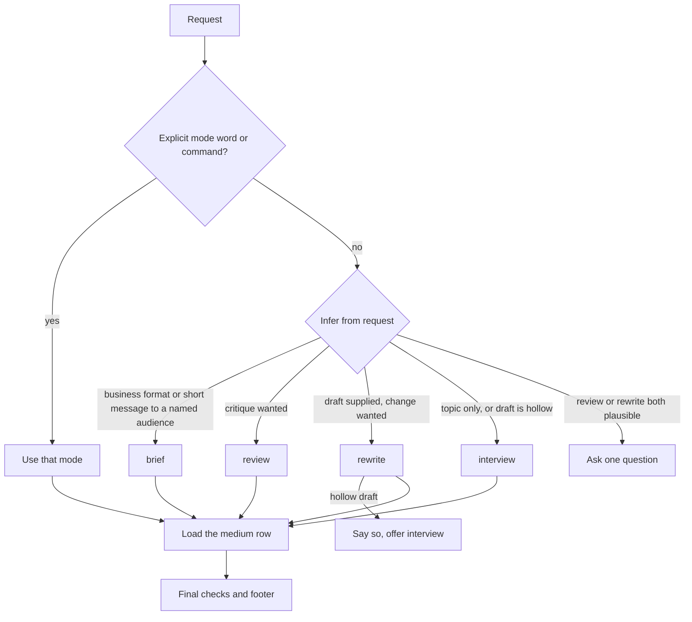

# plainspoken overview

`plainspoken` is one of three plugins this marketplace distributes (alongside
[sec-overlay](../sec-overlay/overview.md) and [readme-keeper](../readme-keeper/overview.md)). It
drafts, rewrites, critiques, reformats, and mechanically lints prose — chat messages, emails,
docs, release notes — so it reads as specific and the writer's own rather than AI-generic. It
has one skill (`skills/plainspoken/`), six slash commands, four read-only lens agents, and one
stdlib-only diagnostic script. Unlike `sec-overlay`, it has no Python deterministic core driving
a multi-phase pipeline — the skill's `SKILL.md` *is* the orchestration logic; the lens agents
and the lint script are its only executable pieces.

## What it will not do

The plugin's hardest constraint, stated identically in its `README.md` and `SKILL.md`: it never
invents a fact, number, quote, example, or personal experience (a gap becomes `[TK: question]`),
never promises AI-detector evasion, and never adds fake typos or stories to "sound human." Every
mode and lens agent inherits this from `SKILL.md`'s shared safeguards.

## Six modes, one router

`skills/plainspoken/SKILL.md` is the mode router (kept under 200 lines; detail lives in
`references/`). A slash command just names a mode and its one hard constraint — all rules live
in the skill, not the command files (`commands/README.md`).

| Mode | Command | What it does |
|---|---|---|
| `interview` | `/plainspoken:interview <topic>` | Asks for the writer's unorganized take, then at most 5 follow-up questions, then writes from their words |
| `rewrite` | `/plainspoken:rewrite <file or text>` | Fixes substance first, then AI tells and rhythm; keeps every fact at the same certainty |
| `review` | `/plainspoken:review <file or text>` | Critiques with P0/P1/P2 severity per finding; never rewrites or changes a file |
| `deep` | `/plainspoken:deep <file or text>` | Command-only trigger. Runs the four lens agents below in parallel, shows ranked findings, then asks before one rewrite |
| `brief` | `/plainspoken:brief <file or text>` | Reformats into a BLUF email, 3-sentence executive summary, action items, or a 75-word message |
| `lint` | `/plainspoken:lint <file>` | Runs `scripts/lint.py`; reports, never edits |


*Mode selection: an explicit command always wins; a free-form request is inferred, and a
genuinely ambiguous one gets a single clarifying question rather than a guess. Grounded in
`plugins/plainspoken/README.md` and `skills/plainspoken/SKILL.md`.*

A file-path argument edits the file in place and puts the notes in chat; use git or an editor
to undo — the plugin itself never commits or pushes.

## The deep-review lens agents

`/plainspoken:deep` is the only trigger for `agents/` — a command word, never inferred from a
free-form request, because it spawns four concurrent subagents. Each is `tools: Read` only,
`model: sonnet`, addressed as `plainspoken:<name>`; the folder carries no `README.md` because
Claude Code loads every `.md` file under `agents/` as an agent definition (the plugin
`README.md` documents them instead — see its own [folder-README rule](../../governance/hooks-and-commits.md)
exemption for this one folder).

| Agent | Finds | Reads |
|---|---|---|
| `structure-lens.md` | Orphaned list signals, duplicate sentence functions, summary paragraphs, section mismatch | `rewrite.md`, `severity.md` |
| `fluff-lens.md` | Defense phrases, redundant pairs, wordy constructions, empty qualifiers, hedges | `rewrite.md`, `severity.md` |
| `pattern-lens.md` | Staging, inflation, rhythm-by-rule, punctuation, chat residue, stock word lists | `rewrite.md`, `severity.md`, `tells.md` |
| `flow-lens.md` | Conclusion-before-setup, assumed context, unjoined paragraphs, open questions for the author | `rewrite.md`, `severity.md` |

All four report only — no lens ever rewrites text. The main skill merges and ranks their
findings by the shared P0/P1/P2 list (`references/severity.md`, the single source every mode and
agent cites) and asks the writer before running the one permitted rewrite pass.

## The stdlib lint script

`skills/plainspoken/scripts/lint.py` is a Python 3.10+, dependency-free diagnostic. It reports
mechanical hits (stock words/phrases, uniform sentence-length bands, em/en dashes, chat-residue
patterns) and never edits. Its lexicon constants must match
`skills/plainspoken/references/tells.md` entry-for-entry — `tests/test_lint.py` enforces this
sync as a regression test, and the two must change together in one commit (plugin
[`CLAUDE.md`](/plugins/plainspoken/CLAUDE.md)).

## Development

```bash
cd plugins/plainspoken
uv run --with pytest pytest -q                     # lint script + eval schema tests
uvx ruff check . && uvx ruff format --check .      # style, line length 100
python3 skills/plainspoken/scripts/lint.py <file>  # run the linter on a draft
```

Every regex in the lint script and the behavioral test suite is held to a performance budget;
treat a hostile-input slowdown as a real regression, not noise. `evals/` is development-only —
a manual, one-fresh-session-per-case run judged by `evals/JUDGE.md`, run after any change to
`SKILL.md` or a reference file and recorded in the pull request, never part of CI.

## Attribution

`plainspoken` adapts, but never copies verbatim text from, two MIT-licensed projects: `clarity`
by Addy Osmani and `work-humanizer` by Pawel Huryn, plus severity-tier and deep-review-lens
ideas from `anti-slop-editor` (which itself draws on `humanizer` by Siqi Chen, MIT). Every
adapted file and its source license is tracked in
[`NOTICE.md`](/plugins/plainspoken/NOTICE.md); keep both tables current when an adapted file is
added, renamed, or removed. [readme-keeper](../readme-keeper/overview.md) in turn adapts this
plugin's shared safeguards and prose-tell lexicon — see that page's Attribution section for the
other direction of this provenance chain.

## Related pages

- [readme-keeper overview](../readme-keeper/overview.md) — the other plugin that borrows
  plainspoken's safeguards and prose-tell lexicon.
- [sec-overlay overview](../sec-overlay/overview.md) — the marketplace's third, unrelated
  plugin.
- [Marketplace overview](../../marketplace/overview.md) — the manifest entry and plugin-layout
  rules every plugin in this repository follows.
- [Commit governance](../../governance/hooks-and-commits.md) — the folder-README rule this
  plugin follows (except its agent-definition folder) and the per-plugin changelog routing.
