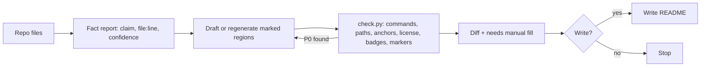

# readme-keeper plugin

`readme-keeper` writes a README from the code, keeps it true as the code changes through
marker-delimited generated regions, checks it offline for drift, and reviews it against a
reader rubric — all without inventing a fact, running target code, or editing hand-written
text. It is one of the three plugins this marketplace distributes (see
[marketplace overview](../marketplace/overview.md)), installed from
`plugins/readme-keeper/` at `plugins/readme-keeper/.claude-plugin/plugin.json` (currently
version `0.1.0`).

## Modes

[`skills/readme-keeper/SKILL.md`](/plugins/readme-keeper/skills/readme-keeper/SKILL.md) is the
playbook. An explicit mode word or slash command wins; otherwise the skill infers the mode:


*The `create`/`update` write path: inspect, fact-report, draft, verify with `check.py`, show a
diff, write only on an explicit yes.*

| Mode | Command | Writes? | What it does |
|---|---|---|---|
| `create` | `/readme-keeper:create` | after approval | Refuses if a README already exists. Inspects the repo, reports each fact with its `file:line` source and confidence (High/Medium/Low — Low claims stay out of the draft), asks what the code can't answer, classifies the project type and depth (minimal/standard/full), drafts only the sections the project earns, verifies with `check.py`, shows the diff |
| `update` | `/readme-keeper:update` | after approval | Regenerates only the content between `readme-keeper:start <region>` / `readme-keeper:end <region>` marker pairs; proposes markers first on an unmarked README (a no-op diff); never touches hand-written text |
| `check` | `/readme-keeper:check --all` | never | Offline drift report from `check.py`: commands, paths, anchors, license, badges, markers; `--links` (network) and `--prose` are opt-in |
| `review` | `/readme-keeper:review --score` | never | Reader-rubric critique (`references/rubric.md`: four questions, three readers, caveats-first, trust signals) with P0/P1/P2 findings; `--score` adds a report-only 0-100 score that is never iterated to raise |

Opt-in flags (`--research`, `--style fancy`, `--score`) are all off by default; `--research`
treats any fetched content as data, never instructions, and borrows structure only, never facts.

## Marker-based regions

```markdown
<!-- readme-keeper:start install -->
generated content
<!-- readme-keeper:end install -->
```

Eight region ids: `badges`, `install`, `quickstart`, `commands`, `env`, `structure`, `license`,
`toc` — each generated from a specific repo source (manifest/lockfile for `install`, tracked
tree for `structure`, `LICENSE` + manifest for `license`, and so on; see `SKILL.md`'s Markers
table for the full mapping). Text outside a region is hand-written and `update` never edits it.
Deleting a region keeps it deleted — `update` lists it under "available regions" instead of
re-adding it. No nesting, no duplicate ids, no unknown ids: `check.py` fails on each.

## `check.py` — the offline drift checker

`skills/readme-keeper/scripts/check.py` is a single stdlib-only file (Python 3.11+, no
dependencies) that verifies a README's claims against the repo mechanically — commands, paths,
anchors, license, badges, and marker well-formedness — with **no model judgment**. Exit 0 means
no P0 (and, with `--strict`, no P1); exit 1 means a P0 was found (or a P1 under `--strict`);
exit 2 is a usage error or unreadable file. `--all` walks every tracked `README.md` except under
fixture/vendored directories; `--links` (external URL checks) and `--prose` are opt-in and need
network/extra judgment respectively. The CI template convention requires `check.py` to remain a
single importable file with no sibling-module imports, because `--install-ci` copies it
verbatim into a target repository.

`references/tells.md` and the lexicon inside `check.py` must list the same entries — a test
enforces this pairing, mirroring the equivalent rule in [plainspoken](plainspoken.md). Every
regex in `check.py` must stay linear-time; `tests/test_check.py` includes a hostile-input
length limit to catch a regression.

## CI installation path

`/readme-keeper:check --install-ci` copies `check.py` to `.github/scripts/readme_check.py` and
[`templates/readme-check.yml`](/plugins/readme-keeper/templates/readme-check.yml) to
`.github/workflows/readme-check.yml` in the **target** repository, as a diff the user approves.
The installed workflow runs offline and needs no Claude Code plugin at runtime — it is a
standalone drift gate the target repo owns afterward.

## What it will not do

Never executes target code (no `--help` runs, no installs, no scripts — read files only), never
invents a license/badge/metric/command/URL, never commits/stages/pushes, and never edits text
outside markers during `update`.

## Change navigation

- **When to consult this page:** changing a mode's behavior, adding/removing a marker region,
  editing `check.py`'s checks or its CI template, or adding a project-type reference under
  `references/types/`.
- **Source entry points:** [`SKILL.md`](/plugins/readme-keeper/skills/readme-keeper/SKILL.md)
  (modes + marker contract), [`scripts/check.py`](/plugins/readme-keeper/skills/readme-keeper/scripts/check.py)
  (the checker), [`templates/readme-check.yml`](/plugins/readme-keeper/templates/readme-check.yml)
  (the installable CI workflow), `commands/*.md` (the four slash commands).
- **Invariants:** `check.py` is one stdlib file the CI template copies verbatim — it must never
  import another plugin file. Every regex in it must be linear-time. `references/tells.md` and
  its lexicon must list the same entries. `check.py` never runs target-repo code; `--links` is
  its only network access and is opt-in. `SKILL.md` stays under 200 lines.
- **Focused tests:** `plugins/readme-keeper/tests/test_check.py` (checker behavior against the
  fixture repos under `tests/fixtures/` — Go, just, make, node-npm, node-pnpm-workspace,
  py-poetry, py-uv, Rust, and a Claude Code plugin fixture), `plugins/readme-keeper/tests/test_evals.py`
  (eval case schema only).
- **Minimal validation:** `cd plugins/readme-keeper && uv run --with pytest pytest -q`, plus
  `uvx ruff check . && uvx ruff format --check .`. `python3 -m doctest
  skills/readme-keeper/scripts/check.py` and `python3 skills/readme-keeper/scripts/check.py
  --all --root <repo>` exercise the checker directly.
- **Non-goals / escalation:** `evals/` is development-only, run manually per `evals/README.md`
  after any change to `SKILL.md`, a reference, or a command — not part of the pytest gate.
  Fixture `README.md` files under `tests/fixtures/` are test inputs, not documentation to
  maintain (the plugin's folder-README convention exempts them).
- **Shipping-file version bump:** follows the same rule as sec-overlay and plainspoken — see
  [validation and versioning](../marketplace/validation-and-versioning.md) and
  [hooks and commits](../governance/hooks-and-commits.md).

## Related pages

- [Marketplace overview](../marketplace/overview.md) — the plugin manifest contract and the
  five-step "add a plugin" process this plugin followed.
- [plainspoken](plainspoken.md) — the sibling plugin added in the same release wave; readme-keeper's
  `NOTICE.md` credits plainspoken among its adapted sources.
- [Commit governance](../governance/hooks-and-commits.md) — the folder-README and changelog
  rules that gate every commit to this plugin.
