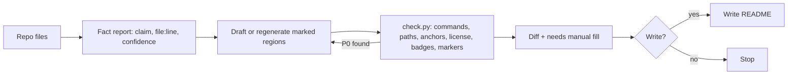

# readme-keeper overview

`readme-keeper` is one of three plugins this marketplace distributes (alongside
[sec-overlay](../sec-overlay/overview.md) and [plainspoken](../plainspoken/overview.md)). It
writes a `README.md` from the code, keeps previously generated regions true as the code changes,
checks a README offline for drift, and reviews one against a reader rubric — all without
inventing facts, running the target's code, or editing text outside its own markers. Like
`plainspoken`, it is a single-skill plugin (`skills/readme-keeper/`) with no Python deterministic
pipeline of its own: the skill drives everything, and its one executable piece is the stdlib
`check.py` script.

## Four modes

| Mode | Writes | What it does |
|---|---|---|
| `create` | after approval | Inspects the repo, reports each fact with its source, asks what the code cannot answer, drafts only the sections the project earns, checks the draft, shows the diff |
| `update` | after approval | Regenerates only the content between `readme-keeper` markers; text outside markers is never edited |
| `check` | never | Offline drift report: commands, paths, anchors, license, badges, markers. `--links` and `--prose` are opt-in |
| `review` | never | Reader-rubric critique with P0/P1/P2 findings; `--score` adds a report-only 0-100 score |


*`create`/`update`'s loop: a draft always passes through the same `check.py` gate before a diff
is ever shown, and nothing is written without explicit approval. Grounded in
`plugins/readme-keeper/README.md`.*

## Markers: the boundary `update` never crosses

```markdown
<!-- readme-keeper:start install -->
generated content
<!-- readme-keeper:end install -->
```

Region ids are `badges`, `install`, `quickstart`, `commands`, `env`, `structure`, `license`, and
`toc`. Deleting a region is permanent from `update`'s point of view — it never adds a deleted
region back. This marker boundary is the mechanism that makes `update` safe to run repeatedly
without clobbering hand-written prose placed outside the markers.

## The offline checker (`check.py`)

`skills/readme-keeper/scripts/check.py` is the one executable module: Python 3.11+, standard
library only (the CI template copies this single file, so it must never import another plugin
file — plugin [`CLAUDE.md`](/plugins/readme-keeper/CLAUDE.md)). It checks commands actually
exist, paths resolve, anchors are real, license/badge claims match the repo, and markers are
well-formed — all without executing the target's own build/install commands. `--links` is its
only network access and is opt-in. Every regex in it is required to be linear-time;
`tests/test_check.py` enforces a hostile-input time limit the same way plainspoken's lint
script does. `references/tells.md` and the checker's lexicon constants must list the same
entries, verified by a dedicated test.

`check.py`'s behavior is proven against a matrix of fixture repos under `tests/fixtures/`
(`claude-plugin`, `go`, `just`, `make`, `node-npm`, `node-pnpm-workspace`, `py-poetry`,
`py-uv`, `rust`) — each a minimal real-shaped project exercising one build/package-manager
convention the checker must recognize. These fixtures' own `README.md` files are test inputs,
not documentation, and are the one exception to this plugin's folder-README rule.

## CI template

`/readme-keeper:check --install-ci` copies the checker to `.github/scripts/readme_check.py` and
a workflow to `.github/workflows/readme-check.yml`, as a diff the user approves — the installed
workflow then runs entirely offline and does not need the plugin itself.

## Development

```bash
cd plugins/readme-keeper
uv run --with pytest pytest -q                       # checker, fixtures, eval schema
uvx ruff check . && uvx ruff format --check .        # style, line length 100
python3 -m doctest skills/readme-keeper/scripts/check.py
python3 skills/readme-keeper/scripts/check.py --all --root <repo>
```

`evals/` is development-only, run manually per `evals/README.md` after any change to
`SKILL.md`, a reference file, or a command — never part of CI.

## Attribution

`readme-keeper` builds on the author's own prior `readme` skill (which adapts Alexey Grigorev's
"How to Write a Good README") and adapts MIT-licensed material from `readme-forge`,
`claudikins`, `cajias/claude-skills`, and — within this same marketplace —
[plainspoken](../plainspoken/overview.md)'s shared safeguards and prose-tell lexicon (which
itself traces to `clarity` and `work-humanizer`, both MIT). Every adapted file and its source
license is listed in [`NOTICE.md`](/plugins/readme-keeper/NOTICE.md). Text from
`tavva/ben-claude-plugins` is explicitly never copied, since that project carries no license
file.

## Related pages

- [plainspoken overview](../plainspoken/overview.md) — the sibling plugin this one adapts
  safeguards and a prose-tell lexicon from.
- [sec-overlay overview](../sec-overlay/overview.md) — the marketplace's third, unrelated
  plugin.
- [Marketplace overview](../../marketplace/overview.md) — the manifest entry and plugin-layout
  rules every plugin in this repository follows.
- [Commit governance](../../governance/hooks-and-commits.md) — the folder-README rule this
  plugin follows (except the fixture-repo READMEs under `tests/fixtures/`).
