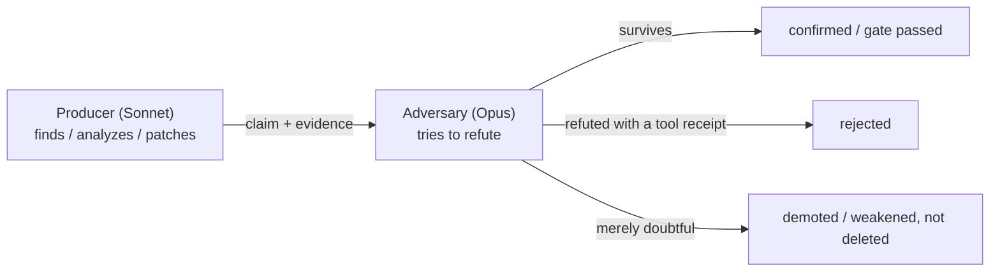
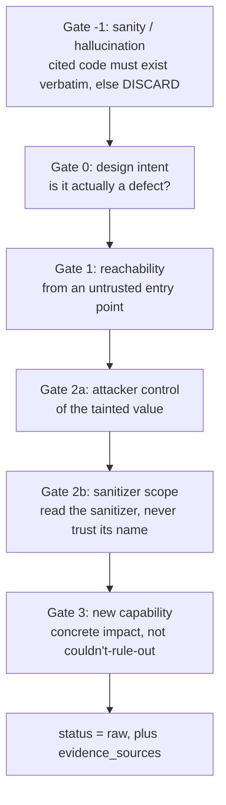

# sec-overlay agent prompts

Every `.md` file under [`agents/`](/plugins/sec-overlay/skills/sec-overlay/agents/) — 27 in
total, plus 13 `classes/` extension prompts — is a **prompt**: a complete set of instructions
for one LLM subagent doing one job in the audit. The Python in [`helpers/`](helpers.md) never
"decides" whether something is a vulnerability — it runs tools, moves files, and enforces
rules. The *judgement* — "is this reachable? is this input attacker-controlled? is this fix
correct?" — happens inside these prompts. Nothing here is code: a prompt is text with
`{{TOKEN}}` placeholders the orchestrator fills in before spawning the subagent (see
[Template tokens](#template-tokens-the-orchestrator-substitutes)).

## Producer vs. adversary

The harness assumes any single LLM will confidently be wrong sometimes, so almost every
important claim is made by one agent and then attacked by a different one on a **stronger,
different model family**:

- **Producers run on Sonnet** — cheaper, recall-biased; when unsure, they keep the finding.
- **Adversaries run on Opus** — a different model family, different blind spots, and they
  default to *demoting* under uncertainty.
- **The judge runs on a cheap, tool-free model** — it only checks for severity inflation.

*The safety contract in one diagram: adversarial reasoning alone can demote or weaken a
finding, but only a competing mechanical tool receipt can delete a tool-backed one.*

**The rule that governs every gate in this harness:** adversarial reasoning alone can demote or
downgrade a finding, but only a competing mechanical tool receipt can delete a tool-backed
finding. See [helpers — the tool-receipt gate](helpers.md#the-tool-receipt-gate) for where this
is enforced in code.

## The pipeline, as prompts

Read top to bottom — this is the order the orchestrator spawns them (see
[pipeline](pipeline.md) for the deterministic steps and the full 28-row `PHASE_TABLE`
interleaved between these).

| Phase | Prompt | Model | Job |
|---|---|---|---|
| C1 context | `context-ingest.md` | sonnet | discovers repo docs/prior scans/deployment config, verifies claimed controls against code |
| C1 context | `context-adversary.md` | opus | pressure-checks that verification |
| recon | `recon.md` | sonnet | surveys the repo → `kb/scan-profile.json` |
| — | `phase-adversary.md` | opus | gates recon (and architecture, threat-model) — re-derives each claim from code |
| — | `recall-adversary.md` | opus | judges what recon *left out*, never what it claimed — reads the route census |
| architecture | `architecture.md` | sonnet | components/data-flows/trust-boundaries → `architecture/arc42.md` + C4 diagrams → **arch-gate** |
| threat_model | `threat-model.md` | sonnet | attacker profiles + CVSS v4.0 findings + hunt list → `threat-model/threat-model.md` + `dfd.mmd` → **tm-gate** |
| investigate | `investigate.md` + `classes/<cls>.md` | sonnet, parallel per class | walks the [gate ladder](#the-investigate-gate-ladder) → `raw`/`rejected` |
| critic | `critic.md` | sonnet | production-viability filter (reject debug-only/dead/test-fixture code); demotes on doubt, never hard-rejects |
| judge | `judge.md` | cheap, no tools | severity-inflation adjudicator; uphold / downgrade / flag |
| validate | `validate.md` | opus, different family | assumes every finding is wrong and tries to refute it; survival = `confirmed` |
| trace | `trace.md` | opus | backward-traces each confirmed sink to an entry point; sets `reachability` + blocker |
| patch | `patch.md` | opus | proposes a minimal diff into `patch_diff`, applied only to a throwaway copy |
| validate-fix | `validate-fix.md` | opus, two personas | security-architect + penetration-tester independently check the patch; `no_new_vulnerabilities` regression is non-waivable |
| redteam | `redteam.md` | sonnet | splits confirmed findings into `static-settled` vs `needs-runtime`; writes `runtime_test` |
| redteam | `redteam-adversary.md` | opus | strips settleable-from-source or payload-mismatched items |
| prove | `prove.md` | opus, **opt-in** | the only phase that executes target-derived code, out of tree under `ws.repro`; promotes a finding only on a real, oracle-observed effect |
| artifact-review | `artifact-review.md` | opus, different family | final adversary over the rendered `report.md`/`report.sarif`/`redteam-plan.md` |
| postflight | `postflight.md` | sonnet | durable security-profile notes to `kb/prior_context.json` |

**`judge` and `validate` must never run concurrently against the same finding file** — the last
writer silently drops the other's field. This is enforced by orchestration order (dispatch
judge, wait for its writes to persist, then dispatch validate), not by code.

### Optional extension agents

Run alongside the numbered phases but are not `PHASE_TABLE` rows — dispatched by the
orchestrator's own judgment, not the driver:

| Prompt | Role |
|---|---|
| `variant-hunt.md` | amplifies one confirmed finding into its family: enqueues sibling call sites as new candidates |
| `bugchain.md` | looks across the confirmed set for chains — individually low findings that compose into a critical |
| `tune-config.md` | optional ratcheted loop (≤3 rounds): authors targeted semgrep rules for uncovered classes, test-fires them, adds noise-floor exclusions |
| `correlate-combiner.md` + `cross-repo-adversary.md` | cross-repo: see [Cross-repo correlation](cross-repo-correlation.md) — these gate correlation *verdicts*, not per-repo findings, and carry the same producer/adversary pattern applied to a joined multi-repo artifact rather than a single finding |

`factcheck.md` (fresh-context re-verification of a finding's citations) existed in an earlier
release but had no phase row wired to run it and never executed; the defect-repair work deleted
the module, the prompt, and the `fact-checked` verification value together rather than finishing
an unreachable capability (see [overview — the four invariants](overview.md#the-four-invariants)).

## The investigate gate ladder

`investigate.md` is spawned in parallel, once per attack class in
`scan-profile.agents_to_spawn` (with `{{ATTACK_CLASS}}` substituted and the matching
[`classes/<cls>.md`](#classes--cwe-class-extension-prompts) extension appended). It is
**recall-biased**: when unsure it keeps a finding as `raw` rather than dropping it — later
stages are the precision filter.

The loop itself is mechanical, not agent-declared: `driver._record_discovery_wave` folds each
pass's finding fingerprints into `kb/discovery-ledger.json` on every `findings-gate` run, and
`_investigate_is_saturated` reads that ledger back. Once `terminal_reason` is `saturated` (two
consecutive waves add no new fingerprint) or `capped` (the `max_waves` cap), the driver advances
instead of dispatching another wave — the agent cannot end the loop early by declaring a class
exhausted, and cannot extend it past the cap. `investigate.md` also names
`dependency-catalog:<entry-id>` as a Tier-2 mechanical receipt (locates a sink inside a
dependency but never confirms alone — a paired Tier-1 receipt is still required).

## `classes/` — CWE-class extension prompts

Thirteen small prompts (`injection`, `ssrf`, `ssti`, `authz`, `authn`, `crypto`, `config`,
`business-logic`, `prompt-injection`, `context-bleed`, `excessive-agency`, `resource`,
`expr-eval-rce`). Each is **appended** to `investigate.md` / `patch.md` for that class and
supplies four things:

1. **Canonical fix shape** (e.g. injection → parameterized query; crypto → AEAD or slow KDF).
2. **Discrimination boundary** — an explicit *IS / IS-NOT* so a finding routes to exactly one
   class (e.g. SSRF is *not* open-redirect; authz is *not* authn). `expr-eval-rce` (server-side
   policy/rule engines — CEL, Starlark, goja, gopher-lua, Spring SpEL) and `ssrf` are a notable
   pair: OPA/Rego's tokens live in `ssrf` because its builtin performs an outbound request.
3. **Proof tuple** — the required 3-part evidence: source, defense/bypass, sink/impact.
4. **Instance-preservation rule** — do **not** collapse sibling instances into one finding.

`test_wiring.py`/`test_class_extensions.py` check that class prompts carry the proof tuple and
anti-collapse rule.

## The diff-review pipeline

`sec-overlay review` (see [running an audit](running-an-audit.md)) runs a distinct, lighter
pipeline over one diff — not the full audit above — with its own three prompts:

| Prompt | Model | Reads | Writes / does |
|---|---|---|---|
| `review-file.md` | sonnet | one changed file's path/diff, sibling changed files (context only), and the resolved review checklist (`rule_glob.resolve_rule_doc`) | the producer: one `code_comment` per confirmed issue plus a closing `task_done`; every finding it produces carries `llm-claimed:review-agent` evidence and `FindingStatus.RAW`, both fixed in code — a comment naming a path outside the reviewed unit is discarded, never converted (Strict Focus Rule, enforced mechanically) |
| `review-plan.md` | sonnet | one over-threshold changed file's path/diff and the checklist | an advisory, severity-ordered plan for files whose diff spans ≥100 lines — never a finding, never a mechanical receipt; injected into `review-file.md` as hints only |
| `review-filter.md` | sonnet | one file's path/diff and the review comments that survived positioning + the hunk gate | a **retract-only** fact-checking verdict; the real safety guarantee is a mechanical code-level veto (`reflection.PROTECTED_SUBJECT_CLASSES`), not model tier or a second opinion — it can never add, rank, or rewrite a finding |

An `artifact-review.md`-style adversary pass does not exist for this track: the position gate
(exact-diff-line matching), the review-profile gate (`security` vs `general`), and
`review-filter.md`'s mechanical veto together stand in for it.

## Template tokens the orchestrator substitutes

| Token | Meaning |
|---|---|
| `{{TARGET}}` | absolute path to the code being scanned |
| `{{WORKSPACE}}` | the harness workspace (`kb/`, `findings/`, `state.json`) |
| `{{OVERLAY_ROOT}}` | absolute path to `skills/sec-overlay/` (so agents find `references/`) |
| `{{HELPERS_DIR}}` | absolute path to `helpers/` (for `python -m sec_overlay.*` calls) |
| `{{REPO_ROOT}}` / `{{SCAN_SCOPE}}` | git top-level of the target + scan sub-path (from `kb/scan-scope.json`) |
| `{{ATTACK_CLASS}}` | one class key (investigate agents); the dispatch block carries the fan-out list as compact JSON |
| `{{PHASE}}` | `recon` / `architecture` / `threat-model` / `context` (phase-adversary) |
| `{{FP_FEEDBACK}}` | path to a file holding prior-pass rejected findings, as negative examples |
| `{{ROUND}}` | tuning iteration number (tune-config) |

Every agent wraps untrusted repo text in the trust envelope and imports the
`references/prompt-constants.md` blocks — see [references](references.md).

## Editing rules

- Every agent prompt imports the shared `prompt-constants.md` blocks — do not restate a rule
  inline that already lives there; edit the block instead so all prompts stay in sync.
- Adding/renaming a `PHASE_TABLE` entry requires running
  `uv run python -m sec_overlay.phase_docs --write` (see [pipeline](pipeline.md)) so the
  generated phase table embedded in this folder's `README.md`, `SKILL.md`, and
  `helpers/README.md` stays current — `test_phase_docs.py` fails a stale copy.
- `test_wiring.py`/`test_docs_invariants.py` guard silent-backend regressions, dead links
  between `attack-classes.md` and its `hunting/` companions, and that every class prompt carries
  the proof tuple + anti-collapse rule — run them after touching any prompt.

## Related pages

- [Pipeline](pipeline.md) — the full phase order these prompts plug into.
- [Helpers](helpers.md) — the deterministic Python that runs between these prompts and enforces
  the tool-receipt gate.
- [References](references.md) — the `prompt-constants.md` blocks every prompt imports.
- [Running an audit](running-an-audit.md) — how the orchestrator dispatches these in practice,
  including the `review` diff-scoped track.
