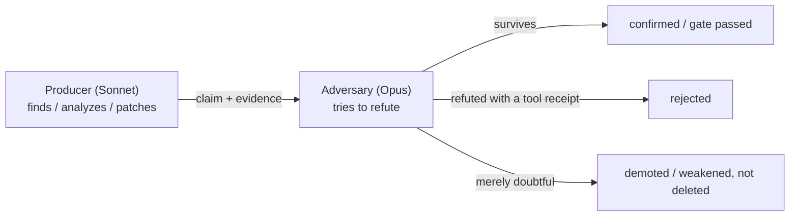
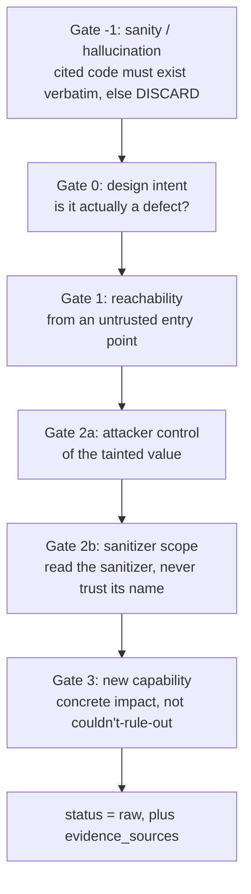

# sec-overlay agent prompts

Every `.md` file under [`agents/`](/plugins/sec-overlay/skills/sec-overlay/agents/) is a
**prompt**: a complete set of instructions for one LLM subagent doing one job in the audit. The
Python in [`helpers/`](helpers.md) never "decides" whether something is a vulnerability — it
runs tools, moves files, and enforces rules. The *judgement* — "is this reachable? is this
input attacker-controlled? is this fix correct?" — happens inside these prompts. Nothing here
is code: a prompt is text with `{{PLACEHOLDER}}` tokens the orchestrator fills in before
spawning the subagent (see [Template tokens](#template-tokens-the-orchestrator-substitutes)).

## Producer vs. adversary

The harness assumes any single LLM will confidently be wrong sometimes, so almost every
important claim is made by one agent and then attacked by a different one on a **stronger,
different model family**:

- **Producers run on Sonnet** — cheaper, recall-biased; when unsure, they keep the finding.
- **Adversaries run on Opus** — a different model family, different blind spots, and they
  default to *demoting* under uncertainty.
- **The judge runs on a cheap, tool-free model** — it only checks for severity inflation.

*The safety contract in one diagram: adversarial reasoning alone can demote or weaken a
finding, but only a competing mechanical tool receipt can delete a tool-backed one.*

**The rule that governs every gate in this harness:** adversarial reasoning alone can demote or
downgrade a finding, but only a competing mechanical tool receipt can delete a tool-backed
finding. See [helpers — the tool-receipt gate](helpers.md#the-tool-receipt-gate) for where this
is enforced in code.

## The pipeline, as prompts

Read top to bottom — this is the order the orchestrator spawns them (see
[pipeline](pipeline.md) for the deterministic steps interleaved between these).

| Phase | Prompt | Model | Job |
|---|---|---|---|
| C1 context | `context-ingest.md` | sonnet | discovers repo docs/prior scans/deployment config, verifies claimed controls against code |
| C1 context | `context-adversary.md` | opus | pressure-checks that verification, including the claimed-control diagram |
| Analysis | `recon.md` | sonnet | surveys the repo → `kb/scan-profile.json` |
| Analysis | `architecture.md` | sonnet | components/data-flows/trust-boundaries → `architecture/` tree (C4 + `arc42.md`) |
| Analysis | `threat-model.md` | sonnet | attacker profiles + hunt list → `threat-model/` tree (`dfd.mmd`, `threat-model.md`) |
| Analysis (each of the three) | `phase-adversary.md` | opus | re-derives each claim from code; verdicts → `kb/gates/<phase>.json` |
| Recon only | `recall-adversary.md` | opus | judges what recon **left out** against the route census and dependency catalog — a separate, count-exempt pass from `phase-adversary.md` |
| Investigate | `investigate.md` + `classes/<cls>.md` | sonnet, parallel per class | walks the [gate ladder](#the-investigate-gate-ladder) → `raw`/`rejected` |
| FP ladder | `critic.md` | sonnet | production-viability filter (reject debug-only/dead/test-fixture code); demotes on doubt, never hard-rejects |
| FP ladder | `judge.md` | cheap, no tools | severity-inflation adjudicator; uphold / downgrade / flag |
| FP ladder | `validate.md` | opus, different family | assumes every finding is wrong and tries to refute it; survival = `confirmed` |
| Trace | `trace.md` | opus | backward-traces each confirmed sink to an entry point; sets `reachability` + blocker taxonomy |
| Patch | `patch.md` | opus | proposes a minimal diff into `patch_diff`, applied only to a throwaway copy |
| Patch | `validate-fix.md` | opus, two personas | security-architect + penetration-tester independently check the patch; `no_new_vulnerabilities` regression is non-waivable |
| Red team | `redteam.md` | sonnet | splits confirmed findings into `static-settled` vs `needs-runtime`; writes `runtime_test` |
| Red team | `redteam-adversary.md` | opus | strips settleable-from-source or payload-mismatched items |
| Prove (opt-in) | `prove.md` | opus | the one agent that executes target-derived code, confined to `{{WORKSPACE}}/repro` |
| Artifact review | `artifact-review.md` | opus, different family | checks the rendered report tells the truth about what the run found |
| Postflight | `postflight.md` | sonnet | durable security-profile notes to `kb/prior_context.json` |

**`judge` and `validate` must never run concurrently against the same finding file** — the last
writer silently drops the other's field. This is enforced by orchestration order (dispatch
judge, wait for its writes to persist, then dispatch validate), not by code.

### Optional extension agents

| Prompt | Role |
|---|---|
| `variant-hunt.md` | amplifies one confirmed finding into its family: enqueues sibling call sites as new candidates |
| `bugchain.md` | looks across the confirmed set for chains — individually low findings that compose into a critical |
| `tune-config.md` | optional ratcheted loop (≤3 rounds): authors targeted semgrep rules for uncovered classes |
| `correlate-combiner.md` + `cross-repo-adversary.md` | cross-repo: see [Cross-repo correlation](cross-repo-correlation.md) — these gate correlation *verdicts*, not per-repo findings, and carry the same producer/adversary pattern applied to a joined multi-repo artifact rather than a single finding |

The `factcheck.md` fresh-context re-verification agent that previously appeared here was
deleted (REQ-42): it was the sole writer of the `fact-checked` verification value, which the
closed `VERIFICATION_VALUES` enum (`evidence.py`) no longer carries. Its re-verification role is
now covered by the `validate`/`trace`/`artifact-review` chain rather than a separate pass.

## The investigate gate ladder

`investigate.md` is spawned in parallel, once per attack class in
`scan-profile.agents_to_spawn` (with `{{ATTACK_CLASS}}` substituted and the matching
[`classes/<cls>.md`](#classes--cwe-class-extension-prompts) extension appended). It is
**recall-biased**: when unsure it keeps a finding as `raw` rather than dropping it — later
stages are the precision filter. Before confirming, it must also **refute its own finding
first**: write the single strongest reason the finding is not exploitable, and only confirm if
that reason does not hold (`agents/investigate.md` step 4.5).

The discovery loop is mechanical, not agent-controlled (REQ-24): `driver._record_discovery_wave`
folds each pass's finding fingerprints into `kb/discovery-ledger.json`, and
`_investigate_is_saturated` reads it back. Once `terminal_reason` is `saturated` (two
consecutive waves add no new fingerprint) or `capped` (the wave cap), the driver advances
instead of dispatching another wave — the agent cannot end the loop early or extend it past the
cap. `investigate.md` also names `dependency-catalog:<entry-id>` as a Tier-2 receipt (locates a
sink inside a dependency but never confirms alone — it needs a paired Tier-1 receipt, e.g. a
`semgrep:sec-overlay.absence.*` hit or a CodeQL dataflow path).

## `classes/` — CWE-class extension prompts

Thirteen small prompts (`injection`, `ssrf`, `ssti`, `authz`, `authn`, `crypto`, `config`,
`business-logic`, `prompt-injection`, `context-bleed`, `excessive-agency`, `resource`,
`expr-eval-rce`). Each is **appended** to `investigate.md` / `patch.md` for that class and
supplies four things:

1. **Canonical fix shape** (e.g. injection → parameterized query; crypto → AEAD or slow KDF).
2. **Discrimination boundary** — an explicit *IS / IS-NOT* so a finding routes to exactly one
   class (e.g. SSRF is *not* open-redirect; authz is *not* authn; `expr-eval-rce` is *not* ssrf —
   OPA/Rego's `http.send` routes to `ssrf` because its builtin performs an outbound request,
   while CEL/Starlark/goja/gopher-lua/Spring SpEL route to `expr-eval-rce`).
3. **Proof tuple** — the required 3-part evidence: source, defense/bypass, sink/impact.
4. **Instance-preservation rule** — do **not** collapse sibling instances into one finding.

`test_wiring.py` checks that class prompts carry the proof tuple and anti-collapse rule.

## Diff-review pipeline (`review`) — a separate, lighter track

The diff-scoped `sec-overlay review` CLI runs a distinct, lighter pipeline over one diff — not
the full audit above, and with its own agent set (`review-file.md`, `review-plan.md`,
`review-filter.md`). See [review mode](review-mode.md) for the full prepare/dispatch/consume
workflow, the `security`/`general` profiles, and the retract-only reflection filter; those three
prompts are detailed there rather than duplicated here.

## Template tokens the orchestrator substitutes

| Token | Meaning |
|-------|---------|
| `{{TARGET}}` | absolute path to the code being scanned |
| `{{WORKSPACE}}` | the harness workspace (`kb/`, `findings/`, `state.json`) |
| `{{OVERLAY_ROOT}}` | absolute path to `skills/sec-overlay/` (so agents find `references/`) |
| `{{HELPERS_DIR}}` | absolute path to `helpers/` (for `python -m sec_overlay.*` calls) |
| `{{REPO_ROOT}}` / `{{SCAN_SCOPE}}` | git top-level of the target + scan sub-path (from `kb/scan-scope.json`) |
| `{{ATTACK_CLASS}}` | one class key (investigate agents); the dispatch block carries the fan-out list as compact JSON |
| `{{PHASE}}` | `recon` / `architecture` / `threat-model` / `context` (phase-adversary) |
| `{{FP_FEEDBACK}}` | path to a file holding prior-pass rejected findings, as negative examples |
| `{{ROUND}}` | tuning iteration number (tune-config) |

Every agent wraps untrusted repo text in the trust envelope and imports the
`references/prompt-constants.md` blocks — see [references](references.md).

The agents most prone to cross-phase field writes import `FIELD_OWNERSHIP` to enforce
phase field-ownership boundaries: `investigate.md`, `critic.md`, `validate.md`, `trace.md`,
`patch.md`, `validate-fix.md`, `redteam.md`, `context-ingest.md`, `context-adversary.md`,
`phase-adversary.md`, plus `architecture.md` / `threat-model.md` (which write no Finding
fields, but consume the same ownership table when citing findings). Agents that never touch
a finding record (`judge.md`, `recon.md`, `tune-config.md`, the `classes/` extensions) do not.

`investigate.md` also imports `FINDING_SHAPES`: the exact keys of the `runtime_test`,
`open_questions`, and `affected_sites` nested fields it populates, so a written key always
matches `models.py`'s key tuples. `threat-model.md` imports `QUALIFIER_PROOF`: the prompt grades
severity, so a blanket mitigation claim must name the reachable paths it checked, not just
assert safety.

`prove.md` is the prompt for the opt-in `prove` phase. It is the one prompt that permits
execution, and it confines every build and every run to `{{WORKSPACE}}/repro` with no network
egress — the only oracle is in-band and on loopback. It names the five auto-confirmable
classes, routes `sqli` and `authz` to a human-run harness, and requires the agent to record
`scope` as `entrypoint` or `slice` honestly. The agent writes `kb/prove.json` and never edits a
finding file directly; the deterministic `prove.py` applies the proofs.

`validate-fix.md` is `PHASE_TABLE`-wired between `patch` and `verify`. Its output is
`kb/gates/validate-fix.json`, mapping each patched finding id to the two personas' combined
`root_cause` / `instance_coverage` / `no_new_vulnerabilities` / `best_practices` statuses. The
agent never computes or writes a verdict — `verify.py`'s `apply_fix_gates` runs
`sec_overlay.scoring.score_fix` on those statuses, so only the deterministic scorer decides
`fixed`/`partial`/`not_fixed`/`unverifiable`.

`artifact-review.md` runs after the deterministic `artifact_gate.py` already passed; it is the
final adversary's judgment the gate cannot make: does the rendered report tell the truth about
what the run found? It is READ-MOSTLY — it updates finding metadata and writes one verdict file,
and it can never delete a receipt-backed finding or execute the target.

## Editing rules — these are load-bearing, not prose

When you edit a prompt, **preserve these verbatim** (the harness's signal-over-noise
guarantees depend on them):

1. **Model-family diversity** — never let a producer be its own sole confirmer; keep the
   opus adversary a different family than the sonnet producer.
2. **Tool-receipt safety contract** — reasoning alone demotes; only a competing tool receipt
   deletes a tool-backed finding.
3. **Count-invariant verdict tables** — an adversary/validator must emit exactly one row per
   input claim/finding (the recall adversary is the one documented exception — its rows have no
   matching claim by construction); a missing row is otherwise a *failure*, not a silent drop.
4. **The gate ladder order** in `investigate.md` — reordering changes the evidence bar.
5. **Class IS/IS-NOT boundaries and proof tuples** in `classes/*.md` — blurring them
   misroutes or duplicates findings.

**When a prompt here changes, this README must change in the same commit** — enforced by the
repo pre-commit hook (plugin [`CLAUDE.md`](../../../CLAUDE.md), "Documentation" section). The
same rule applies to this wiki page via the update-time docs-impact plan, not a hook.
