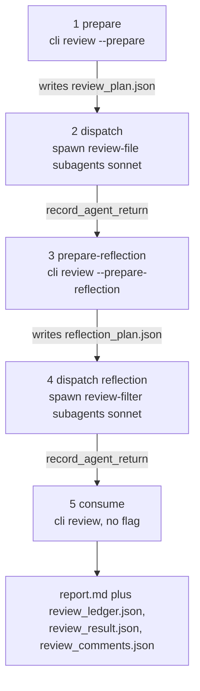

# Diff-scoped review (`sec_overlay.cli review`)

Alongside the full [audit pipeline](pipeline.md), sec-overlay ships a second, lighter CLI track:
`sec_overlay.cli review`. It reviews a diff (a base/head ref range, a single commit, or the dirty
working tree) file by file, instead of surveying a whole repo. It is the closest thing in this
plugin to a traditional PR-review bot, and it shares some of the audit pipeline's machinery
(agents, the trust envelope, the per-repo sidecar) without being a numbered `PHASE_TABLE` phase
itself — `SKILL.md`'s own "Other unwired prompts are for non-driver entrypoints (review,
correlate, etc.)" note in `phases.py` makes that boundary explicit.

```bash
cd "${CLAUDE_PLUGIN_ROOT}/skills/sec-overlay/helpers"
uv run python -m sec_overlay.cli review \
  --base <base-ref> --head <head-ref> --root <path-to-code> \
  --profile security   # or: general
```

## Why it exists, and how it differs from an audit

An audit surveys an entire repository's attack surface once and re-scopes incrementally on later
passes. A code-review workflow instead needs to judge *this diff* — a pull request — quickly and
cheaply, closer to how a human reviewer reads a PR. `review` is a tracer implementation of that:
ported from the open-source **open-code-review** (OCR) tool's shape (file selection, bundling,
budget, plan/review/reflection passes), adapted to this skill's trust-envelope and
single-shot/no-tool dispatch conventions. `helpers/sec_overlay/helpers/README.md`'s
`docs/parity/` notes track exactly which OCR behaviors were ported, refuted, or deliberately not
built (e.g. OCR's claimed cross-file bundling in review mode is refuted — `agents/README.md`'s
"Diff-review pipeline" section cites `agent.go:673` dispatching per file).

## Review profiles: `security` vs `general`

`sec_overlay.review_findings.apply_profile(findings, profile)` is the gate:

- **`security`** (default) reproduces the pre-REV-01 gate ladder byte-for-byte: every finding
  marked by gates A-E (`references/prompt-constants.md`'s `EXCLUSION_RULES`) is dropped.
- **`general`** relaxes gates A and B for a finding whose rule-doc defect class is one of
  `null-dereference`, `thread-safety`, `resource-leak`, `error-swallowing`, `injection`
  (`GENERAL_PROFILE_EXCLUSION_RULES`) — a strict superset of `security`'s output, never a change
  to it. `security` and `general` never mix rule sets.

Exit codes: `0` on a `complete` coverage seal (including zero reviewable files), `2` on an
invalid ref or an unsafe rule file, `3` when one or more files could not be reviewed.

## The prepare / dispatch / consume loop

Review mode has **no phase driver** like the audit above — it is a loop the main agent runs
directly, over one `review-file` subagent per reviewable file (or per `bundle.py` `ReviewUnit` —
see below):


*A three-step loop (plus its reflection sub-loop), not a phase table — the Python core validates
and records bounds but never dispatches an agent itself; the orchestrating agent is the
enforcement point for `--concurrency`.*

1. **Prepare** — `review --base <ref> --prepare` writes `runs/review_plan.json` (one entry per
   reviewable file: path, resolved rule text, diff, other changed files) and renders one prompt
   per entry from `agents/review-file.md` under `runs/review_prompts/<slug>.md`. A file (or
   `ReviewUnit`) whose diff is at or over `PLAN_LINE_THRESHOLD` (100 lines) first gets an
   advisory `agents/review-plan.md` pass (severity-ordered guidance only, never a finding).
2. **Dispatch** — spawn a `review-file` subagent (sonnet) per prepared entry, in waves of three
   to four, never exceeding `--concurrency` (default 8, ceiling 128); persist each final return
   with `workspace.record_agent_return` — disk, not the chat summary, is the source of truth.
   `sec_overlay.review_agent.parse_review_response` is the **sole** parser of a `review-file`
   return; a `code_comment` naming a path outside the reviewing unit's membership is discarded,
   never converted (the Strict Focus Rule, REV-03).
3. **Prepare reflection** — `review --base <ref> [--profile general] --prepare-reflection` reads
   the recorded returns, runs the position gate + `apply_profile`, and for each file with kept
   findings renders a retract-only `agents/review-filter.md` prompt.
4. **Dispatch reflection** — spawn a `review-filter` subagent (sonnet) per plan entry; its verdict
   is `approve_all_comments` or `report_incorrect_comments` naming only ids it was shown — it is
   never allowed to add, rank, or rewrite a finding, only retract one.
5. **Consume** — `review --base <ref> [--profile general] [--model <id>]` reads both recorded
   returns back from disk and runs them through the full gate chain: position gate →
   `apply_profile` → the reflection filter → the tool-receipt-adjacent `review_coverage` seal.

The loop fails open at every step: a file with no recorded return, or a return that will not
parse, contributes zero findings and is listed in a skip ledger rather than aborting the pass —
the same discipline as `ReflectionSkip` below.

## The retract-only reflection pass (D-16)

Every kept finding for a reviewable file runs through one more fact-check before the report is
written. `sec_overlay.reflection.render_reflection_prompt` renders `agents/review-filter.md`
with that file's path, diff, and kept comments — deliberately **no severity or category**, so the
filter has nothing to rank. `validate_verdict` parses the raw response before any finding sees
it; `apply_verdict` is the only code path allowed to act on it, and only to retract.
`PROTECTED_SUBJECT_CLASSES` is a hardcoded veto no verdict can override: a retraction naming a
protected-subject finding is refused — but the refusal is still recorded, never silently dropped.
A file whose reflection raises fails open as a `ReflectionSkip`, keeping its findings rather than
aborting the run.

## Position verification, bundling, and the budget gate

- **`positioning.resolve_position`** (`phase_gate.review_position_gate`) confirms or declines a
  finding's claimed `path`/`line` against the diff through a four-rung ladder: exact hunk match,
  whole-file match in the claimed file, match in exactly one other changed file, else decline
  (`needs-position-review`). Two or more matches at any rung decline rather than guess.
- **`bundle.group_bundles`** groups impl/test pairs and locale/config siblings into one
  `ReviewUnit` so a multi-file unit shares one review pass; `review_budget.py`'s
  `estimate_review_cost` and `--token-budget` exclude an oversized file (over
  `FILE_BUDGET_FRACTION`, 0.8, of the budget) as `too-large-tokens` before dispatch, setting
  `budget_exceeded` in the consolidated result.
- **`review_coverage.CoverageManifest`** tracks `pending → in_review → done/failed` per file in
  `artifacts/coverage_manifest.json`; `seal()` raises rather than claim coverage for a file still
  `pending`/`in_review`. `check_resume_identity` rejects a resumed run whose `--model`/`--profile`
  differs from the prior manifest's recorded value (exit 2) instead of silently mixing results
  from two different models on one manifest.

## Downstream surfaces built on `review`

| Module | Job |
|---|---|
| `review_result.py` | `write_review_result` — the consolidated per-run `artifacts/review_result.json` (status, findings, drops, declines, retractions, skips, manifest, budget flag, tokens) |
| `review_comments.py` | `write_review_comments` — diff-anchored `DiffComment`s (`path`/`line`/`side`/`existing_code`/`content`) in `artifacts/review_comments.json`, feeding `pr_poster.py` |
| `pr_poster.py` | Stdlib GitHub pull-request review poster (REQ-S1): `route_findings` splits critical/high into inline comments from everything else (summary body); `post_review` POSTs a `COMMENT`-event review (never blocks a merge on its own) |
| `sessions.py` | Read-only `cli.py sessions list\|show` renderer over the per-repo sidecar — pass/sha/finding counts, or one session's stage + ledger detail |
| `action.yml` | The plugin-root composite GitHub Action invoking `pr_poster.main` to post `review_result.json` to a pull request |
| `background.py` | REQ-P8 sanitizer for optional developer-supplied background context passed into the review prompt (`--background`/`--background-file`; size cap, control-char strip, secret abort) |

`cli.py rules check <path> --root <path>` is a related, standalone diagnostic: it prints the
resolved rule layer and doc for one path via `rule_glob.resolve_with_layer`, independent of a
live review run.

## Related pages

- [Pipeline](pipeline.md) — the audit track this CLI mode does **not** join.
- [Agents](agents.md) — `review-file.md`/`review-plan.md`/`review-filter.md` share this
  harness's producer/adversary conventions even though `review-filter` is a retract-only
  fact-checker rather than a classic adversary.
- [Helpers](helpers.md) — `review_agent.py`, `reflection.py`, `bundle.py`, and the rest of the
  deterministic core this page's modules sit alongside.
- [Running an audit](running-an-audit.md) — the audit-mode commands this page's `review` command
  is an alternative to, not a replacement for.
