# helpers — the deterministic Python core

If [`agents/`](agents.md) is the judgement and [`references/`](references.md) is the rule book,
[`helpers/`](/plugins/sec-overlay/skills/sec-overlay/helpers/) is everything that *runs*: it
invokes the SAST tools, parses their output, drives the phase sequencer, moves findings through
the pipeline, enforces the gates no LLM is trusted to enforce, and writes the final SARIF and
Markdown reports.

Two facts are true of every module here:

1. **It never runs or edits the reviewed source.** Static analysis only. Patches are applied to
   a throwaway *copy* to verify them; the target's own files are never executed or written
   (the one narrow exception is the opt-in `prove` phase, which executes target-derived code
   out of tree under `ws.repro` — never the target's own working tree).
2. **The core is stdlib-only.** `pyproject.toml` declares **no runtime dependencies** — only dev
   deps (`pytest`, `ruff`, `ty`). External SAST binaries (semgrep, codeql, osv-scanner,
   ast-grep, ripgrep, gitleaks) are optional backends the code shells out to, not Python
   imports. Adding a runtime dependency needs a strong reason and user sign-off (see
   [developing the skill](developing-the-skill.md)).

```
helpers/
├── pyproject.toml       stdlib-only; dev deps pytest/ruff/ty; line-length 100
├── sec_overlay/         ~100 modules — the pipeline (this page's main subject)
│   └── correlate/       cross-repo correlation subpackage — see cross-repo-correlation.md
├── bench/               dev-only detection benchmark
├── tests/               142 pytest files, 1830 tests
├── fixtures/            golden JSON + a deliberately vulnerable test repo (excluded from this wiki)
└── rules/               vendored semgrep rules (gitignored shallow clone, not a submodule) + smoke.yaml + absence/
```

## The pipeline these modules implement

```mermaid
flowchart TD
    PF["preflight.py<br/>tools present?"] --> GR["graph.py build<br/>Tier-1 substrate, LLM-free"]
    GR --> RC["route_census.py<br/>code-derived route inventory"]
    RC --> CTX["context.py<br/>ingest repo docs + deployment config"]
    CTX --> PROFILE["profile.py<br/>ScanProfile from recon"]
    PROFILE --> PRE["prefilter.py<br/>run semgrep+codeql+sca+secrets concurrently"]
    PRE --> NORM["normalize.py<br/>dedup, assign F-#### ids"]
    NORM --> PART["partition.py<br/>group candidates by attack class"]
    PART --> INV(("investigate agents"))
    INV --> DED["dedupe.py<br/>refactor-resistant fingerprint"]
    DED --> CLUS["cluster.py<br/>systemic clustering"]
    CLUS --> GATE1["findings_gate.py<br/>schema + tool-receipt gate"]
    GATE1 --> LADDER(("critic / judge / validate agents"))
    LADDER --> TRACE(("trace agent<br/>reachability + blocker"))
    TRACE --> CAL["calibrate.py<br/>risk_score 1-10"]
    CAL --> CIT["citations.py<br/>attach ASVS/CodeGuard"]
    CIT --> PATCHV(("patch / validate-fix agents"))
    PATCHV --> VER["verify.py<br/>apply patch to COPY, re-scan"]
    VER --> DN["partition.demote_noise"]
    DN --> RT(("redteam agents")) --> RTR["redteam.py<br/>render redteam-plan.md"]
    RTR --> REP["report.py<br/>report.sarif + report.md"]
    REP --> SCORE["selfscore.py"]
    SCORE --> AGATE["artifact_gate.py<br/>deterministic report self-check"]
    AGATE --> AREV(("artifact-review agent, opus<br/>claim vs evidence over the report"))
    AREV --> ACON["artifact_consistency.py<br/>terminal cross-artifact reconciliation"]
    ACON --> POST["postflight.py<br/>prior_context.json, durable, final phase"]
```


*The deterministic spine of the pipeline in [pipeline.md](pipeline.md); the LLM agents plug in
between the rectangles. Every step here records completion with
`campaign.record_stage(ws, "<phase>")`; `driver.py`'s `run_audit` walks `phases.PHASE_TABLE` in
exactly this order.*

## The audit sequencer (`driver.py` / `phases.py`)

`phases.py`'s `PhaseSpec` dataclass and `PHASE_TABLE` tuple are the single source of within-run
phase order (28 entries — see [pipeline](pipeline.md) for the full table). `driver.py`'s
`run_deterministic_phase` gates a `PhaseSpec` on its declared `inputs`, runs its
`DETERMINISTIC_ACTIONS` entry, then `record_stage`s it — raising `PhaseHalt` if an input is
missing, no action is registered, or a declared output never appears. Agent phases print a
dispatch block instead (`render_dispatch`, tokens from `DISPATCH_TOKENS`). Renaming, reordering,
or adding/removing a `PhaseSpec` requires `uv run python -m sec_overlay.phase_docs --write` to
regenerate the phase table embedded in `SKILL.md`, the skill root `README.md`,
`agents/README.md`, and this folder's own `README.md` — `test_phase_docs.py` fails a stale copy.

## The tool-receipt gate

This is the mechanism behind the harness's core safety contract: **a finding reaches
`confirmed`/`fixed` only with at least one mechanical tool receipt.**

`helpers/sec_overlay/evidence.py` defines the whitelist:

```python
_MECHANICAL = {"semgrep", "codeql", "ast-grep", "tree-sitter", "ripgrep",
               "structural-index", "secrets", "sca", "dependency-catalog"}
```

`is_tool_receipt(source)` returns `False` for anything `llm`-prefixed and `True` only when the
source's colon-delimited prefix (e.g. `codeql` in `codeql:dataflow`) is in `_MECHANICAL`.
`as_llm_claim(source)` namespaces an LLM-asserted source as `llm-claimed:<source>` so it can
never masquerade as a receipt, and `confidence_for(sources)` grades a finding HIGH if any
source is a real receipt, MEDIUM if any is `llm-corroborated`, else LOW. `dependency-catalog:
<entry-id>` is a Tier-2 receipt — it locates a sink inside a declared dependency but never
confirms alone; a gate still needs a paired Tier-1 receipt.

`helpers/sec_overlay/findings_gate.py`'s `validate_findings(ws)` enforces this at the schema
level for every `findings/*.json` file: it parses each into a `Finding`, validates against
`references/finding.schema.json`, and — the safety-contract check — for any finding with
`status in ("confirmed", "fixed")`, requires `any(is_tool_receipt(s) for s in
f.evidence_sources)`; if none qualify, it emits an error naming the finding id and its actual
(non-qualifying) sources. It also forbids a `raw`/`confirmed` finding from carrying a
`duplicate_of` (that combination must be `status=duplicate` instead). The CLI
(`python -m sec_overlay.findings_gate --workspace <WS>`) exits 1 if any error exists — this is
what the `findings-gate` phase in the [pipeline](pipeline.md) calls after `investigate`.

For SAST-unsupported languages, a `ripgrep:` receipt proving the sink literally exists is a
valid mechanical ground — the gate does not require semgrep/codeql specifically, only *some*
mechanical source. `evidence.unknown_receipts` rejects any source prefix outside the mechanical
set and outside `llm-claimed:`/`llm-corroborated:` — the `prove` lane's `reproduction` receipt
is the one deliberate exception, since it proves by execution rather than static match.

## The Finding / CampaignState schema contract

`helpers/sec_overlay/models.py` defines the `Finding` dataclass and `FindingStatus` /
`Severity` enums — the frozen contract every later phase reads and writes. Key lifecycle
statuses: `candidate → raw → confirmed/rejected → fixed`, plus the terminal
`needs-deployment-testing` (real-but-unprovable-from-source; never confirmed and never folded
into rejected) and `informational` (low-value vendored-rule hits, never re-run, never entering
the confirmed report). Notable fields: `evidence_sources` (namespaced, feeds the gate above),
`reachability` (the trace-phase verdict, `{reachable, blocker, chain}`), `runtime_disposition`
/ `runtime_test` (red-team phase output), `cluster_id` / `affected_sites` (set by
`cluster.py`), and `open_questions` (human-answerable unknowns a live test can't settle,
populated by `trace`/`redteam`). `evidence.py`'s `VERIFICATION_VALUES` is a closed four-value
set (`verified-static`, `static-only`, `not-fixed`, `verify-error`) — the fifth value,
`fact-checked`, was removed with the deleted `factcheck` phase, its sole writer.

**`models.py` and `evidence.py` together define the serialization/schema contract.** Changing a
`Finding`/`CampaignState` field or the `_MECHANICAL` set requires updating
`references/finding.schema.json` too, and keeping `tests/test_contracts.py` (prompt↔schema
drift: a `Finding` JSON example inside an agent prompt must parse against real `models.py`) and
`tests/test_finding_schema.py` green — see [developing the skill](developing-the-skill.md).

## Module map, grouped by job

~100 modules under `sec_overlay/`. Selected groups (see the module's own docstring for detail
not summarized here):

| Group | Modules | Job |
|---|---|---|
| Data model & serialization | `models.py`, `evidence.py`, `schema.py` | the Finding contract, the tool-receipt gate, a stdlib-only JSON-Schema validator |
| SAST backends & prefilter | `sast.py`, `codeql.py`, `sca.py`, `secrets.py`, `prefilter.py`, `exclusions.py` | run semgrep/CodeQL/osv-scanner/secrets concurrently; merge deterministically; never-silent backend accounting |
| Attack-class routing | `clsmap.py`, `detection_coverage.py`, `rule_matcher.py`, `asvs.py`/`codeguard.py`, `citations.py`, `custom_checks.py`, `dependency_sinks.py` | CWE→class mapping, ASVS/CodeGuard citation attachment, in-repo custom-check discovery, dependency-internal sink catalog |
| Graph & structural substrate | `graph.py`, `structural_index.py`, `entrypoints.py`, `astgrep.py`, `reachability.py` | the two-tier code graph answering reachability/attacker-control; ripgrep symbol index |
| Route census & coverage routing | `route_census.py`, `route_control.py` | code-derived route inventory independent of recon, and the route→control table it feeds |
| FP reduction & finding identity | `normalize.py`, `dedupe.py`, `fingerprint.py`, `cluster.py`, `findings_gate.py`, `partition.py`, `fp_feedback.py`, `phase_gate.py`, `stage_validate.py` | dedup, fingerprinting, systemic clustering, the tool-receipt gate, phase-adversary/recall-adversary pre-checks |
| Scoring & prioritization | `calibrate.py`, `cvss.py`, `cvss4_data.py`, `scoring.py`, `fix_disposition.py`, `crypto_policy.py`, `selfscore.py` | deterministic `risk_score`, CVSS v4.0 by formula (never LLM arithmetic), the per-run self-score |
| Reporting | `report.py`, `sarif.py`, `render_util.py` | assemble `report.sarif` + `report.md`; shared rendering helpers for `expected_signal` (object/string/null) |
| Diagram generation & gate | `mermaid_index.py`, `diagram_gate.py`, `ste_lint.py` | line-oriented Mermaid structure extraction, hard element caps + derivation-provenance checks, ASD-STE100 prose linting |
| Campaign, state & sequencer | `campaign.py`, `state.py`, `phases.py`, `driver.py`, `repo_memory.py`, `workspace.py`, `scanscope.py`, `kb.py`, `context.py`, `profile.py`, `diffscope.py`, `githist.py`, `postflight.py` | multi-pass supervision, the `PHASE_TABLE` sequencer, the on-disk workspace layout, per-repo memory sidecar, context ingestion |
| Coverage & completeness | `coverage_ledger.py`, `coverage_guide.py`, `discovery_ledger.py` | the completeness ledger, multi-pass auto-stop, saturation state |
| Hunting aids & tuning | `variant.py`, `bugchain.py`, `novelty.py`, `rule_gaps.py`, `tuning.py` | sibling-search seeds, finding chains, upstream-fix checks, adaptive-tuning scoreboard |
| Terminal artifact checks | `artifact_gate.py`, `artifact_consistency.py` | the deterministic self-check before `artifact-review`, and the terminal cross-artifact reconciliation after it |
| Diff-scoped review (`sec-overlay review`) | `diffhunks.py`, `file_select.py`, `positioning.py`, `review_coverage.py`, `review_findings.py`, `rule_glob.py`, `reflection.py`, `review_agent.py`, `background.py`, `bundle.py`, `review_comments.py`, `pr_poster.py`, `sessions.py`, `review_result.py` | the lighter one-diff review track: hunk parsing, per-file position gate, review-profile gate, rule-doc resolution, retract-only reflection, bundling, PR-comment posting, read-only session listing |
| Verification, safety & plumbing | `verify.py`, `patch_status.py`, `preflight.py`, `redactor.py`, `envelope.py`, `redteam.py`, `parse.py`, `gates.py`, `cost.py`, `class_ext.py` | apply a patch to a temp copy and re-scan, secret redaction, the untrusted-text envelope, fail-open JSON parsing |
| Opt-in proof-by-execution | `prove.py` | the `prove` phase's sole implementation — executes target-derived code out of tree under `ws.repro`, never the target's own tree |

`partition.py` is also the mechanism behind the "thoroughly review a codebase" principle's
coverage guarantee: its `unrouted_candidate_classes(ws, agents_to_spawn)` compares the classes
recon actually planned investigate agents for against every class present in the raw candidate
set. Vendored SAST rules often carry no `cls`/CWE and land in a `security-other`/`unknown`
bucket that recon never explicitly planned for — and that bucket can hold high-value hits
(command execution, weak crypto) just as easily as noise. If `unrouted_candidate_classes`
returns anything non-empty, the orchestrator logs the counts and spawns a general-triage
`investigate` agent (`{{ATTACK_CLASS}}=security-other`) over exactly those candidates, so a
class recon missed is never silently dropped from the audit.

`route_census.py`'s `census()` derives a route inventory from source code via
`references/route-frameworks.json` + ripgrep, independent of recon's own output — this is what
lets `recall-gate` and `agents/recall-adversary.md` catch a route recon never named, closing the
circularity where `route_control.py` used to compare recon against itself.

Two modules named in an earlier release no longer exist: `factcheck.py` (deleted with the
unreachable `factcheck` phase) and `coverage.py` (the file-based per-language coverage line was
replaced by `coverage_ledger.py`'s surface-completeness ledger). A third, `scope.py`, was
removed as dead code — its only function, `is_external_package`, had no caller; the
`reachability.blocker == "external-boundary"` disposition it used to back is now read straight
from `reachability.py`'s blocker taxonomy.

`correlate/` (a separate cross-repo correlation subpackage: `ingest.py`, `edges.py`,
`rethreshold.py`, `manifest.py`, `artifacts.py`, `mermaid.py`, `xrepo_sarif.py`, `workspace.py`,
`cli.py`) has its own promote/demote invariant — see
[cross-repo correlation](cross-repo-correlation.md) rather than the single-repo groups above.

## CLI-callable modules

Modules that expose `python -m sec_overlay.<module>` (a `__main__`) are the deterministic steps
the orchestrator calls between agent phases: `cli` (`scan`, `audit`, `memory`, `sessions
list|show`, `rules check`, `review --base <ref> --head <ref> --root <path>`), `preflight`,
`graph`, `structural_index`, `astgrep`, `dedupe`, `cluster`, `findings_gate`, `calibrate`,
`citations`, `bugchain`, `rule_gaps`, `verify`, `redteam`, `diagram_gate`, `ste_lint`, `report`,
`redactor`, `postflight`, `dependency_sinks` (`list` / `match --root <dir>`), `route_census`
(`--root <dir>`). See [running an audit](running-an-audit.md) for how the orchestrator
sequences these across a full pass, and `correlate`'s own dedicated CLI in
[cross-repo correlation](cross-repo-correlation.md).

`cli`'s `review` subcommand is the diff-scoped review pipeline's entry point: it resolves and
pins `--base`/`--head` refs, groups changed files into bundles (`bundle.group_bundles`), runs
the position gate and the review-profile gate (`security`/`general`), and writes
`artifacts/review_result.json`, `artifacts/review_ledger.json`, and
`artifacts/review_comments.json` under the same per-repo sidecar `scan`/`audit` use — never at
`--root` itself. `pr_poster.py`'s stdlib-only GitHub review poster (invoked by the plugin's
`action.yml`) reads that consolidated `review_result.json` to post inline/summary PR comments.

## Related pages

- [Pipeline](pipeline.md) — the phase-by-phase order these modules implement.
- [Agents](agents.md) — the LLM prompts that plug in between the deterministic steps above.
- [References](references.md) — the schema/policy files these modules read.
- [Running an audit](running-an-audit.md) — exact commands, preflight checks, environment prerequisites.
- [Developing the skill](developing-the-skill.md) — tests, linting, the bench harness, and the stdlib-only rule.
- [Cross-repo correlation](cross-repo-correlation.md) — the `correlate/` subpackage in detail.
