# helpers — the deterministic Python core

If [`agents/`](agents.md) is the judgement and [`references/`](references.md) is the rule book,
[`helpers/`](/plugins/sec-overlay/skills/sec-overlay/helpers/) is everything that *runs*: it
invokes the SAST tools, parses their output, moves findings through the pipeline, enforces the
gates no LLM is trusted to enforce, and writes the final SARIF + Markdown reports.

Two facts are true of every module here:

1. **It never runs or edits the reviewed source.** Static analysis only. Patches are applied to
   a throwaway *copy* to verify them; the target's own files are never executed or written.
2. **The core is stdlib-only.** `pyproject.toml` declares **no runtime dependencies** — only dev
   deps (`pytest`, `ruff`, `ty`). External SAST binaries (semgrep, codeql, osv-scanner,
   ast-grep) are optional backends the code shells out to, not Python imports. Adding a runtime
   dependency needs a strong reason and user sign-off (see
   [developing the skill](developing-the-skill.md)).

```
helpers/
├── pyproject.toml       stdlib-only; dev deps pytest/ruff/ty; line-length 100
├── sec_overlay/         ~100 modules — the pipeline (this page's main subject)
│   └── correlate/       cross-repo correlation subpackage (11 files) — see cross-repo-correlation.md
├── bench/               dev-only detection benchmark; corpus_seed/ ships committed (public entries)
├── tests/               145 pytest files
├── fixtures/            golden JSON + a deliberately vulnerable test repo (excluded from this wiki)
└── rules/               vendored, gitignored shallow clone of semgrep-rules (not a submodule) + smoke.yaml
```

## The pipeline these modules implement

```mermaid
flowchart TD
    RC["route_census.py<br/>code-derived route inventory, before recon"] --> REC(("recon agent"))
    REC --> RG["route_control.py + coverage_ledger.py<br/>recall-gate: record recon omissions"]
    RG --> GR["graph.py build<br/>Tier-1 substrate, LLM-free"]
    GR --> CTX["context.py<br/>ingest repo docs"]
    CTX --> PRE["prefilter.py<br/>run semgrep+codeql+sca+secrets concurrently"]
    PRE --> NORM["normalize.py<br/>dedup, assign F-#### ids"]
    NORM --> PART["partition.py<br/>group candidates by attack class"]
    PART --> INV(("investigate agents"))
    INV --> GATE1["findings_gate.py<br/>schema + tool-receipt gate"]
    GATE1 --> DED["dedupe.py<br/>refactor-resistant fingerprint"]
    DED --> LADDER(("critic / judge / validate agents"))
    LADDER --> CAL["calibrate.py<br/>risk_score 1-10"]
    CAL --> CIT["citations.py<br/>attach ASVS/CodeGuard"]
    CIT --> PATCHV(("patch / validate-fix agents"))
    PATCHV --> VER["verify.py<br/>apply patch to COPY, re-scan"]
    VER --> DN["partition.demote_noise<br/>re-applies NOISE_CLASS demotion"]
    DN --> RT(("redteam agents")) --> RTR["redteam.py<br/>render redteam-plan.md"]
    RTR --> REP["report.py<br/>report.sarif + report.md"]
    REP --> SS["selfscore.py<br/>per-run finding-status score"]
    SS --> PRV["prove.py<br/>opt-in execution lane"]
    PRV --> AG["artifact_gate.py<br/>deterministic self-check"]
    AG --> AR(("artifact-review agent"))
    AR --> AC["artifact_consistency.py<br/>terminal cross-artifact check"]
    AC --> POST["postflight.py<br/>prior_context.json, durable — the true final phase"]
```


*The deterministic spine of the pipeline in [pipeline.md](pipeline.md); the LLM agents plug in
between the rectangles. `cluster.py` (systemic clustering) runs between dedupe and the FP
ladder per `SKILL.md` but is not itself a `PHASE_TABLE` entry. Every `PHASE_TABLE` step records
completion with `campaign.record_stage(ws, "<phase>")`.*

## The tool-receipt gate

This is the mechanism behind the harness's core safety contract: **a finding reaches
`confirmed`/`fixed` only with a Tier-1 mechanical tool receipt** (or the separate `prove`
execution receipt below) — a Tier-2 receipt alone is not enough.

`helpers/sec_overlay/evidence.py` splits mechanical receipts into two tiers, not one flat set:

```python
TIER1_RECEIPTS = {"codeql", "semgrep", "sca", "secrets"}       # confirm a finding alone
TIER2_RECEIPTS = {"ripgrep", "structural-index", "ast-grep",    # locate; never confirm alone
                   "tree-sitter", "dependency-catalog"}
_MECHANICAL = TIER1_RECEIPTS | TIER2_RECEIPTS
```

Tier-1 sources are each proof-complete for their own shape (a dataflow path, a vulnerable
version, a live secret). Tier-2 sources locate code — they prove something matched, not that
it is reachable — so a finding whose only receipts are Tier-2 cannot reach `confirmed`; it
routes to `needs-deployment-testing` instead. `is_tool_receipt(source)` returns `False` for
anything `llm`-prefixed and `True` for any prefix in `_MECHANICAL` (either tier);
`receipt_tier(source)` returns `1`, `2`, or `None`; `confirms_alone(sources)` is `True` only
when at least one source is Tier-1 — this, not `is_tool_receipt`, is what the gate below
actually checks. `as_llm_claim(source)` namespaces an LLM-asserted source as
`llm-claimed:<source>` so it can never masquerade as a receipt, and `confidence_for(sources)`
grades a finding HIGH if any source is a real receipt, MEDIUM if any is `llm-corroborated`,
else LOW. A `dependency-catalog:<entry-id>` receipt (Tier 2) names a
`references/dependency-sinks.json` entry when the sink lives inside a declared dependency's
own code rather than first-party source; `validate_dependency_catalog_receipt` rejects an id
that isn't in the catalog.

`helpers/sec_overlay/findings_gate.py`'s `validate_findings(ws)` enforces this at the schema
level for every `findings/*.json` file: it parses each into a `Finding`, validates against
`references/finding.schema.json`, and — the safety-contract check — for any finding with
`status in ("confirmed", "fixed")`, requires `confirms_alone(f.evidence_sources)` **or** a
recorded `reproduction` receipt from the opt-in `prove` phase; if neither holds it emits an
error naming the finding id and its actual sources, explicitly calling out that a
"Tier-2-only match... locates code but does not prove reachability." It also rejects any
evidence-source prefix outside the closed set (a typo or an undeclared tool must namespace as
`llm-claimed:` instead), validates a `dependency-catalog:` receipt's entry id against the
catalog, and forbids a `raw`/`confirmed` finding from carrying a `duplicate_of` (that
combination must be `status=duplicate` instead). The CLI
(`python -m sec_overlay.findings_gate --workspace <WS>`) exits 1 if any error exists — this is
the `findings-gate` phase (right after `investigate`, before `dedupe`) and the standalone
`gate`/`demote-noise`-adjacent checks later in the [pipeline](pipeline.md).

For SAST-unsupported languages there is no Tier-1 fallback: a `ripgrep:`/`ast-grep:` hit alone
proves the sink exists but never confirms — it is exactly the Tier-2 case above, and the
finding routes to `needs-deployment-testing` unless a Tier-1 backend (or `prove`) also fires.

## The Finding / CampaignState schema contract

`helpers/sec_overlay/models.py` defines the `Finding` dataclass and `FindingStatus` /
`Severity` enums — the frozen contract every later phase reads and writes. Key lifecycle
statuses: `candidate → raw → confirmed/rejected → fixed`, plus the terminal
`needs-deployment-testing` (real-but-unprovable-from-source; never confirmed and never folded
into rejected) and `informational` (low-value vendored-rule hits, never re-run, never entering
the confirmed report). Notable fields: `evidence_sources` (namespaced, feeds the gate above),
`reachability` (the trace-phase verdict, `{reachable, blocker, chain}`), `runtime_disposition`
/ `runtime_test` (red-team phase output), `cluster_id` / `affected_sites` (set by
`cluster.py`), and `open_questions` (human-answerable unknowns a live test can't settle,
populated by `trace`/`redteam` — unrelated to `coverage_ledger.py`'s differently-shaped,
same-named list).

**`models.py` and `evidence.py` together define the serialization/schema contract.** Changing a
`Finding`/`CampaignState` field or the `_MECHANICAL` set requires updating
`references/finding.schema.json` too, and keeping `tests/test_contracts.py` (prompt↔schema
drift: a `Finding` JSON example inside an agent prompt must parse against real `models.py`) and
`tests/test_finding_schema.py` green — see [developing the skill](developing-the-skill.md).

## Module map, grouped by job

Roughly 100 modules under `sec_overlay/` (plus the 11-file `correlate/` subpackage). Selected
groups (see the module's own docstring for detail not summarized here):

| Group | Modules | Job |
|---|---|---|
| Orchestration | `driver.py`, `phases.py`, `phase_docs.py`, `run.py` | `phases.py` defines `PHASE_TABLE` (the single source of phase order); `driver.py` walks it, running a deterministic phase's action or printing an agent phase's dispatch and stopping; `phase_docs.py` renders the table into every document that states it (`--check` fails CI on a stale doc); `run.py` is the `/sec-overlay:audit` command's `drive()`/`advance()` entrypoint |
| Data model & serialization | `models.py`, `evidence.py`, `schema.py` | the Finding contract, the two-tier tool-receipt gate, a stdlib-only JSON-Schema validator |
| SAST backends & prefilter | `sast.py`, `codeql.py`, `sca.py`, `secrets.py`, `prefilter.py`, `exclusions.py` | run semgrep/CodeQL/osv-scanner/secrets concurrently; merge deterministically; never-silent backend accounting |
| Attack-class routing | `clsmap.py`, `detection_coverage.py`, `rule_matcher.py`, `asvs.py`/`codeguard.py`, `citations.py`, `custom_checks.py`, `class_ext.py`, `dependency_sinks.py` | CWE→class mapping, ASVS/CodeGuard citation attachment, in-repo custom-check discovery, class-extension coverage, the dependency-sink catalog for sinks that live inside a declared dependency's own code |
| Route/coverage recall | `route_census.py`, `route_control.py`, `coverage_ledger.py`, `coverage_guide.py`, `discovery_ledger.py` | a code-derived route inventory read before recon (so an unnamed route is visible as a gap, not self-comparison); the recall-gate that records recon's omissions against it; the surface-completeness ledger; saturation state for the investigate loop |
| Graph & structural substrate | `graph.py`, `structural_index.py`, `entrypoints.py`, `astgrep.py`, `reachability.py` | the two-tier code graph answering reachability/attacker-control; ripgrep symbol index |
| FP reduction & finding identity | `normalize.py`, `dedupe.py`, `fingerprint.py`, `cluster.py`, `findings_gate.py`, `partition.py`, `fp_feedback.py`, `phase_gate.py`, `stage_validate.py` | dedup, fingerprinting, systemic clustering, the tool-receipt gate, phase-adversary pre-checks, per-stage schema validation + repair prompts |
| Scoring & prioritization | `calibrate.py`, `cvss.py`, `cvss4_data.py`, `scoring.py`, `fix_disposition.py`, `crypto_policy.py`, `selfscore.py` | deterministic `risk_score`; CVSS **v4.0** MacroVector scoring by formula (never LLM arithmetic — `cvss4_data.py` is vendored, unedited data from FIRST's calculator); the per-run self-score |
| Reporting & artifact self-checks | `report.py`, `sarif.py`, `render_util.py`, `artifact_gate.py`, `artifact_consistency.py`, `diagram_gate.py`, `ste_lint.py`, `mermaid_index.py` | assemble `report.sarif` + `report.md`; `artifact_gate.py`/`artifact_consistency.py` are the deterministic self-checks before/after the `artifact-review` adversary; `diagram_gate.py` + `ste_lint.py` enforce Mermaid node caps and ASD-STE100 prose rules on `architecture`/`threat_model` output |
| Proof by execution | `prove.py` | the one opt-in phase that runs target-derived code, out-of-tree, only when `scan_options.prove_findings` is true |
| CI review mode | `review_agent.py`, `review_budget.py`, `review_comments.py`, `review_coverage.py`, `review_findings.py`, `review_result.py`, `pr_poster.py`, `bundle.py`, `file_select.py`, `background.py`, `positioning.py`, `diffhunks.py`, `sessions.py` | the PR-diff review capability `action.yml` drives — see [running an audit](running-an-audit.md#ci-review-mode-and-the-audit-command) |
| Campaign, state & memory | `campaign.py`, `state.py`, `repo_memory.py`, `workspace.py`, `scanscope.py`, `kb.py`, `context.py`, `profile.py`, `diffscope.py`, `githist.py`, `postflight.py` | multi-pass supervision, the on-disk workspace layout, per-repo memory sidecar, context ingestion |
| Hunting aids & tuning | `variant.py`, `bugchain.py`, `novelty.py`, `rule_gaps.py`, `tuning.py` | sibling-search seeds, finding chains, upstream-fix checks, adaptive-tuning scoreboard |
| Verification, safety & plumbing | `verify.py`, `patch_status.py`, `preflight.py`, `redactor.py`, `envelope.py`, `redteam.py`, `parse.py`, `gates.py`, `cost.py` | apply a patch to a temp copy and re-scan, secret redaction, the untrusted-text envelope, fail-open JSON parsing |

`coverage.py`, `factcheck.py`, and `scope.py` were deleted as unreachable dead code (their
callers were removed or never existed); `scanscope.py` is the live module for scan-scope
identity, not `scope.py`.

`partition.py` is also the mechanism behind the "thoroughly review a codebase" principle's
coverage guarantee: its `unrouted_candidate_classes(ws, agents_to_spawn)` compares the classes
recon actually planned investigate agents for against every class present in the raw candidate
set. Vendored SAST rules often carry no `cls`/CWE and land in a `security-other`/`unknown`
bucket that recon never explicitly planned for — and that bucket can hold high-value hits
(command execution, weak crypto) just as easily as noise. If `unrouted_candidate_classes`
returns anything non-empty, the orchestrator logs the counts and spawns a general-triage
`investigate` agent (`{{ATTACK_CLASS}}=security-other`) over exactly those candidates, so a
class recon missed is never silently dropped from the audit — it is either routed to its own
agent or explicitly triaged by the safety-net agent, never orphaned.

The `external-boundary` disposition is worth calling out on its own: `agents/trace.md` sets
`reachability.blocker = "external-boundary"` when a sink resolves into a dependency outside the
ingested set, and `calibrate.py` reads that blocker to cap `risk_score` at `_EXTERNAL_CAP = 3`
and set `completeness_tier` to `external-unverifiable` — such a lead can never present as a
confirmed medium-or-above finding. `findings_gate.py` separately rejects an
`external-boundary`-blocked finding that lacks the accompanying calibration history event, and
`report.to_markdown` renders these leads in their own "pending external-dependency
verification" section, distinct from the source-provable needs-runtime bucket. (An earlier
`scope.py`/`is_external_package` module implementing a related ingested-package check was
removed as unreachable dead code — this blocker-taxonomy path is the live mechanism.)

`correlate/` (11 modules: `ingest.py`, `edges.py`, `rethreshold.py`, `manifest.py`,
`artifacts.py`, `mermaid.py`, `xrepo_sarif.py`, `workspace.py`, `cli.py`) is a separate
cross-repo correlation subpackage with its own promote/demote invariant — see
[cross-repo correlation](cross-repo-correlation.md) rather than the single-repo groups above.

## CLI-callable modules

Around 25 modules expose `python -m sec_overlay.<module>` (an `argparse` entrypoint) — the
deterministic steps the orchestrator calls between agent phases: `cli` (scan/memory/sessions/
rules, the main entrypoint), `preflight`, `graph`, `structural_index`, `astgrep`, `dedupe`,
`cluster`, `findings_gate`, `calibrate`, `citations`, `bugchain`, `rule_gaps`, `verify`,
`redteam`, `report`, `redactor`, `postflight`, `route_census`, `dependency_sinks`,
`artifact_gate`, `artifact_consistency`, `diagram_gate`, `ste_lint`, `phase_docs`, `selfscore`.
See [running an audit](running-an-audit.md) for how the orchestrator sequences these across a
full pass, and `correlate`'s own dedicated CLI in
[cross-repo correlation](cross-repo-correlation.md).

## Related pages

- [Pipeline](pipeline.md) — the phase-by-phase order these modules implement.
- [Agents](agents.md) — the LLM prompts that plug in between the deterministic steps above.
- [References](references.md) — the schema/policy files these modules read.
- [Running an audit](running-an-audit.md) — exact commands, preflight checks, environment prerequisites.
- [Developing the skill](developing-the-skill.md) — tests, linting, the bench harness, and the stdlib-only rule.
- [Cross-repo correlation](cross-repo-correlation.md) — the `correlate/` subpackage in detail.
