# helpers — the deterministic Python core

If [`agents/`](agents.md) is the judgement and [`references/`](references.md) is the rule book,
[`helpers/`](/plugins/sec-overlay/skills/sec-overlay/helpers/) is everything that *runs*: it
invokes the SAST tools, parses their output, moves findings through the pipeline, enforces the
gates no LLM is trusted to enforce, and writes the final SARIF + Markdown reports.

Two facts are true of every module here:

1. **It never runs or edits the reviewed source.** Static analysis only. Patches are applied to
   a throwaway *copy* to verify them; the target's own files are never executed or written. The
   one deliberate exception is `prove.py` (opt-in, out-of-tree — see
   [pipeline](pipeline.md#the-full-phase-order)).
2. **The core is stdlib-only.** `pyproject.toml` declares **no runtime dependencies** — only dev
   deps (`pytest`, `ruff`, `ty`). External SAST binaries (semgrep, codeql, osv-scanner,
   ast-grep) are optional backends the code shells out to, not Python imports. Adding a runtime
   dependency needs a strong reason and user sign-off (see
   [developing the skill](developing-the-skill.md)).

```
helpers/
├── pyproject.toml       stdlib-only; dev deps pytest/ruff/ty; line-length 100
├── sec_overlay/         ~95 modules — the pipeline (this page's main subject)
│   └── correlate/       cross-repo correlation subpackage — see cross-repo-correlation.md
├── bench/               dev-only detection benchmark; corpus_seed/ ships committed (public entries only)
├── tests/               95 pytest files, 828 tests
├── fixtures/            golden JSON + a deliberately vulnerable test repo (excluded from this wiki)
└── rules/               vendored semgrep rules (gitignored shallow clone, not a submodule) + smoke.yaml + tracked absence/ pack
```

## The pipeline these modules implement

```mermaid
flowchart TD
    PF["preflight.py<br/>tools present?"] --> SS["scanscope.py<br/>pin repo_root + scan_scope"]
    SS --> GR["graph.py build<br/>Tier-1 substrate, LLM-free"]
    GR --> RC["route_census.py<br/>code-derived route inventory"]
    RC --> PROFILE(("recon agent")) --> AGATE1["arch-gate / tm-gate<br/>diagram_gate.py + ste_lint.py"]
    AGATE1 --> PRE["prefilter.py<br/>run semgrep+codeql+sca+secrets+dep-sinks concurrently"]
    PRE --> NORM["normalize.py<br/>dedup, assign F-#### ids"]
    NORM --> PART["partition.py<br/>group candidates by attack class"]
    PART --> INV(("investigate agents"))
    INV --> GATE1["findings_gate.py"]
    GATE1 --> DED["dedupe.py<br/>refactor-resistant fingerprint"]
    DED --> CLUS["cluster.py<br/>systemic clustering"]
    CLUS --> LADDER(("critic / judge / validate agents")) --> TRACE(("trace agent<br/>reachability + blocker"))
    TRACE --> CAL["calibrate.py<br/>risk_score 1-10"]
    CAL --> CIT["citations.py<br/>attach ASVS/CodeGuard"]
    CIT --> PATCHV(("patch / validate-fix agents"))
    PATCHV --> VER["verify.py<br/>apply patch to COPY, re-scan"]
    VER --> DN["partition.demote_noise"]
    DN --> RT(("redteam agents")) --> RTR["redteam.py<br/>render redteam-plan.md"]
    RTR --> REP["report.py<br/>report.sarif + report.md"]
    REP --> SCORE["selfscore.py"]
    SCORE --> PROVE(("prove agent, opt-in"))
    PROVE --> AGATE2["artifact_gate.py"]
    AGATE2 --> AREV(("artifact-review agent, opus"))
    AREV --> ACON["artifact_consistency.py"]
    ACON --> POST["postflight.py<br/>prior_context.json, durable"]
```


*The deterministic spine of the pipeline in [pipeline.md](pipeline.md); the LLM agents plug in
between the rectangles. Every step here records completion with
`campaign.record_stage(ws, "<phase>")`. See [pipeline](pipeline.md#the-full-phase-order) for the
authoritative, numbered `PHASE_TABLE` this diagram mirrors.*

## The tool-receipt gate

This is the mechanism behind the harness's core safety contract: **a finding reaches
`confirmed`/`fixed` only with at least one mechanical tool receipt.**

`helpers/sec_overlay/evidence.py` defines two receipt tiers, not one flat whitelist — this is
the sharpest edge in the whole gate:

```python
TIER1_RECEIPTS = frozenset({"codeql", "semgrep", "sca", "secrets"})
TIER2_RECEIPTS = frozenset({"ripgrep", "structural-index", "ast-grep", "tree-sitter",
                             "dependency-catalog"})
_MECHANICAL = TIER1_RECEIPTS | TIER2_RECEIPTS
```

**Tier 1 confirms alone; Tier 2 only locates.** `is_tool_receipt(source)` is `True` for anything
in `_MECHANICAL` (either tier) and `False` for anything `llm`-prefixed, but
`confirms_alone(sources)` — the function the gate actually checks for `confirmed`/`fixed` — is
`True` only when at least one source's prefix is in `TIER1_RECEIPTS`. A Tier-2-only match (a
ripgrep/ast-grep/structural-index/tree-sitter hit with no Tier-1 backing it) *locates* code but
does not *prove reachability*, so it cannot confirm alone; `dependency-catalog:<entry-id>`
(proves a dependency declares the sink, not that it's reached) is Tier 2 for the same reason.
`as_llm_claim(source)` namespaces an LLM-asserted source as `llm-claimed:<source>` so it can
never masquerade as either tier, and `confidence_for(sources)` grades a finding HIGH if any
source is a real receipt (either tier), MEDIUM if any is `llm-corroborated`, else LOW. The
`prove` phase's `reproduction` receipt (`evidence.REPRODUCTION_RECEIPT`) is a third, separate
exception: a real tool receipt that carries no tier prefix because it proves by execution, not
static match — `findings_gate.py` accepts it as an alternative to `confirms_alone`.

`helpers/sec_overlay/findings_gate.py`'s `validate_findings(ws)` enforces this at the schema
level for every `findings/*.json` file: it parses each into a `Finding`, validates against
`references/finding.schema.json`, and — the safety-contract check — for any finding with
`status in ("confirmed", "fixed")`, requires `confirms_alone(f.evidence_sources) or
is_reproduction_receipt(s in f.evidence_sources)`; if neither holds, it emits an error naming the
finding id and its actual (non-qualifying) sources and the required rerouting to
`needs-deployment-testing`. It also forbids a `raw`/`confirmed` finding from carrying a
`duplicate_of` (that combination must be `status=duplicate` instead), and validates any
`dependency-catalog:<entry-id>` receipt against the live `references/dependency-sinks.json`
catalog (`sec_overlay.dependency_sinks.catalog_ids()`) — an unknown entry id is an error. The CLI
(`python -m sec_overlay.findings_gate --workspace <WS>`) exits 1 if any error exists — this is
what phases 10 and the post-verify re-run in the [pipeline](pipeline.md) call after every ladder
pass.

## The Finding / CampaignState schema contract

`helpers/sec_overlay/models.py` defines the `Finding` dataclass and `FindingStatus` /
`Severity` enums — the frozen contract every later phase reads and writes. Key lifecycle
statuses: `candidate → raw → confirmed/rejected → fixed`, plus the terminal
`needs-deployment-testing` (real-but-unprovable-from-source; never confirmed and never folded
into rejected) and `informational` (low-value vendored-rule hits, never re-run, never entering
the confirmed report). Notable fields: `evidence_sources` (namespaced, feeds the gate above),
`reachability` (the trace-phase verdict, `{reachable, blocker, chain}`), `runtime_disposition`
/ `runtime_test` (red-team phase output), `cluster_id` / `affected_sites` (set by
`cluster.py`), and `open_questions` (human-answerable unknowns a live test can't settle,
populated by `trace`/`redteam` — unrelated to `coverage_ledger.py`'s differently-shaped,
same-named list).

**`models.py` and `evidence.py` together define the serialization/schema contract.** Changing a
`Finding`/`CampaignState` field or the `_MECHANICAL` set requires updating
`references/finding.schema.json` too, and keeping `tests/test_contracts.py` (prompt↔schema
drift: a `Finding` JSON example inside an agent prompt must parse against real `models.py`) and
`tests/test_finding_schema.py` green — see [developing the skill](developing-the-skill.md).

## Module map, grouped by job

~95 modules under `sec_overlay/` (plus the separate `correlate/` subpackage, below). Selected
groups (see the module's own docstring for detail not summarized here); diff-scoped **review
mode**'s own modules (`file_select.py`, `bundle.py`, `positioning.py`, `reflection.py`,
`review_agent.py`, `review_budget.py`, `review_comments.py`, `review_coverage.py`,
`review_findings.py`, `review_result.py`, `background.py`, `pr_poster.py`, `sessions.py`,
`diffhunks.py`) are documented on [review mode](review-mode.md) instead, since they belong to a
separate pipeline:

| Group | Modules | Job |
|---|---|---|
| Data model & serialization | `models.py`, `evidence.py`, `schema.py` | the Finding contract, the tool-receipt gate, a stdlib-only JSON-Schema validator |
| SAST backends & prefilter | `sast.py`, `codeql.py`, `sca.py`, `secrets.py`, `prefilter.py`, `exclusions.py` | run semgrep/CodeQL/osv-scanner/secrets concurrently; merge deterministically; never-silent backend accounting |
| Attack-class & dependency routing | `clsmap.py`, `detection_coverage.py`, `rule_matcher.py`, `asvs.py`/`codeguard.py`, `citations.py`, `custom_checks.py`, `class_ext.py`, `dependency_sinks.py`, `route_census.py`, `route_control.py` | CWE→class mapping, ASVS/CodeGuard citation attachment, in-repo custom-check discovery, dependency-internal sink catalog matching, code-derived route census and route-to-control reconciliation |
| Graph & structural substrate | `graph.py`, `structural_index.py`, `entrypoints.py`, `astgrep.py`, `reachability.py` | the two-tier code graph answering reachability/attacker-control; ripgrep symbol index; the static-vs-runtime blocker taxonomy (including `external-boundary`) |
| FP reduction & finding identity | `normalize.py`, `dedupe.py`, `fingerprint.py`, `cluster.py`, `findings_gate.py`, `partition.py`, `fp_feedback.py`, `phase_gate.py`, `stage_validate.py` | dedup, fingerprinting, systemic clustering, the tool-receipt gate, phase-adversary pre-checks |
| Scoring & prioritization | `calibrate.py`, `cvss.py`, `cvss4_data.py`, `scoring.py`, `fix_disposition.py`, `crypto_policy.py`, `selfscore.py` | deterministic `risk_score`, CVSS v4.0 by the official MacroVector formula (never LLM arithmetic), the per-run self-score |
| Reporting | `report.py`, `sarif.py`, `render_util.py` | assemble `report.sarif` + `report.md`; shared rendering helpers for `expected_signal` (object/string/null) |
| Diagram generation & gate | `mermaid_index.py`, `diagram_gate.py`, `ste_lint.py` | line-oriented Mermaid structure extraction; the deterministic per-diagram-kind cap/derivation/orphan gate that halts `arch-gate`/`tm-gate`; the ASD-STE100 prose linter |
| Post-report gates | `artifact_gate.py`, `artifact_consistency.py` | the deterministic mechanical self-check before `artifact-review`, then the terminal cross-reference/coverage reconciliation after it |
| Campaign, state, memory & orchestration | `campaign.py`, `state.py`, `phases.py`, `driver.py`, `phase_docs.py`, `repo_memory.py`, `workspace.py`, `scanscope.py`, `kb.py`, `context.py`, `profile.py`, `diffscope.py`, `githist.py`, `postflight.py` | multi-pass supervision, the generated `PHASE_TABLE` + sequencer, the phase-table doc generator, the on-disk workspace layout, per-repo memory sidecar, context ingestion |
| Coverage & completeness | `coverage_ledger.py`, `coverage_guide.py`, `discovery_ledger.py` | the completeness ledger (refuses `complete` while gaps remain), multi-pass auto-stop, loop-until-dry saturation state |
| Hunting aids & tuning | `variant.py`, `bugchain.py`, `novelty.py`, `rule_gaps.py`, `tuning.py` | sibling-search seeds, finding chains, upstream-fix checks, adaptive-tuning scoreboard |
| Verification, safety & plumbing | `verify.py`, `patch_status.py`, `preflight.py`, `redactor.py`, `envelope.py`, `redteam.py`, `parse.py`, `gates.py`, `cost.py` | apply a patch to a temp copy and re-scan, secret redaction, the untrusted-text envelope, fail-open JSON parsing |
| Proof (opt-in) | `prove.py` | drives the `prove` phase's out-of-tree build/run; only invoked when `scan_options.prove_findings` is true |

`partition.py` is also the mechanism behind the "thoroughly review a codebase" principle's
coverage guarantee: its `unrouted_candidate_classes(ws, agents_to_spawn)` compares the classes
recon actually planned investigate agents for against every class present in the raw candidate
set. Vendored SAST rules often carry no `cls`/CWE and land in a `security-other`/`unknown`
bucket that recon never explicitly planned for — and that bucket can hold high-value hits
(command execution, weak crypto) just as easily as noise. If `unrouted_candidate_classes`
returns anything non-empty, the orchestrator logs the counts and spawns a general-triage
`investigate` agent (`{{ATTACK_CLASS}}=security-other`) over exactly those candidates, so a
class recon missed is never silently dropped from the audit — it is either routed to its own
agent or explicitly triaged by the safety-net agent, never orphaned. `reconcile_plan` performs
the equivalent reconciliation for dependency-internal sinks: it also merges in the attack class
of every `dependency-sinks.json` catalog entry the target declares in a manifest, so a
dependency whose own code holds the sink (e.g. an OPA policy calling `http.send`) is never
dropped just because the target repo has no first-party pattern for it.

The `reachability.blocker == "external-boundary"` disposition — a sink that resolves outside the
scanned repository's own code — is set by `agents/trace.md` and enforced at
`findings_gate.py`/`calibrate.py` (caps the calibrated risk and keeps such a finding out of
`confirmed`); there is no longer a separate `scope.py` module computing it (that module was
deleted as unreachable dead code — REQ-47).

`correlate/` (11 modules: `ingest.py`, `edges.py`, `rethreshold.py`, `manifest.py`,
`artifacts.py`, `mermaid.py`, `xrepo_sarif.py`, `workspace.py`, `cli.py`) is a separate
cross-repo correlation subpackage with its own promote/demote invariant — see
[cross-repo correlation](cross-repo-correlation.md) rather than the single-repo groups above.

## CLI-callable modules

Twenty-three modules expose `python -m sec_overlay.<module>` (a `__main__`) — the deterministic
steps the orchestrator calls between agent phases: `cli` (scan/review/memory), `preflight`,
`postflight`, `calibrate`, `dedupe`, `verify`, `report`, `redteam`, `bugchain`, `astgrep`,
`structural_index`, `citations`, `findings_gate`, `rule_gaps`, `redactor`, `graph`,
`artifact_gate`, `diagram_gate`, `ste_lint`, `route_census`, `dependency_sinks`, `pr_poster`,
`phase_docs`. See [running an audit](running-an-audit.md) for how the orchestrator sequences
these across a full pass, [review mode](review-mode.md) for `cli review`/`pr_poster`, and
`correlate`'s own dedicated CLI in [cross-repo correlation](cross-repo-correlation.md).

Run `phase_docs --check` any time `phases.py`'s `PHASE_TABLE` changes (a rename, reorder, or
added/removed phase); it exits 1 and names every stale document without writing. `phase_docs
--write` regenerates the generated phase-table block in place across `SKILL.md`, the skill
`CLAUDE.md`, `agents/README.md`, and this folder's own `README.md`. `tests/test_phase_docs.py`
runs the same regeneration check inside the normal test suite, so a `PHASE_TABLE` change that
skips `--write` fails `uv run pytest`, not just a manual `--check`.

## Related pages

- [Pipeline](pipeline.md) — the phase-by-phase order these modules implement.
- [Agents](agents.md) — the LLM prompts that plug in between the deterministic steps above.
- [References](references.md) — the schema/policy files these modules read.
- [Running an audit](running-an-audit.md) — exact commands, preflight checks, environment prerequisites.
- [Developing the skill](developing-the-skill.md) — tests, linting, the bench harness, and the stdlib-only rule.
- [Cross-repo correlation](cross-repo-correlation.md) — the `correlate/` subpackage in detail.
- [Review mode](review-mode.md) — the diff-scoped review pipeline's own modules, not listed above.
