# helpers — the deterministic Python core

If [`agents/`](agents.md) is the judgement and [`references/`](references.md) is the rule book,
[`helpers/`](/plugins/sec-overlay/skills/sec-overlay/helpers/) is everything that *runs*: it
invokes the SAST tools, parses their output, moves findings through the pipeline, drives the
phase table between agent spawns, enforces the gates no LLM is trusted to enforce, and writes
the final SARIF + Markdown reports.

Two facts are true of every module here:

1. **It never runs or edits the reviewed source.** Static analysis only. Patches are applied to
   a throwaway *copy* to verify them; the target's own files are never executed or written —
   **except** the opt-in `prove` phase, which executes target-derived code entirely out of tree
   under `ws.repro` (see [pipeline](pipeline.md#the-full-phase-order), phase 24).
2. **The core is stdlib-only.** `pyproject.toml` declares **no runtime dependencies** — only dev
   deps (`pytest`, `ruff`, `ty`). External SAST binaries (semgrep, codeql, osv-scanner,
   ast-grep) are optional backends the code shells out to, not Python imports. Adding a runtime
   dependency needs a strong reason and user sign-off (see
   [developing the skill](developing-the-skill.md)).

```
helpers/
├── pyproject.toml       stdlib-only; dev deps pytest/ruff/ty; line-length 100
├── sec_overlay/         ~95 modules — the pipeline (this page's main subject)
│   └── correlate/       cross-repo correlation subpackage — see cross-repo-correlation.md
├── bench/               dev-only detection benchmark
├── tests/               142 pytest files, 1830 tests
├── fixtures/            golden JSON + a deliberately vulnerable test repo (excluded from this wiki)
└── rules/               vendored semgrep rules (gitignored shallow clone) + smoke.yaml + a tracked absence/ pack
```

## The pipeline these modules implement

```mermaid
flowchart TD
    PF["preflight.py<br/>tools present?"] --> SS["scanscope.py<br/>pin repo_root + scan_scope"]
    SS --> GR["graph.py build<br/>Tier-1 substrate, LLM-free"]
    GR --> CTX["context.py<br/>ingest repo docs"]
    CTX --> RC["route_census.py<br/>code-derived route inventory"]
    RC --> PROFILE["profile.py<br/>ScanProfile from recon"]
    PROFILE --> PRE["prefilter.py<br/>run semgrep+codeql+sca+secrets concurrently"]
    PRE --> NORM["normalize.py<br/>dedup, assign F-#### ids"]
    NORM --> PART["partition.py<br/>group candidates by attack class"]
    PART --> INV(("investigate agents"))
    INV --> DED["dedupe.py<br/>refactor-resistant fingerprint"]
    DED --> CLUS["cluster.py<br/>systemic clustering"]
    CLUS --> GATE1["findings_gate.py<br/>schema + tool-receipt gate"]
    GATE1 --> LADDER(("critic / judge / validate agents"))
    LADDER --> CAL["calibrate.py<br/>risk_score 1-10"]
    CAL --> CIT["citations.py<br/>attach ASVS/CodeGuard"]
    CIT --> PATCHV(("patch / validate-fix agents"))
    PATCHV --> VER["verify.py<br/>apply patch to COPY, re-scan"]
    VER --> GATE2["findings_gate.py"]
    GATE2 --> RT(("redteam agents")) --> RTR["redteam.py<br/>render redteam-plan.md"]
    RTR --> REP["report.py<br/>report.sarif + report.md"]
    REP --> PROVE["prove.py<br/>opt-in execution lane"]
    PROVE --> AGATE["artifact_gate.py<br/>self-check"]
    AGATE --> AREV(("artifact-review agent"))
    AREV --> ACON["artifact_consistency.py<br/>terminal reconciliation"]
    ACON --> POST["postflight.py<br/>prior_context.json, durable"]
```


*The deterministic spine of the pipeline in [pipeline.md](pipeline.md); the LLM agents plug in
between the rectangles. Every step here records completion with
`campaign.record_stage(ws, "<phase>")`. `driver.py`'s `run_audit` walks this whole sequence as
`PHASE_TABLE`, halting at each agent node rather than guessing what to spawn.*

## The deterministic phase driver

`driver.py` (`AuditContext`, `run_audit`) and `run.py` (`fence`, `drive`, manifest synthesis) are
the newest and most structurally important modules here: together they turn "the main agent
manually runs each `uv` command in order" into "run `python -m sec_overlay.cli audit`, follow
its halt message, repeat." `run_audit` walks `phases.PHASE_TABLE`; for each deterministic phase
it calls the registered action and `record_stage`; for each agent phase it renders the dispatch
instructions and returns without calling a model. `fence()` guards against the audited working
tree changing mid-run (compares `git status --porcelain` against a baseline, raising
`WorkingTreeFenceError` if it drifted). See [pipeline](pipeline.md#the-deterministic-phase-driver)
for the full walkthrough and [running an audit](running-an-audit.md) for the exact invocation.

## The tool-receipt gate

This is the mechanism behind the harness's core safety contract: **a finding reaches
`confirmed`/`fixed` only with at least one mechanical tool receipt.**

`helpers/sec_overlay/evidence.py` defines the whitelist, split into two tiers:

```python
TIER1_RECEIPTS = {"codeql", "semgrep", "sca", "secrets"}
TIER2_RECEIPTS = {"ripgrep", "structural-index", "ast-grep", "tree-sitter", "dependency-catalog"}
```

`is_tool_receipt(source)` returns `False` for anything `llm`-prefixed and `True` only when the
source's colon-delimited prefix (e.g. `codeql` in `codeql:dataflow`) is in either tier.
`as_llm_claim(source)` namespaces an LLM-asserted source as `llm-claimed:<source>` so it can
never masquerade as a receipt. `confirms_alone(sources)` is the rule `findings_gate.py` actually
enforces for `confirmed`/`fixed`: **only a Tier-1 receipt can confirm alone.** A Tier-2-only
finding (e.g. `dependency-catalog:<entry-id>` with no paired Tier-1 hit) routes to
`needs-deployment-testing` instead — Tier-2 corroborates but never confirms by itself. The
`prove` lane's `reproduction` receipt is the one exception, exempted separately because it
proves by execution rather than static match.

`helpers/sec_overlay/findings_gate.py`'s `validate_findings(ws)` enforces this at the schema
level for every `findings/*.json` file: it parses each into a `Finding`, validates against
`references/finding.schema.json`, and — the safety-contract check — for any finding with
`status in ("confirmed", "fixed")`, requires `confirms_alone` to hold; if not, it emits an error
naming the finding id and its actual (non-qualifying) sources. It also forbids a
`raw`/`confirmed` finding from carrying a `duplicate_of` (that combination must be
`status=duplicate` instead), and rejects an undeclared receipt prefix outright
(`evidence.unknown_receipts`). The CLI (`python -m sec_overlay.findings_gate --workspace <WS>`)
exits 1 if any error exists — this is what phases 10 and 19 in the [pipeline](pipeline.md) call
after every ladder pass.

For SAST-unsupported languages, a `ripgrep:` receipt proving the sink literally exists is a
valid Tier-2 ground — the gate does not require semgrep/codeql specifically — but a Tier-2
receipt alone still cannot *confirm*, per the rule above.

## The Finding / CampaignState schema contract

`helpers/sec_overlay/models.py` defines the `Finding` dataclass and `FindingStatus` /
`Severity` enums — the frozen contract every later phase reads and writes. Key lifecycle
statuses: `candidate → raw → confirmed/rejected → fixed`, plus the terminal
`needs-deployment-testing` (real-but-unprovable-from-source; never confirmed and never folded
into rejected) and `informational` (low-value vendored-rule hits, never re-run, never entering
the confirmed report). Notable fields: `evidence_sources` (namespaced, feeds the gate above),
`reachability` (the trace-phase verdict, `{reachable, blocker, chain}` — the `external-boundary`
blocker may omit `reachable` entirely), `runtime_disposition`/`runtime_test`/`open_questions`
(red-team phase output; `open_questions` is human-answerable unknowns a live test can't settle),
`cluster_id`/`affected_sites` (set by `cluster.py`), `receipt_tier` (derived tool-receipt
strength, stamped by the gate), and `impact` (required non-empty for any shipping status).
Severity is scored on **CVSS v4.0** (`cvss.py`/`cvss4_data.py`), computed by formula, never by
LLM arithmetic — `calibrate.py` reads the finding's `cvss_vector` verbatim.

**`models.py` and `evidence.py` together define the serialization/schema contract.** Changing a
`Finding`/`CampaignState` field or either `_RECEIPTS` tier requires updating
`references/finding.schema.json` too, and keeping `tests/test_contracts.py` (prompt↔schema
drift: a `Finding` JSON example inside an agent prompt must parse against real `models.py`),
`tests/test_finding_schema.py`, and `tests/test_contract_lint.py` (closed-vocabulary /
schema-enum drift) green — see [developing the skill](developing-the-skill.md).

## Module map, grouped by job

~95 modules under `sec_overlay/`. Selected groups (see the module's own docstring for detail
not summarized here):

| Group | Modules | Job |
|---|---|---|
| Data model & serialization | `models.py`, `evidence.py`, `schema.py` | the Finding contract, the tool-receipt gate, a stdlib-only JSON-Schema validator |
| SAST backends & prefilter | `sast.py`, `codeql.py`, `sca.py`, `secrets.py`, `prefilter.py`, `exclusions.py` | run semgrep/CodeQL/osv-scanner/secrets concurrently; merge deterministically; never-silent backend accounting |
| Attack-class & dependency routing | `clsmap.py`, `detection_coverage.py`, `rule_matcher.py`, `asvs.py`/`codeguard.py`, `citations.py`, `custom_checks.py`, `dependency_sinks.py`, `class_ext.py` | CWE→class mapping, ASVS/CodeGuard citation attachment, in-repo custom-check discovery, dependency-internal-sink catalog matching |
| Route census & recall | `route_census.py`, `route_control.py` | code-derived route inventory; writes census/catalog omissions into the coverage ledger |
| Graph & structural substrate | `graph.py`, `structural_index.py`, `entrypoints.py`, `astgrep.py`, `reachability.py` | the two-tier code graph answering reachability/attacker-control; ripgrep symbol index |
| FP reduction & finding identity | `normalize.py`, `dedupe.py`, `fingerprint.py`, `cluster.py`, `findings_gate.py`, `partition.py`, `fp_feedback.py`, `phase_gate.py`, `stage_validate.py` | dedup, fingerprinting, systemic clustering, the tool-receipt gate, phase-adversary pre-checks |
| Scoring & prioritization | `calibrate.py`, `cvss.py`, `cvss4_data.py`, `scoring.py`, `fix_disposition.py`, `crypto_policy.py`, `selfscore.py` | deterministic `risk_score`, CVSS v4.0 by formula (never LLM arithmetic), the per-run self-score |
| Reporting & diagrams | `report.py`, `sarif.py`, `render_util.py`, `mermaid_index.py`, `diagram_gate.py`, `ste_lint.py` | assemble `report.sarif` + `report.md`; validate generated mermaid diagrams against `mermaid-caps.md`; lint prose against ASD-STE100 |
| Campaign, state, driver & memory | `campaign.py`, `state.py`, `driver.py`, `run.py`, `phases.py`, `repo_memory.py`, `workspace.py`, `scanscope.py`, `kb.py`, `context.py`, `profile.py`, `diffscope.py`, `githist.py`, `postflight.py`, `cost.py` | multi-pass supervision, the phase table + driver, the on-disk workspace layout, per-repo memory sidecar, context ingestion |
| Coverage & completeness | `coverage_ledger.py`, `coverage_guide.py`, `discovery_ledger.py` | the surface-completeness ledger, saturation state |
| Hunting aids & tuning | `variant.py`, `bugchain.py`, `novelty.py`, `rule_gaps.py`, `tuning.py` | sibling-search seeds, finding chains, upstream-fix checks, adaptive-tuning scoreboard |
| Verification, safety & plumbing | `verify.py`, `patch_status.py`, `preflight.py`, `redactor.py`, `envelope.py`, `redteam.py`, `parse.py`, `gates.py`, `prove.py`, `artifact_gate.py`, `artifact_consistency.py` | apply a patch to a temp copy and re-scan, secret redaction, the untrusted-text envelope, the opt-in execution lane, the self-check/terminal-reconciliation gates |
| Diff-scoped review | `review_agent.py`, `review_budget.py`, `review_comments.py`, `review_coverage.py`, `review_findings.py`, `review_result.py`, `reflection.py`, `bundle.py`, `diffhunks.py`, `file_select.py`, `positioning.py`, `background.py`, `sessions.py`, `pr_poster.py`, `rule_glob.py` | the separate `review` CLI track — see [running an audit](running-an-audit.md#diff-scoped-review-review) |
| Doc generation | `phase_docs.py` | regenerates the phase table/notes into `SKILL.md` and the three READMEs from `PHASE_TABLE` |

`partition.py` is also the mechanism behind the "thoroughly review a codebase" principle's
coverage guarantee: its `unrouted_candidate_classes(ws, agents_to_spawn)` compares the classes
recon actually planned investigate agents for against every class present in the raw candidate
set. If anything non-empty comes back, the orchestrator logs the counts and spawns a
general-triage `investigate` agent (`{{ATTACK_CLASS}}=security-other`) over exactly those
candidates, so a class recon missed is never silently dropped from the audit.

`scanscope.py`'s `is_external_package(pkg, ws)` is worth calling out on its own: it reads
`kb/scan-scope.json`'s `ingested_packages` list to decide whether a sink's package was actually
scanned, returning `True` (external) only when a manifest exists **and** excludes `pkg` — it
never invents a boundary when no manifest is present. The older, separate `scope.py` module this
used to live in was deleted as dead code (`tests/test_dead_lever.py::test_scope_module_is_gone`)
— `scanscope.py` is the live surface now. This backs the `reachability.blocker ==
"external-boundary"` disposition that caps a finding's calibrated risk and keeps it out of
`confirmed` (see `agents/trace.md` / `agents/validate.md` in [agents](agents.md)).

`correlate/` (`ingest.py`, `edges.py`, `rethreshold.py`, `manifest.py`, `artifacts.py`,
`mermaid.py`, `xrepo_sarif.py`, `workspace.py`, `cli.py`) is a separate cross-repo correlation
subpackage with its own promote/demote invariant — see
[cross-repo correlation](cross-repo-correlation.md) rather than the single-repo groups above.

## CLI-callable modules

`python -m sec_overlay.cli` is the main entry point and now exposes six subcommands: `scan`
(deterministic prefilter → SARIF/MD), `memory` (status/append a learning), `audit` (the
deterministic phase driver — see above), `sessions list|show` (read-only render over the
per-repo sidecar), `rules check <path>` (prints the resolved review-rule layer + doc for a path,
with a did-you-mean suggestion on a misspelled subcommand), and `review` (the diff-scoped review
track — see [running an audit](running-an-audit.md#diff-scoped-review-review)). Beyond `cli`,
`helpers/README.md`'s own CLI-callable table lists twenty-one `python -m sec_overlay.<module>`
entries for the deterministic steps the driver (or a human, for one-off debugging) calls between
agent phases: `preflight`, `graph`, `structural_index`, `astgrep`, `dedupe`, `cluster`,
`findings_gate`, `calibrate`, `citations`, `bugchain`, `rule_gaps`, `verify`, `redteam`,
`diagram_gate`, `ste_lint`, `report`, `redactor`, `postflight`, `dependency_sinks`,
`route_census` — plus `phase_docs` (`--check`/`--write`), invoked separately whenever
`phases.PHASE_TABLE` changes. See [running an audit](running-an-audit.md) for how these are
sequenced across a full pass, and `correlate`'s own dedicated CLI in
[cross-repo correlation](cross-repo-correlation.md).

## Related pages

- [Pipeline](pipeline.md) — the phase-by-phase order these modules implement, and the driver
  that walks it.
- [Agents](agents.md) — the LLM prompts that plug in between the deterministic steps above.
- [References](references.md) — the schema/policy files these modules read.
- [Running an audit](running-an-audit.md) — exact commands, preflight checks, environment prerequisites.
- [Developing the skill](developing-the-skill.md) — tests, linting, the bench harness, and the stdlib-only rule.
- [Cross-repo correlation](cross-repo-correlation.md) — the `correlate/` subpackage in detail.
