# helpers — the deterministic Python core

If [`agents/`](agents.md) is the judgement and [`references/`](references.md) is the rule book,
[`helpers/`](/plugins/sec-overlay/skills/sec-overlay/helpers/) is everything that *runs*: it
invokes the SAST tools, parses their output, moves findings through the pipeline, enforces the
gates no LLM is trusted to enforce, and writes the final SARIF + Markdown reports.

Two facts are true of every module here:

1. **It never runs or edits the reviewed source.** Static analysis only. Patches are applied to
   a throwaway *copy* to verify them; the target's own files are never executed or written — the
   one narrow, opt-in exception is the [`prove` phase](pipeline.md#the-opt-in-prove-lane--the-one-execution-exception),
   which builds and runs target-derived code strictly under `ws.repro/`, outside the target tree.
2. **The core is stdlib-only.** `pyproject.toml` declares **no runtime dependencies** — only dev
   deps (`pytest`, `ruff`, `ty`). External SAST binaries (semgrep, codeql, osv-scanner,
   ast-grep) are optional backends the code shells out to, not Python imports. Adding a runtime
   dependency needs a strong reason and user sign-off (see
   [developing the skill](developing-the-skill.md)).

```
helpers/
├── pyproject.toml       stdlib-only; dev deps pytest/ruff/ty; line-length 100
├── sec_overlay/         ~100 modules — the pipeline (this page's main subject)
│   └── correlate/       cross-repo correlation subpackage — see cross-repo-correlation.md
├── bench/               dev-only detection benchmark
├── tests/               145 pytest files
├── fixtures/            golden JSON + a deliberately vulnerable test repo (excluded from this wiki)
└── rules/               vendored semgrep rules (gitignored shallow clone, not a submodule) +
                        smoke.yaml + absence/ pack
```

## The pipeline these modules implement

`sec_overlay/phases.py`'s `PHASE_TABLE` is the single ordered source of truth for a run; `driver.py`
walks it (`next_actionable_phase`), running a deterministic phase's action itself and printing an
exact dispatch block for an agent phase, then stopping until the orchestrator supplies that
phase's declared outputs. See [pipeline](pipeline.md#the-full-phase-order) for the full 28-entry
table; the module groups below implement it.

```mermaid
flowchart TD
    PF["preflight.py<br/>tools present?"] --> SS["scanscope.py<br/>pin repo_root + scan_scope"]
    SS --> GR["graph.py build<br/>Tier-1 substrate, LLM-free"]
    GR --> RC["route_census.py<br/>deterministic route inventory"]
    RC --> CTX["context.py<br/>ingest repo docs"]
    CTX --> PROFILE["profile.py<br/>ScanProfile from recon"]
    PROFILE --> DG["diagram_gate.py + ste_lint.py<br/>arch-gate / tm-gate"]
    DG --> PRE["prefilter.py<br/>run semgrep+codeql+sca+secrets concurrently"]
    PRE --> NORM["normalize.py<br/>dedup, assign F-#### ids"]
    NORM --> PART["partition.py<br/>group candidates by attack class"]
    PART --> INV(("investigate agents"))
    INV --> DED["dedupe.py + cluster.py<br/>fingerprint + systemic clustering"]
    DED --> GATE1["findings_gate.py<br/>schema + tool-receipt gate"]
    GATE1 --> LADDER(("critic / judge / validate agents"))
    LADDER --> CAL["calibrate.py<br/>risk_score 1-10, CVSS v4.0"]
    CAL --> CIT["citations.py<br/>attach ASVS/CodeGuard"]
    CIT --> PATCHV(("patch / validate-fix agents"))
    PATCHV --> VER["verify.py<br/>apply patch to COPY, re-scan"]
    VER --> GATE2["findings_gate.py"]
    GATE2 --> RT(("redteam agents")) --> RTR["redteam.py<br/>render redteam-plan.md"]
    RTR --> REP["report.py<br/>report.sarif + report.md"]
    REP --> PRV(("prove agent, opt-in")) --> AG["artifact_gate.py + artifact_consistency.py"]
    AG --> POST["postflight.py<br/>prior_context.json, durable"]
```


*The deterministic spine of the pipeline in [pipeline.md](pipeline.md); the LLM agents plug in
between the rectangles. Every step here records completion with
`campaign.record_stage(ws, "<phase>")`.*

## The tool-receipt gate

This is the mechanism behind the harness's core safety contract: **a finding reaches
`confirmed`/`fixed` only with at least one mechanical tool receipt.**

`helpers/sec_overlay/evidence.py` defines the whitelist:

```python
_MECHANICAL = {"semgrep", "codeql", "ast-grep", "tree-sitter", "ripgrep",
               "structural-index", "secrets", "sca", "dependency-catalog"}
```

`is_tool_receipt(source)` returns `False` for anything `llm`-prefixed and `True` only when the
source's colon-delimited prefix (e.g. `codeql` in `codeql:dataflow`) is in `_MECHANICAL`.
`as_llm_claim(source)` namespaces an LLM-asserted source as `llm-claimed:<source>` so it can
never masquerade as a receipt, and `confidence_for(sources)` grades a finding HIGH if any
source is a real Tier-1 receipt, MEDIUM if any is `llm-corroborated`, else LOW.
`dependency-catalog:<entry-id>` (below) is a Tier-2 receipt — it locates a sink inside a
declared dependency but never confirms a finding alone; a gate needs a paired Tier-1 receipt
too. `_MECHANICAL` is itself `TIER1_RECEIPTS | TIER2_RECEIPTS`, so the two frozensets are the
single place a receipt prefix is declared mechanical. The one narrow exception is
`evidence.REPRODUCTION_RECEIPT` (`"reproduction"`, applied by `prove.py`) from the opt-in
[`prove` phase](pipeline.md#the-opt-in-prove-lane--the-one-execution-exception): it proves by an
observed execution effect rather than a static match, and is exempted from the Tier-1/Tier-2
split by name rather than by loosening `_MECHANICAL`.

`helpers/sec_overlay/findings_gate.py`'s `validate_findings(ws)` enforces this at the schema
level for every `findings/*.json` file: it parses each into a `Finding`, validates against
`references/finding.schema.json`, and — the safety-contract check — for any finding with
`status in ("confirmed", "fixed")`, requires `any(is_tool_receipt(s) for s in
f.evidence_sources)`; if none qualify, it emits an error naming the finding id and its actual
(non-qualifying) sources. It also forbids a `raw`/`confirmed` finding from carrying a
`duplicate_of` (that combination must be `status=duplicate` instead). The CLI
(`python -m sec_overlay.findings_gate --workspace <WS>`) exits 1 if any error exists — this is
what phases 10 and the redteam-adjacent gates in the [pipeline](pipeline.md) call after every
ladder pass.

For SAST-unsupported languages, a `ripgrep:` receipt proving the sink literally exists is a
valid mechanical ground — the gate does not require semgrep/codeql specifically, only *some*
mechanical source.

## The Finding / CampaignState schema contract

`helpers/sec_overlay/models.py` defines the `Finding` dataclass and `FindingStatus` /
`Severity` enums — the frozen contract every later phase reads and writes (byte-pinned together
with `evidence.py` by `tests/test_frozen_contract.py`, since a separate Go port must receive any
change to either file by hand). Key lifecycle statuses: `candidate → raw → confirmed/rejected →
fixed`, plus the terminal `needs-deployment-testing` (real-but-unprovable-from-source; never
confirmed and never folded into rejected) and `informational` (low-value vendored-rule hits,
never re-run, never entering the confirmed report). Notable fields: `evidence_sources`
(namespaced, feeds the gate above), `reachability` (the trace-phase verdict, `{reachable,
blocker, chain}`), `runtime_disposition` / `runtime_test` (red-team phase output), `cluster_id` /
`affected_sites` (set by `cluster.py`), `impact` (required non-empty for a shipping-status
finding), and `open_questions` (human-answerable unknowns a live test can't settle, populated by
`trace`/`redteam`).

**`models.py` and `evidence.py` together define the serialization/schema contract.** Changing a
`Finding`/`CampaignState` field or the `_MECHANICAL` set requires updating
`references/finding.schema.json` too, and keeping `tests/test_contracts.py` (prompt↔schema
drift: a `Finding` JSON example inside an agent prompt must parse against real `models.py`) and
`tests/test_finding_schema.py` green — see [developing the skill](developing-the-skill.md).

## Route census and the dependency-sink catalog — closing recon's blind spots

Two modules exist specifically because a first-party pattern search can miss a sink that lives
somewhere recon would never look:

- **`route_census.py`** derives the target's route inventory directly from source (matching
  framework-specific registration signatures in `references/route-frameworks.json`), rather than
  reading recon's own `kb/scan-profile.json` — so a route recon never named is visible as a gap
  instead of the check comparing recon against itself. It runs as the *first* `PHASE_TABLE`
  entry, before recon. `route_control.py` reconciles the census against the scan profile and
  records unnamed routes/catalog classes into `kb/coverage-ledger.json` via the `recall-gate`
  phase (demoting `completeness` to `partial`).
- **`dependency_sinks.py`** loads `references/dependency-sinks.json`, a catalog of sinks that
  live *inside* a declared dependency's own code (an OPA policy's `http.send`, a CEL program's
  host function) rather than in first-party source. A manifest match routes the attack class
  regardless of whether any first-party pattern exists, and is cited as a
  `dependency-catalog:<entry-id>` Tier-2 receipt (see the tool-receipt gate above).

Both are new detection modalities added alongside the **absence rule pack**
(`rules/absence/`, e.g. `go-policy-engines.yaml`, `python-templates.yaml`): first-party,
tracked semgrep rules that fire on the *absence* of a safe option (a template engine
constructed without its sandboxing flag) rather than the presence of a dangerous call —
`recon.md` always adds `rules/absence` to `sast_plan.semgrep.rulesets`, for every language.

## Module map, grouped by job

~100 top-level modules under `sec_overlay/`. Selected groups (see the module's own docstring
for detail not summarized here):

| Group | Modules | Job |
|---|---|---|
| Data model & serialization | `models.py`, `evidence.py`, `schema.py` | the Finding contract, the tool-receipt gate, a stdlib-only JSON-Schema validator |
| Phase order & driving | `phases.py`, `driver.py`, `run.py`, `phase_docs.py` | the ordered `PHASE_TABLE` + pure sequencer helpers; the driver that walks it; `phase_docs.py` regenerates every generated phase-order table from `PHASE_TABLE` |
| SAST backends & prefilter | `sast.py`, `codeql.py`, `sca.py`, `secrets.py`, `prefilter.py`, `exclusions.py` | run semgrep/CodeQL/osv-scanner/secrets concurrently; merge deterministically; never-silent backend accounting |
| Attack-class routing | `clsmap.py`, `class_ext.py`, `detection_coverage.py`, `rule_matcher.py`, `asvs.py`/`codeguard.py`, `citations.py`, `custom_checks.py`, `dependency_sinks.py` | CWE→class mapping, ASVS/CodeGuard citation attachment, in-repo custom-check discovery, the dependency-sink catalog above |
| Route & recall coverage | `route_census.py`, `route_control.py` | the deterministic route inventory and its reconciliation into the coverage ledger — see above |
| Graph & structural substrate | `graph.py`, `structural_index.py`, `entrypoints.py`, `astgrep.py`, `reachability.py` | the two-tier code graph answering reachability/attacker-control; ripgrep symbol index |
| Diagram & prose contracts | `diagram_gate.py`, `mermaid_index.py`, `ste_lint.py` | enforce `references/mermaid-caps.md`'s per-diagram-kind element caps and ASD-STE100 prose rules at `arch-gate`/`tm-gate` |
| FP reduction & finding identity | `normalize.py`, `dedupe.py`, `fingerprint.py`, `cluster.py`, `findings_gate.py`, `partition.py`, `fp_feedback.py`, `phase_gate.py`, `stage_validate.py` | dedup, fingerprinting, systemic clustering, the tool-receipt gate, phase-adversary pre-checks |
| Scoring & prioritization | `calibrate.py`, `cvss.py`, `cvss4_data.py`, `scoring.py`, `fix_disposition.py`, `crypto_policy.py`, `selfscore.py` | deterministic `risk_score`, **CVSS v4.0** base scoring (`cvss.cvss40_base`, a MacroVector model ported from FIRST's own calculator — never LLM arithmetic), the per-run self-score |
| Proof by execution (opt-in) | `prove.py` | applies `agents/prove.md`'s reproductions, promotes only an entrypoint-driven proof of an oracle-able class — the one module that touches execution results, never the target itself |
| Reporting | `report.py`, `sarif.py`, `render_util.py` | assemble `report.sarif` + `report.md`; shared rendering helpers for `expected_signal` (object/string/null) |
| Artifact self-checks | `artifact_gate.py`, `artifact_consistency.py` | deterministic checks the rendered report/SARIF/self-score tell a consistent story, ahead of and alongside the `artifact-review` opus adversary |
| Campaign, state & memory | `campaign.py`, `state.py`, `repo_memory.py`, `workspace.py`, `scanscope.py`, `kb.py`, `context.py`, `profile.py`, `diffscope.py`, `githist.py`, `postflight.py` | multi-pass supervision, the on-disk workspace layout, per-repo memory sidecar, context ingestion |
| Coverage & completeness | `coverage_ledger.py`, `coverage_guide.py`, `discovery_ledger.py` | per-language SAST coverage accounting, the completeness ledger, saturation state |
| Hunting aids & tuning | `variant.py`, `bugchain.py`, `novelty.py`, `rule_gaps.py`, `tuning.py` | sibling-search seeds, finding chains, upstream-fix checks, adaptive-tuning scoreboard |
| Verification, safety & plumbing | `verify.py`, `patch_status.py`, `preflight.py`, `redactor.py`, `envelope.py`, `redteam.py`, `parse.py`, `gates.py`, `cost.py`, `diffhunks.py`, `file_select.py` | apply a patch to a temp copy and re-scan, secret redaction, the untrusted-text envelope, fail-open JSON parsing, diff-hunk parsing and file selection for the review pipeline |
| Diff-scoped review pipeline | `review_agent.py`, `review_budget.py`, `review_comments.py`, `review_coverage.py`, `review_findings.py`, `review_result.py`, `reflection.py`, `positioning.py`, `rule_glob.py`, `bundle.py`, `background.py`, `sessions.py`, `pr_poster.py` | the lighter per-diff track — see [the review pipeline](review-pipeline.md), a separate page from the audit pipeline above |

`partition.py` is also the mechanism behind the "thoroughly review a codebase" principle's
coverage guarantee: its `unrouted_candidate_classes(ws, agents_to_spawn)` compares the classes
recon actually planned investigate agents for against every class present in the raw candidate
set. Vendored SAST rules often carry no `cls`/CWE and land in a `security-other`/`unknown`
bucket that recon never explicitly planned for — and that bucket can hold high-value hits
(command execution, weak crypto) just as easily as noise. If `unrouted_candidate_classes`
returns anything non-empty, the orchestrator logs the counts and spawns a general-triage
`investigate` agent (`{{ATTACK_CLASS}}=security-other`) over exactly those candidates, so a
class recon missed is never silently dropped from the audit — it is either routed to its own
agent or explicitly triaged by the safety-net agent, never orphaned.

`correlate/` (11 modules: `ingest.py`, `edges.py`, `rethreshold.py`, `manifest.py`,
`artifacts.py`, `mermaid.py`, `xrepo_sarif.py`, `workspace.py`, `cli.py`) is a separate
cross-repo correlation subpackage with its own promote/demote invariant — see
[cross-repo correlation](cross-repo-correlation.md) rather than the single-repo groups above.

## CLI-callable modules

`python -m sec_overlay.<module>` exposes the deterministic steps the orchestrator calls between
agent phases: `cli` (scan/memory/review), `preflight`, `graph`, `route_census`, `structural_index`,
`astgrep`, `dedupe`, `cluster`, `findings_gate`, `calibrate`, `citations`, `bugchain`, `rule_gaps`,
`verify`, `redteam`, `report`, `redactor`, `postflight`, `phase_docs` (`--check`/`--write` for the
generated phase-order docs), plus `correlate`'s own dedicated CLI (see
[cross-repo correlation](cross-repo-correlation.md)). See [running an audit](running-an-audit.md)
for how the orchestrator sequences these across a full pass.

## Related pages

- [Pipeline](pipeline.md) — the phase-by-phase order these modules implement.
- [Agents](agents.md) — the LLM prompts that plug in between the deterministic steps above.
- [References](references.md) — the schema/policy files these modules read.
- [Running an audit](running-an-audit.md) — exact commands, preflight checks, environment prerequisites.
- [Developing the skill](developing-the-skill.md) — tests, linting, the bench harness, and the stdlib-only rule.
- [Cross-repo correlation](cross-repo-correlation.md) — the `correlate/` subpackage in detail.
- [The review pipeline](review-pipeline.md) — the diff-scoped review modules in detail.
