# sec-overlay audit pipeline

One audit pass runs a fixed phase order, driven by the main agent following
[`SKILL.md`](/plugins/sec-overlay/skills/sec-overlay/SKILL.md) (the full playbook; this page is
the map). Deterministic steps run `uv run python -m sec_overlay.<module>` from
`skills/sec-overlay/helpers/`; agent steps spawn a subagent with the named `agents/*.md` prompt,
substituting tokens like `{{TARGET}}`/`{{WORKSPACE}}`/`{{ATTACK_CLASS}}`. Every phase is recorded
with `record_stage(<WS>, "<phase>")` so an interrupted run can resume — a phase is only "done"
when all its outputs exist **and** `record_stage` ran, never inferred from one file's presence.
`SKILL.md`'s `<!-- BEGIN GENERATED: phase-table -->` block and this page's table are both
generated/kept in sync from the same `PHASE_TABLE` constant (`helpers/sec_overlay/phases.py`) by
`sec_overlay.phase_docs` — see [developing the skill](developing-the-skill.md).

## The full phase order (28 `PHASE_TABLE` entries)

```mermaid
flowchart TD
    P0["preflight<br/>tools + CodeQL packs present?"] --> P1["begin_pass<br/>pin SHA"]
    P1 --> C1(("C1 context-ingest to context-adversary<br/>repo docs as UNTRUSTED"))
    C1 --> T1["Tier-1 graph build<br/>structural substrate, LLM-free"]
    T1 --> RC["1 route-census<br/>deterministic, source-derived"]
    RC --> R["2 recon (agent)"]
    R --> RG["3 recall-gate<br/>deterministic, logs census/catalog gaps"]
    RG --> AR["4 architecture (agent)"]
    AR --> AG["5 arch-gate<br/>diagram caps + STE prose"]
    AG --> TM["6 threat_model (agent)"]
    TM --> TG["7 tm-gate<br/>+ duplication check vs arc42.md"]
    TG -.each gated by.-> PA(("phase-adversary (opus)<br/>+ recall-adversary after recon"))
    TG --> TUNE["0.5 tune-config, optional<br/>ratcheted rule/exclusion loop"]
    TUNE --> PRE["8 prefilter<br/>semgrep+codeql+sca+secrets, never-silent"]
    PRE --> INV(("9 investigate<br/>parallel per class, loop-until-dry"))
    INV --> GATE1["10 findings-gate"]
    GATE1 --> DED["11 dedupe<br/>refactor-resistant fingerprint"]
    DED --> CLUS["cluster<br/>3+ same-class/sink to systemic cluster"]
    CLUS --> LAD(("12-14 critic to judge to validate, opus refutes"))
    LAD --> TRACE["15 trace (agent)<br/>reachability, blocker taxonomy"]
    TRACE --> CAL["16 calibrate<br/>risk_score 1-10 + citations"]
    CAL --> PAT["17 patch (agent)"]
    PAT --> VF["18 validate-fix (agent)<br/>architect + pentester"]
    VF --> VER["19 verify<br/>apply patch to COPY, re-scan"]
    VER --> DN["20 demote-noise"]
    DN --> RT(("21 redteam to redteam-adversary"))
    RT --> REP["22 report<br/>report.sarif + report.md"]
    REP --> SS["23 selfscore"]
    SS --> PROVE["24 prove (opt-in, agent)<br/>only scan_options.prove_findings"]
    PROVE --> AGATE["25 artifact-gate<br/>deterministic self-check"]
    AGATE --> AREV["26 artifact-review (agent)<br/>opus, final adversary"]
    AREV --> ACON["27 artifact-consistency<br/>terminal reconciliation gate"]
    ACON --> C2["28 postflight<br/>durable prior_context.json"]
```


*One audit pass. Deterministic steps are rectangles, agent-driven phases are rounded nodes.
Grounded in `SKILL.md`'s generated `PHASE_TABLE` and its per-phase operator notes.*

| # | Phase | Kind | Runs / prompt | Writes |
|---|---|---|---|---|
| — | preflight | deterministic | `sec_overlay.preflight` | reports which SAST binaries + CodeQL query packs are installed |
| — | begin_pass | deterministic | `sec_overlay.state.begin_pass(ws, sha)` | pins the SHA, increments the pass counter |
| C1 | context-ingest | agent | `agents/context-ingest.md` (sonnet) → `agents/context-adversary.md` (opus) | `kb/context.json` |
| — | Tier-1 substrate | deterministic (no LLM) | `sec_overlay.graph build` | `kb/graph.json` v1 — structural index + regex call-edge heuristic + OSV/secrets/crypto facts |
| 1 | `route-census` | deterministic | `sec_overlay.route_census.census` (`_act_route_census`) | `kb/route-census.json` — a source-derived route inventory, independent of recon's own output |
| 2 | `recon` | agent | `agents/recon.md` (sonnet) → **phase-adversary** gate | `kb/scan-profile.json` |
| 3 | `recall-gate` | deterministic | `_act_recall_gate`; runs right after recon | records unmentioned census routes/catalog classes into `kb/coverage-ledger.json`, demoting `completeness` to `partial` |
| 4 | `architecture` | agent | `agents/architecture.md` (sonnet) → **arch-gate** | `architecture/` tree (C4 diagrams, runtime-view sequences, `arc42.md`) |
| 5 | `arch-gate` | deterministic | `sec_overlay.diagram_gate` + `ste_lint` | halts on a diagram-cap or STE-prose violation |
| 6 | `threat_model` | agent | `agents/threat-model.md` (sonnet) → **tm-gate** | `threat-model/` tree (`dfd.mmd`, `attack-sequences/`, `threat-model.md` with STRIDE findings + hunt list) |
| 7 | `tm-gate` | deterministic | same checks as arch-gate plus a duplication check against `arc42.md` | halts on cap/prose/derivation violation |
| 0.5 | tune-config (optional) | agent, ratcheted loop ≤3 rounds | `agents/tune-config.md` | `kb/tuning/round_k/`, merged `sast_plan`/exclusions |
| 8 | `prefilter` | deterministic (no LLM) | `sec_overlay.prefilter.run_prefilter(ws, target, profile)` | candidate findings via semgrep+codeql+sca+secrets, run concurrently; never-silent backend accounting |
| 9 | `investigate` | agent | `agents/investigate.md` (sonnet, parallel per attack class) | `raw`/`rejected` findings; loops until saturated or capped |
| 10 | `findings-gate` | deterministic | `sec_overlay.findings_gate` | schema + tool-receipt validation, right after investigate |
| 11 | `dedupe` | deterministic (no LLM) | `sec_overlay.dedupe` | merges exact collisions, stamps refactor-resistant fingerprint |
| — | cluster | deterministic (no LLM) | `sec_overlay.cluster` | groups ≥3 same-class/sink `raw` findings into one systemic cluster, before the critic/gate ladder |
| 12 | `critic` | agent | `agents/critic.md` (sonnet) | production-viability filter; demotes on doubt, never hard-rejects |
| 13 | `judge` | agent | `agents/judge.md` (cheap, tool-free) | severity-inflation adjudicator: uphold/downgrade/flag |
| 14 | `validate` | agent | `agents/validate.md` (opus, different family) | `confirmed`/`rejected` |
| 15 | `trace` | agent | `agents/trace.md` (opus) | reachability verdict + blocker taxonomy on confirmed findings |
| 16 | `calibrate` | deterministic (no LLM) | `sec_overlay.calibrate` | `risk_score` 1-10; promotes `runtime_dependent` raw findings to `needs-deployment-testing` |
| 17 | `patch` | agent | `agents/patch.md` (opus) | `patch_diff` on a throwaway copy |
| 18 | `validate-fix` | agent | `agents/validate-fix.md` (opus, architect + pentester personas) | `kb/gates/validate-fix.json` (per-gate statuses, never a verdict) |
| 19 | `verify` | deterministic (no LLM) | `sec_overlay.verify` | applies the patch to a temp copy, re-scans, sets `fixed`/`verified-static`/`not-fixed` |
| 20 | `demote-noise` | deterministic | `partition.demote_noise` (`driver._act_demote_noise`) | re-applies the NOISE_CLASS→informational demotion before red team sees it |
| 21 | `redteam` | agent + deterministic | `agents/redteam.md` (sonnet) → `agents/redteam-adversary.md` (opus) → `sec_overlay.redteam` | sets `runtime_disposition`/`runtime_test`; renders `redteam-plan.md` |
| 22 | `report` | deterministic (no LLM) | `sec_overlay.report` | `report.sarif` + `report.md` (confirmed/fixed + needs-deployment-testing) |
| 23 | `selfscore` | deterministic (no LLM) | `sec_overlay.selfscore` | per-run finding-status counts → `state.json` `budget.self_score` |
| 24 | `prove` | agent, opt-in | `agents/prove.md` (opus); only when `scan_options.prove_findings` is true | the one phase that executes target-derived code, out of tree under `ws.repro` |
| 25 | `artifact-gate` | deterministic (no LLM) | `sec_overlay.artifact_gate` | self-check that the report, finding details, and redteam-plan are internally consistent |
| 26 | `artifact-review` | agent | `agents/artifact-review.md` (opus, different family) | the final adversary's judgment on whether the rendered report tells the truth |
| 27 | `artifact-consistency` | deterministic (no LLM) | terminal reconciliation gate | every cross-reference resolves, coverage claim matches the ledger, self-score doesn't contradict the report |
| C2 | postflight | deterministic | `sec_overlay.postflight` | durable `kb/prior_context.json` |

See [running an audit](running-an-audit.md) for the exact commands and the quick deterministic
smoke-scan alternative (prefilter + report only, no agents).

## The phase-adversary gate

The false-positive ladder (§12-14 above) already battle-tests investigate findings. The
**earlier** analysis/context phases — recon, architecture, threat-model, and C1 context — each
end with a reusable phase gate so their output is trusted only after an independent challenge:

```
phase output -> deterministic pre-check (sec_overlay.phase_gate.run_phase_checks)
                  cited code ref does not resolve / malformed -> REJECT, no agent, log reason
                  resolves / can't-settle -> independent adversary (agents/phase-adversary.md,
                                             opus, DIFFERENT family, fresh context)
                only battle-tested claims flow forward -> kb/gates/<phase>.json
```

The deterministic pre-check builds claims as `{"id", "refs": [file or file:line, ...]}` — using
`sec_overlay.phase_gate.claims_from_profile(profile)` / `claims_from_context(ctx)` rather than
hand-rolled dicts — and runs `run_phase_checks(claims, <T>)`; a hard-unresolvable ref is
rejected with **no agent call at all**. `phase_gate.py` also flags a comment-only `file:line`
citation via `is_comment_line()` as a gate note (skipping prose files like `.md`/`.rst`/`.txt`,
since every Markdown heading would otherwise read as a comment) — a separate, additive check
from the basename-fallback note. Survivors go to `agents/phase-adversary.md` with
`{{PHASE}}` set to `recon`/`architecture`/`threat-model`/`context`; its INVALIDATED/WEAKENED
verdicts are applied back to the phase artifact and recorded with `build_gate_record` /
`write_gate_record` into `kb/gates/<phase>.json`. Same independence guard as `validate.md`:
opus, a different model family than the sonnet producer.

## recon's extra adversary: recall-adversary + recall-gate

The recon phase alone gets a second, independent adversary after its phase-adversary pass:
`agents/recall-adversary.md` (opus, fresh context) judges what recon **left out**, never what
it claimed — a deliberately separate pass, because `phase-adversary.md`'s verdict tables are
count-invariant (one verdict per claim) and a recall/omission row has no matching claim by
construction. Its input is `sec_overlay.phase_gate.recall_claims(ws, profile, target_root=<T>)`
plus `kb/route-census.json`; it emits `OMISSION | <what> | <file:line or manifest path> | <why
recon could miss it>` rows or `NO OMISSION FOUND`.

The deterministic `recall-gate` phase runs separately, right after recon, and recomputes the
same census and catalog checks itself — it is not reading the adversary's prose. It writes any
gap it finds into `kb/coverage-ledger.json` through `route_control.record_route_gaps`, which
demotes `completeness` to `partial`: a deterministic omission therefore cannot be lost by the
audit reporting `complete`. An **adversary-only** `OMISSION` row (something only the LLM caught)
has no automatic route into the ledger — a reviewer must record that one by hand as follow-up
work.

## `scan_options` knobs

Four knobs in `scan_options` let the orchestrator tune cost, coverage, and fan-out. Two carry
hard invariants that are **not** knobs:

- **`adversary_depth`** — `full` (default) runs the opus phase-adversary after every phase
  gate; `gate-by-exception` skips it when a phase adds no material new claims beyond context
  already adversarially validated. **Hard rule:** this only controls which phase-adversary
  invocations fire — it never lets a *finding* reach `confirmed` without a mechanical tool
  receipt. The finding-side FP ladder always runs at full strength regardless of this knob.
- **`model_tier_map`** — phase-to-model-tier overrides (default: sonnet for
  recon/architecture/threat-model/context-ingest/investigate/critic/redteam; opus for
  adversarial-validate/patch/phase-adversary/redteam-adversary/context-adversary). **Hard
  invariant — model-family diversity:** the adversarial validator must be a different, stronger
  model family than the sonnet producer. If an override would collapse finder and validator into
  the same family, the harness must detect it, fall back to a fresh-context validator, and log
  the degradation in `state.json` — never let the finder be the sole confirmer.
- **`wave_k` / `max_waves`** — override the investigate saturation parameters (`K=2` consecutive
  no-new-fingerprint waves = saturated; `max_waves=5` hard cap). Raising `wave_k` trades more
  investigate round-trips for recall; lowering `max_waves` tightens the token ceiling.
- **`token_budget`** — a soft per-scan output-token target that scales investigate fan-out
  width and gates whether the optional adaptive tuning loop (Phase 0.5) runs; it is a steering
  heuristic, not a hard abort, and a finding already in flight is never dropped mid-run.
- **`prove_findings`** — off by default. When true, the opt-in `prove` phase (#24) is allowed
  to execute target-derived code, out of tree under `ws.repro` — see
  [running an audit](running-an-audit.md#the-do-not-execute-the-target-invariant) for the
  conditions under which a proof may promote a finding to `confirmed`.

## Multi-pass campaigns

The full pipeline above is one **pass**; a campaign repeats passes over one persistent
workspace. Each pass: `begin_pass(ws, sha)` pins the current SHA and increments `pass_number`
if the prior pass recorded stages; the phases run and each records completion; the pass ends
with `pass_report` (a state + findings-by-status summary).

On pass N>1 (incremental), the orchestrator scopes to changed code —
`diffscope.changed_files(<prior_sha>, "HEAD")` — and carries settled findings forward with a
drift re-check via `campaign.carry_forward`: settled findings (`confirmed`/`fixed`/`rejected`)
on **changed** files become `stale` and are re-examined; those on **unchanged** files are kept
as-is. The campaign never re-litigates a stable conclusion but always re-checks code that
moved. A full re-scan (pass-1 semantics every pass) remains the safe default; incremental
scoping is the token-saving optimization.

## Context ingestion and postflight (C1/C2)

The harness reads the repo's own security context and its own prior scans, while treating repo
docs strictly as **untrusted claims** — a doc never confirms a finding and never suppresses one,
it only produces leads to verify against code.

- **C1 context-ingest** runs after preflight, before recon, so its leads can feed recon's
  `attack_surface` (an attack-surface class may be added from a lead only if a code indicator
  also exists — docs never inflate scope alone). `agents/context-ingest.md` (sonnet, read-only)
  discovers context docs (`sec_overlay.context.discover_context_files` — `docs/`, `openspec/`,
  ADRs, `SECURITY*`, runbooks, `*-review*.md`, `test-findings*`, and IaC/deployment-config files
  carrying a `deployed_in` tag) and the prior scan's `kb/prior_context.json`, trust-tagging
  every item (`untrusted-doc` / `prior-scan`). For each claimed control it sets `verify_status`
  (`PRESENT`/`MISSING`/`BYPASSABLE`) against code; MISSING/BYPASSABLE controls become `CTL-####`
  candidate findings (evidence `llm-claimed:doc-claim`, so a doc claim alone cannot confirm
  them). `agents/context-adversary.md` (opus) then pressure-checks that verification before any
  later phase consumes it.
- **C2 postflight** runs after artifact-review, as the final phase: `sec_overlay.postflight`
  distills settled results into the durable `kb/prior_context.json` (confirmed findings,
  rejected-with-rationale so they are not re-litigated, drift-keyed by SHA) for the *next*
  scan's C1 to read as higher-trust prior context (still drift-checked).

## Cross-repo correlation is a separate capability

Cross-repo correlation (`helpers/sec_overlay/correlate/`) is an optional, opt-in, multi-repo
capability that runs **after** N independent per-repo campaigns like the one above already
exist — it is not a numbered stage of this single-repo phase order. See
[cross-repo correlation](cross-repo-correlation.md) for its own workspace, edge model, and
producer/adversary pair.

## Related pages

- [Running an audit](running-an-audit.md) — the exact commands for each phase, the smoke-scan
  path, the `/sec-overlay:audit` slash command's `drive`/`advance` loop, and environment
  prerequisites.
- [Agents](agents.md) — every prompt named above, its model tier, and the investigate gate
  ladder.
- [Helpers](helpers.md) — the deterministic modules that implement every non-agent step.
- [Cross-repo correlation](cross-repo-correlation.md) — the multi-repo capability noted above.
