# sec-overlay audit pipeline

One audit pass runs a fixed phase order, driven by the main agent following
[`SKILL.md`](/plugins/sec-overlay/skills/sec-overlay/SKILL.md) (the full playbook; this page is
the map). The order is the single source of truth in
`helpers/sec_overlay/phases.py`'s `PHASE_TABLE` — a tuple of 28 `PhaseSpec` entries, each
declaring its `inputs` (artifacts that must exist to start) and `outputs` (artifacts that must
exist to count as finished). Deterministic steps run `uv run python -m sec_overlay.<module>`
from `skills/sec-overlay/helpers/`; agent steps spawn a subagent with the named `agents/*.md`
prompt, substituting tokens like `{{TARGET}}`/`{{WORKSPACE}}`/`{{ATTACK_CLASS}}`. Every phase is
recorded with `record_stage(<WS>, "<phase>")` so an interrupted run can resume —
`driver.py`/`run.py` walk `PHASE_TABLE` and `next_actionable_phase` returns the first phase not
yet marked `"done"`; a phase is only "done" when all its declared outputs exist **and**
`record_stage` ran, never inferred from one file's presence.

`helpers/sec_overlay/phase_docs.py` renders the generated phase-order tables embedded in
`SKILL.md`, the root `README.md`, `agents/README.md`, and `helpers/README.md` directly from
`PHASE_TABLE`, so these tables cannot drift from the code that drives a run — see
[developing the skill](developing-the-skill.md#keeping-the-generated-phase-tables-in-sync).

## The full phase order

Five steps run alongside `PHASE_TABLE` but are not phase-table entries themselves: preflight
(phase 0), begin-pass (phase 1), C1 context-ingest, the T1 graph substrate, and the 7.5 cluster
step (folded into the deterministic side of `findings-gate`/`dedupe`).

```mermaid
flowchart TD
    P0["0 preflight<br/>tools + CodeQL packs present?"] --> P1["1 begin_pass<br/>pin SHA"]
    P1 --> C1(("C1 context-ingest to context-adversary<br/>repo docs as UNTRUSTED"))
    C1 --> T1["T1 graph build<br/>Tier-1 substrate, LLM-free"]
    T1 --> RC["route-census<br/>deterministic, source-derived, no recon input"]
    RC --> REC(("recon"))
    REC --> RG["recall-gate<br/>records census/catalog gaps recon omitted"]
    RG --> ARCH(("architecture"))
    ARCH --> AG["arch-gate<br/>diagram caps + STE prose"]
    AG --> TM(("threat_model"))
    TM --> TG["tm-gate<br/>same checks + arc42 duplication check"]
    TG --> PRE["prefilter<br/>semgrep+codeql+sca+secrets, never-silent"]
    PRE --> INV(("investigate<br/>parallel per class, loop-until-dry"))
    INV --> FG["findings-gate"]
    FG --> DED["dedupe<br/>refactor-resistant fingerprint + 7.5 cluster"]
    DED --> LAD(("critic to judge to validate, opus refutes"))
    LAD --> TR(("trace<br/>reachability"))
    TR --> CAL["calibrate<br/>risk_score 1-10 + citations"]
    CAL --> PAT(("patch"))
    PAT --> VF(("validate-fix<br/>architect + pentester"))
    VF --> VER["verify<br/>apply patch to COPY, re-scan"]
    VER --> DN["demote-noise"]
    DN --> RT(("redteam"))
    RT --> REP["report<br/>report.sarif + report.md"]
    REP --> SS["selfscore"]
    SS --> PRV(("prove, opt-in<br/>scan_options.prove_findings"))
    PRV --> AGATE["artifact-gate"]
    AGATE --> AR(("artifact-review"))
    AR --> AC["artifact-consistency"]
    AC --> POST["postflight<br/>durable prior_context.json"]
```


*One audit pass, deterministic Python steps as rectangles, agent-driven phases as rounded
nodes. Grounded in `helpers/sec_overlay/phases.py`'s `PHASE_TABLE` and `SKILL.md`'s "Running a
full audit" section.*

| # | Phase | Kind | Prompt / runner |
|---|---|---|---|
| — | Preflight (not a table entry) | deterministic | `sec_overlay.preflight` |
| — | Begin pass (not a table entry) | deterministic | `sec_overlay.state.begin_pass` |
| — | C1 context-ingest (not a table entry) | agent | `agents/context-ingest.md` (sonnet) → `agents/context-adversary.md` (opus) |
| — | T1 graph substrate (not a table entry) | deterministic | `sec_overlay.graph build` |
| 1 | `route-census` | deterministic | `sec_overlay.route_census.census` — reads the target's source directly, never recon's output, so an unnamed route still surfaces as a gap |
| 2 | `recon` | agent | `agents/recon.md` (sonnet) → `kb/scan-profile.json` |
| 3 | `recall-gate` | deterministic | records every census route/dependency-catalog class recon didn't name into `kb/coverage-ledger.json`, demoting `completeness` to `partial` |
| 4 | `architecture` | agent | `agents/architecture.md` (sonnet) → C4 diagrams + `arc42.md` |
| 5 | `arch-gate` | deterministic | `sec_overlay.diagram_gate` + `ste_lint` — halts on a diagram-cap or STE-prose violation |
| 6 | `threat_model` | agent | `agents/threat-model.md` (sonnet) → `dfd.mmd` + `threat-model.md` (STRIDE + CVSS v4.0) |
| 7 | `tm-gate` | deterministic | same checks as arch-gate, plus a duplication check against `arc42.md` |
| 8 | `prefilter` | deterministic | `sec_overlay.prefilter.run_prefilter` — semgrep+codeql+sca+secrets concurrently, never-silent |
| 9 | `investigate` | agent | `agents/investigate.md` (sonnet, parallel per attack class) |
| 10 | `findings-gate` | deterministic | `sec_overlay.findings_gate` schema + tool-receipt validation |
| 11 | `dedupe` | deterministic | `sec_overlay.dedupe` + `sec_overlay.cluster` (systemic clustering) |
| 12 | `critic` | agent | `agents/critic.md` (sonnet) |
| 13 | `judge` | agent | `agents/judge.md` (cheap, tool-free) |
| 14 | `validate` | agent | `agents/validate.md` (opus, different family) |
| 15 | `trace` | agent | `agents/trace.md` (opus) — reachability + blocker taxonomy |
| 16 | `calibrate` | deterministic | `sec_overlay.calibrate` — `risk_score` 1-10, CVSS v4.0 via `cvss.cvss40_base` |
| 17 | `patch` | agent | `agents/patch.md` (opus) |
| 18 | `validate-fix` | agent | `agents/validate-fix.md` (opus, architect + pentester personas) → `kb/gates/validate-fix.json` |
| 19 | `verify` | deterministic | `sec_overlay.verify` — apply patch to a temp copy, re-scan |
| 20 | `demote-noise` | deterministic | moves log-injection/clear-text-logging/unknown candidates to `informational` |
| 21 | `redteam` | agent | `agents/redteam.md` (sonnet) → `agents/redteam-adversary.md` (opus) → `redteam-plan.md` |
| 22 | `report` | deterministic | `sec_overlay.report` — `report.sarif` + `report.md` |
| 23 | `selfscore` | deterministic | per-run finding-status score into `state.json` |
| 24 | `prove` | agent, **opt-in** | `agents/prove.md` (opus) — only runs when `scan_options.prove_findings` is set |
| 25 | `artifact-gate` | deterministic | `sec_overlay.artifact_gate` — self-check on the rendered report |
| 26 | `artifact-review` | agent | `agents/artifact-review.md` (opus) — claim-to-evidence + impact-honesty + red-team-coverage checks |
| 27 | `artifact-consistency` | deterministic | `sec_overlay.artifact_consistency` — cross-checks report/SARIF/self-score population |
| 28 | `postflight` | deterministic | `sec_overlay.postflight` — durable `kb/prior_context.json` |

See [running an audit](running-an-audit.md) for the exact commands and the quick deterministic
smoke-scan alternative (preflight + prefilter + report only, no agents).

## `factcheck` is gone, not renamed

An earlier phase table shipped a `factcheck` agent and CLI module; no phase row ever ran it, so
no real run ever produced a `fact-checked` verification value. The defect-repair build (REQ-42)
deleted the phase name, `agents/factcheck.md`, `helpers/sec_overlay/factcheck.py`, and the
`fact-checked` `verification` enum value together, and bumped the plugin to a major version
because each surface was externally reachable (see
[`docs/decisions/2026-09-01-sec-overlay-major-version-bump.md`](/docs/decisions/2026-09-01-sec-overlay-major-version-bump.md)).
A workspace resumed from a pre-bump run carries stage keys in the old order and simply re-runs
phases — there is no resume-across-version guarantee.

## The opt-in `prove` lane — the one execution exception

Every phase above except `prove` is read-only against the target: it parses source, scans
manifests, or applies a patch to a throwaway copy. `prove` (phase 24) is the harness's single,
narrow exception, and it is off by default. When an operator sets
`scan_options.prove_findings = true` in `kb/scan-profile.json`, `agents/prove.md` (opus) builds
and runs target-derived code, but **only** under `{{WORKSPACE}}/repro/`, never inside
`{{TARGET}}`. It may auto-confirm a finding only when all three conditions hold: the agent drove
a real entrypoint (not just a code slice), the finding's class has a wrapper-decidable oracle
(`ssrf`, `cmdi`, `path-traversal`, `deserialization`, `expr-eval-rce`), and the oracle actually
observed the effect (a stdlib loopback HTTP collector — no network egress, no new dependency).
`sqli` and `authz` always route to a human-run harness because their oracles need a provisioned
backend. The deterministic side (`prove.py`) applies proofs and promotes only an
entrypoint-driven proof of an oracle-able class; it never trusts the agent's write to a finding
file directly. See
[`docs/decisions/2026-08-31-prove-lane-execution.md`](/docs/decisions/2026-08-31-prove-lane-execution.md)
for the full rationale, including the accepted trade-off that this lane has no sandbox on
darwin and bypasses the Tier-1 tool-receipt requirement in exchange for an observed effect.
[Running an audit](running-an-audit.md#the-do-not-execute-the-target-invariant) covers how this
interacts with the harness's other, absolute never-execute guarantees.

## The phase-adversary gate

The false-positive ladder (critic → judge → validate, §12-14 above) already battle-tests
investigate findings. The **earlier** analysis/context phases — recon, architecture,
threat_model, and C1 context — each end with a reusable phase gate so their output is trusted
only after an independent challenge:

```
phase output -> deterministic pre-check (sec_overlay.phase_gate.run_phase_checks)
                  cited code ref does not resolve / malformed -> REJECT, no agent, log reason
                  resolves / can't-settle -> independent adversary (agents/phase-adversary.md,
                                             opus, DIFFERENT family, fresh context)
                only battle-tested claims flow forward -> kb/gates/<phase>.json
```

The deterministic pre-check builds claims as `{"id", "refs": [file or file:line, ...]}` — using
`sec_overlay.phase_gate.claims_from_profile(profile)` / `claims_from_context(ctx)` rather than
hand-rolled dicts — and runs `run_phase_checks(claims, <T>)`; a hard-unresolvable ref is
rejected with **no agent call at all**. `phase_gate.py` also flags a comment-only `file:line`
citation via `is_comment_line()` as a gate note (skipping prose files like `.md`/`.rst`/`.txt`),
and exposes `recall_claims`, the omission-side claim builder `agents/recall-adversary.md` reads
instead of `claims_from_profile`/`claims_from_context` (a recall row has no matching claim by
construction, so it cannot break `phase-adversary.md`'s count-invariant verdict tables).
Survivors go to `agents/phase-adversary.md` with `{{PHASE}}` set to
`recon`/`architecture`/`threat-model`/`context`; its INVALIDATED/WEAKENED verdicts are applied
back to the phase artifact and recorded with `build_gate_record` / `write_gate_record` into
`kb/gates/<phase>.json`. Same independence guard as `validate.md`: opus, a different model
family than the sonnet producer. `agents/recall-adversary.md` judges what recon *left out* —
run only after recon's own `phase-adversary.md` pass — and its `OMISSION` findings feed the
deterministic `recall-gate` phase (above); an adversary-only omission has no automatic route
into the coverage ledger and must be carried by a reviewer as follow-up work.

`arch-gate` and `tm-gate` are a second kind of deterministic gate, layered on top of the
adversarial one: `sec_overlay.diagram_gate` enforces the per-diagram-kind element caps in
`references/mermaid-caps.md`, and `ste_lint.py` checks the prose against ASD-STE100's
checkable core (active voice, ≤25-word sentences, no semicolons). Both halt the pipeline on a
cap or prose violation rather than merely flagging it — the producer re-scopes (group → split →
promote) and regenerates once. `tm-gate` additionally checks `threat-model.md` doesn't restate
`arc42.md`'s structural narrative, enforcing the architecture/threat-model ownership boundary.

## `scan_options` knobs

Knobs in `scan_options` let the orchestrator tune cost, coverage, and fan-out. Several carry
hard invariants that are **not** knobs:

- **`adversary_depth`** — `full` (default) runs the opus phase-adversary after every phase
  gate; `gate-by-exception` skips it when a phase adds no material new claims beyond context
  already adversarially validated. **Hard rule:** this only controls which phase-adversary
  invocations fire — it never lets a *finding* reach `confirmed` without a mechanical tool
  receipt. The finding-side FP ladder always runs at full strength regardless of this knob.
- **`model_tier_map`** — phase-to-model-tier overrides (default: sonnet for
  recon/architecture/threat-model/context-ingest/investigate/critic/redteam; opus for
  validate/patch/phase-adversary/redteam-adversary/context-adversary/validate-fix/trace/prove/
  artifact-review). **Hard invariant — model-family diversity:** the adversarial validator must
  be a different, stronger model family than the sonnet producer. If an override would collapse
  finder and validator into the same family, the harness must detect it, fall back to a
  fresh-context validator, and log the degradation in `state.json` — never let the finder be the
  sole confirmer.
- **`wave_k` / `max_waves`** — override the investigate saturation parameters (`K=2` consecutive
  no-new-fingerprint waves = saturated; `max_waves=5` hard cap). Raising `wave_k` trades more
  investigate round-trips for recall; lowering `max_waves` tightens the token ceiling.
- **`token_budget`** — a soft per-scan output-token target that scales investigate fan-out
  width and gates whether the optional adaptive tuning loop (`agents/tune-config.md` — not a
  `PHASE_TABLE` entry, run out-of-band before prefilter when invoked) fires; it is a steering
  heuristic, not a hard abort, and a finding already in flight is never dropped mid-run.
- **`prove_findings`** — off by default; the sole switch for the opt-in `prove` phase above.

## Multi-pass campaigns

The full pipeline above is one **pass**; a campaign repeats passes over one persistent
workspace. Each pass: `begin_pass(ws, sha)` pins the current SHA and increments `pass_number`
if the prior pass recorded stages; the phases run and each records completion; the pass ends
with `pass_report` (a state + findings-by-status summary).

On pass N>1 (incremental), the orchestrator scopes to changed code —
`diffscope.changed_files(<prior_sha>, "HEAD")` — and carries settled findings forward with a
drift re-check via `campaign.carry_forward`: settled findings (`confirmed`/`fixed`/`rejected`)
on **changed** files become `stale` and are re-examined; those on **unchanged** files are kept
as-is. The campaign never re-litigates a stable conclusion but always re-checks code that
moved. A full re-scan (pass-1 semantics every pass) remains the safe default; incremental
scoping is the token-saving optimization.

## Context ingestion and postflight (C1/C2)

The harness reads the repo's own security context and its own prior scans, while treating repo
docs strictly as **untrusted claims** — a doc never confirms a finding and never suppresses one,
it only produces leads to verify against code.

- **C1 context-ingest** runs after preflight, before route-census/recon, so its leads can feed
  recon's `attack_surface` (an attack-surface class may be added from a lead only if a code
  indicator also exists — docs never inflate scope alone). `agents/context-ingest.md` (sonnet,
  read-only) discovers context docs (`sec_overlay.context.discover_context_files` — `docs/`,
  `openspec/`, ADRs, `SECURITY*`, runbooks, `*-review*.md`, test-findings, IaC/deployment config)
  and the prior scan's `kb/prior_context.json`, trust-tagging every item (`untrusted-doc` /
  `prior-scan`). For each claimed control it sets `verify_status`
  (`PRESENT`/`MISSING`/`BYPASSABLE`) against code; MISSING/BYPASSABLE controls become `CTL-####`
  candidate findings (evidence `llm-claimed:doc-claim`, so a doc claim alone cannot confirm
  them). `agents/context-adversary.md` (opus) then pressure-checks that verification before any
  later phase consumes it.
- **C2 postflight** runs after artifact-review/artifact-consistency: `sec_overlay.postflight`
  distills settled results into the durable `kb/prior_context.json` (confirmed findings,
  rejected-with-rationale so they are not re-litigated, drift-keyed by SHA) for the *next*
  scan's C1 to read as higher-trust prior context (still drift-checked).

## Cross-repo correlation is a separate capability

Cross-repo correlation (`helpers/sec_overlay/correlate/`) is an optional, opt-in, multi-repo
capability that runs **after** N independent per-repo campaigns like the one above already
exist — it is not a `PHASE_TABLE` entry. See
[cross-repo correlation](cross-repo-correlation.md) for its own workspace, edge model, and
producer/adversary pair.

## The diff-scoped `review` pipeline is a separate, lighter track

`sec_overlay.cli review` runs a distinct pipeline over one diff (base..head) rather than a full
audit — used by `/sec-overlay:audit` for multi-repo fan-out and by the `sec-overlay review`
GitHub Action for pull-request review comments. See
[the review pipeline](review-pipeline.md) for its own agents and artifact shape.

## Related pages

- [Running an audit](running-an-audit.md) — the exact commands for each phase, the smoke-scan
  path, and environment prerequisites.
- [Agents](agents.md) — every prompt named above, its model tier, and the investigate gate
  ladder.
- [Helpers](helpers.md) — the deterministic modules that implement every non-agent step.
- [Cross-repo correlation](cross-repo-correlation.md) — the multi-repo capability noted above.
- [The review pipeline](review-pipeline.md) — the lighter diff-scoped track and its GitHub
  Action / slash-command distribution surfaces.
