# sec-overlay audit pipeline

One audit pass runs a fixed phase order, driven by the main agent following
[`SKILL.md`](/plugins/sec-overlay/skills/sec-overlay/SKILL.md) (the full playbook; this page is
the map). Deterministic steps run `uv run python -m sec_overlay.<module>` from
`skills/sec-overlay/helpers/`; agent steps spawn a subagent with the named `agents/*.md` prompt,
substituting tokens like `{{TARGET}}`/`{{WORKSPACE}}`/`{{ATTACK_CLASS}}`. Every phase is recorded
with `record_stage(<WS>, "<phase>")` so an interrupted run can resume — a phase is only "done"
when all its outputs exist **and** `record_stage` ran, never inferred from one file's presence.

This page describes the **audit** pipeline (`sec_overlay.cli audit` / the full `SKILL.md`
walkthrough). A separate, lighter diff-scoped CLI track — `sec_overlay.cli review` — reuses some
of the same agents but has no phase table of its own; see
[diff-scoped review](diff-review.md).

## Phases alongside the table

Five steps run around the generated table but are not `PHASE_TABLE` entries themselves (`SKILL.md`
calls these out explicitly so they carry no auto-generated operator note):

- **0 Preflight** — `sec_overlay.preflight` checks tool/CodeQL-pack availability; missing
  backends are skipped and logged, never block.
- **1 Begin pass** — `sec_overlay.state.begin_pass(ws, sha)` pins the SHA and increments the
  pass counter.
- **C1 Context-ingest** — `agents/context-ingest.md` (sonnet) → `agents/context-adversary.md`
  (opus), runs before recon so its leads can feed `attack_surface`.
- **T1 Tier-1 substrate** — `sec_overlay.graph build` (no LLM): structural index + a regex
  call-edge heuristic + OSV/secrets/crypto facts → `kb/graph.json` v1.
- **7.5 Cluster** — `sec_overlay.cluster` (no LLM) groups ≥3 same-class/same-sink `raw`
  findings into one systemic cluster before the critic/gate ladder sees them.

An optional sixth step, **Phase 0.5 adaptive tool tuning** (`agents/tune-config.md`, a ratcheted
loop of ≤3 rounds authoring targeted semgrep rules for uncovered classes), runs after Phase 0-1
and before the deterministic scan when enabled; off by default.

## The full phase order (`PHASE_TABLE`, 28 phases)

`SKILL.md`, the skill root `README.md`, `agents/README.md`, and `helpers/README.md` all embed
this same table, generated from `sec_overlay.phases.PHASE_TABLE` by
`sec_overlay.phase_docs.regenerate` — `helpers/tests/test_phase_docs.py` fails any of the four
documents whose generated block drifts from the code, so this table cannot go stale in the
source docs (only in a hand-copied page like this one — treat the table below as a mirror, and
re-derive it from `PHASE_TABLE` rather than trusting it blindly after a future phase change).

```mermaid
flowchart TD
    P0["0 preflight"] --> P1["1 begin_pass"]
    P1 --> C1(("C1 context-ingest to<br/>context-adversary"))
    C1 --> T1["T1 graph build<br/>Tier-1 substrate, no LLM"]
    T1 --> RC["1 route-census<br/>code-derived route inventory"]
    RC --> RECON(("2 recon")) --> RG["3 recall-gate"]
    RG --> ARCH(("4 architecture")) --> AG["5 arch-gate"]
    AG --> TM(("6 threat_model")) --> TMG["7 tm-gate"]
    TMG --> PRE["8 prefilter<br/>semgrep+codeql+sca+secrets"]
    PRE --> INV(("9 investigate")) --> FG["10 findings-gate"]
    FG --> DED["11 dedupe"] --> CLUS["7.5 cluster"]
    CLUS --> LAD(("12 critic to 13 judge to 14 validate"))
    LAD --> TR(("15 trace<br/>backward reachability"))
    TR --> CAL["16 calibrate<br/>risk_score 1-10"]
    CAL --> PAT(("17 patch to 18 validate-fix"))
    PAT --> VER["19 verify<br/>apply patch to COPY, re-scan"]
    VER --> DN["20 demote-noise"]
    DN --> RT(("21 redteam")) --> REP["22 report"]
    REP --> SS["23 selfscore"]
    SS --> PRV(("24 prove, opt-in"))
    PRV --> AGATE["25 artifact-gate"]
    AGATE --> AREV(("26 artifact-review"))
    AREV --> ACON["27 artifact-consistency"]
    ACON --> POST["28 postflight"]
```


*One audit pass, deterministic Python steps as rectangles, agent-driven phases as rounded
nodes. Regenerated from `sec_overlay.phases.PHASE_TABLE`; see `SKILL.md`'s `<!-- BEGIN
GENERATED: phase-table -->` block for the authoritative current table.*

| # | Phase | Kind | Prompt / module |
|---|---|---|---|
| 1 | `route-census` | deterministic | `sec_overlay.route_census.census` — code-derived route/endpoint inventory, run before recon so an unnamed route is still a visible gap |
| 2 | `recon` | agent | `agents/recon.md` (sonnet) → `kb/scan-profile.json` |
| 3 | `recall-gate` | deterministic | re-runs the census/catalog checks; records unmentioned routes into `kb/coverage-ledger.json`, demoting `completeness` to `partial` |
| 4 | `architecture` | agent | `agents/architecture.md` (sonnet) → C4 diagrams, runtime-view sequences, `arc42.md` |
| 5 | `arch-gate` | deterministic | `sec_overlay.diagram_gate` + `ste_lint`; halts on cap/prose violation |
| 6 | `threat_model` | agent | `agents/threat-model.md` (sonnet) → `dfd.mmd`, `attack-sequences/`, STRIDE hunt list |
| 7 | `tm-gate` | deterministic | same checks as arch-gate plus a duplication check against `arc42.md` |
| 8 | `prefilter` | deterministic | `sec_overlay.prefilter.run_prefilter` — semgrep+codeql+sca+secrets run concurrently, never-silent backend accounting |
| 9 | `investigate` | agent | `agents/investigate.md` (sonnet, parallel per attack class) → `raw`/`rejected` |
| 10 | `findings-gate` | deterministic | `sec_overlay.findings_gate` — schema validation, runs again later too |
| 11 | `dedupe` | deterministic | `sec_overlay.dedupe` — refactor-resistant fingerprint |
| 12 | `critic` | agent | `agents/critic.md` (sonnet) — production-viability filter |
| 13 | `judge` | agent | `agents/judge.md` (cheap, tool-free) — severity-inflation check; must finish before `validate` starts (same-file write race) |
| 14 | `validate` | agent | `agents/validate.md` (opus, different family) → `confirmed`/`rejected` |
| 15 | `trace` | agent | `agents/trace.md` (opus) — backward-traces sink→entry point, sets `reachability`; demotes provably-unreachable findings |
| 16 | `calibrate` | deterministic | `sec_overlay.calibrate` → `risk_score` 1-10; also promotes `runtime_dependent` findings to `needs-deployment-testing` |
| 17 | `patch` | agent | `agents/patch.md` (opus) → `patch_diff` on a throwaway copy |
| 18 | `validate-fix` | agent | `agents/validate-fix.md` (opus, architect + pentester personas) → `kb/gates/validate-fix.json` gate statuses (never a verdict) |
| 19 | `verify` | deterministic | `sec_overlay.verify` — applies the patch to a temp copy, re-scans, sets `fixed`/`static-only`/`not-fixed` |
| 20 | `demote-noise` | deterministic | `partition.demote_noise` re-applied, catching any NOISE_CLASS candidate that reached this far |
| 21 | `redteam` | agent | `agents/redteam.md` (sonnet) → `agents/redteam-adversary.md` (opus); `sec_overlay.redteam` renders `redteam-plan.md` |
| 22 | `report` | deterministic | `sec_overlay.report` → `report.sarif` + `report.md` |
| 23 | `selfscore` | deterministic | `sec_overlay.selfscore` — per-run finding-status counts into `state.json` |
| 24 | `prove` | agent | `agents/prove.md` (opus, opt-in via `scan_options.prove_findings`) — the only phase that executes target-derived code, out-of-tree under `ws.repro` |
| 25 | `artifact-gate` | deterministic | `sec_overlay.artifact_gate` — cheap self-check: no placeholder sections, every shipping finding has a detail file + red-team directive |
| 26 | `artifact-review` | agent | `agents/artifact-review.md` (opus, different family) — the final adversary on the *rendered* output: claim-to-evidence, impact honesty, red-team coverage |
| 27 | `artifact-consistency` | deterministic | terminal reconciliation: every cross-reference resolves, coverage claim matches the ledger, self-score doesn't contradict the report |
| 28 | `postflight` | deterministic | `sec_overlay.postflight` → durable `kb/prior_context.json` |

See [running an audit](running-an-audit.md) for the exact commands and the quick deterministic
smoke-scan alternative (preflight + prefilter + report only, no agents).

## The phase-adversary gate

The false-positive ladder (phases 12-14 above) already battle-tests investigate findings. The
**earlier** analysis/context phases — recon, architecture, threat-model, and C1 context — each
end with a reusable phase gate so their output is trusted only after an independent challenge:

```
phase output -> deterministic pre-check (sec_overlay.phase_gate.run_phase_checks)
                  cited code ref does not resolve / malformed -> REJECT, no agent, log reason
                  resolves / can't-settle -> independent adversary (agents/phase-adversary.md,
                                             opus, DIFFERENT family, fresh context)
                only battle-tested claims flow forward -> kb/gates/<phase>.json
```

The deterministic pre-check builds claims as `{"id", "refs": [file or file:line, ...]}` — using
`sec_overlay.phase_gate.claims_from_profile(profile)` / `claims_from_context(ctx)` rather than
hand-rolled dicts — and runs `run_phase_checks(claims, <T>)`; a hard-unresolvable ref is
rejected with **no agent call at all**. `phase_gate.py` also flags a comment-only `file:line`
citation via `is_comment_line()` as a gate note (skipping prose files like `.md`/`.rst`/`.txt`,
since every Markdown heading would otherwise read as a comment) — a separate, additive check
from the basename-fallback note. Survivors go to `agents/phase-adversary.md` with
`{{PHASE}}` set to `recon`/`architecture`/`threat-model`/`context`; its INVALIDATED/WEAKENED
verdicts are applied back to the phase artifact and recorded with `build_gate_record` /
`write_gate_record` into `kb/gates/<phase>.json`. Same independence guard as `validate.md`:
opus, a different model family than the sonnet producer.

For `recon` only, one extra adversary runs after the phase adversary: `agents/recall-adversary.md`
(opus, fresh context), judging what recon **left out** rather than what it claimed — a recall row
has no matching claim by construction, which is why `phase-adversary.md`'s count-invariant verdict
tables stay intact. Its input is `sec_overlay.phase_gate.recall_claims` plus `kb/route-census.json`
(phase 1's output). The deterministic `recall-gate` phase (3) separately records any unmentioned
census route or catalog class into `kb/coverage-ledger.json`, demoting `completeness` to
`partial` — a deterministic omission can never be silently lost. An adversary-only `OMISSION`
row has no automatic route into the ledger; a reviewer must carry it forward by hand.

## `scan_options` knobs

Four knobs in `scan_options` let the orchestrator tune cost, coverage, and fan-out. Two carry
hard invariants that are **not** knobs:

- **`adversary_depth`** — `full` (default) runs the opus phase-adversary after every phase
  gate; `gate-by-exception` skips it when a phase adds no material new claims beyond context
  already adversarially validated. **Hard rule:** this only controls which phase-adversary
  invocations fire — it never lets a *finding* reach `confirmed` without a mechanical tool
  receipt. The finding-side FP ladder always runs at full strength regardless of this knob.
- **`model_tier_map`** — phase-to-model-tier overrides (default: sonnet for
  recon/architecture/threat-model/context-ingest/investigate/critic/redteam; opus for
  adversarial-validate/patch/phase-adversary/redteam-adversary/context-adversary/trace/
  validate-fix/artifact-review/prove). **Hard invariant — model-family diversity:** the
  adversarial validator must be a different, stronger model family than the sonnet producer. If
  an override would collapse finder and validator into the same family, the harness must detect
  it, fall back to a fresh-context validator, and log the degradation in `state.json` — never
  let the finder be the sole confirmer.
- **`wave_k` / `max_waves`** — override the investigate saturation parameters (`K=2` consecutive
  no-new-fingerprint waves = saturated; `max_waves=5` hard cap). Raising `wave_k` trades more
  investigate round-trips for recall; lowering `max_waves` tightens the token ceiling.
- **`token_budget`** — a soft per-scan output-token target that scales investigate fan-out
  width and gates whether the optional adaptive tuning loop (Phase 0.5) runs; it is a steering
  heuristic, not a hard abort, and a finding already in flight is never dropped mid-run.

## Multi-pass campaigns

The full pipeline above is one **pass**; a campaign repeats passes over one persistent
workspace. Each pass: `begin_pass(ws, sha)` pins the current SHA and increments `pass_number`
if the prior pass recorded stages; the phases run and each records completion; the pass ends
with `pass_report` (a state + findings-by-status summary).

On pass N>1 (incremental), the orchestrator scopes to changed code —
`diffscope.changed_files(<prior_sha>, "HEAD")` — and carries settled findings forward with a
drift re-check via `campaign.carry_forward`: settled findings (`confirmed`/`fixed`/`rejected`)
on **changed** files become `stale` and are re-examined; those on **unchanged** files are kept
as-is. The campaign never re-litigates a stable conclusion but always re-checks code that
moved. A full re-scan (pass-1 semantics every pass) remains the safe default; incremental
scoping is the token-saving optimization.

## Context ingestion and postflight (C1/C2)

The harness reads the repo's own security context and its own prior scans, while treating repo
docs strictly as **untrusted claims** — a doc never confirms a finding and never suppresses one,
it only produces leads to verify against code.

- **C1 context-ingest** runs after preflight, before recon, so its leads can feed recon's
  `attack_surface` (an attack-surface class may be added from a lead only if a code indicator
  also exists — docs never inflate scope alone). `agents/context-ingest.md` (sonnet, read-only)
  discovers context docs (`sec_overlay.context.discover_context_files` — `docs/`, `openspec/`,
  ADRs, `SECURITY*`, runbooks, `*-review*.md`, `test-findings*`) and the prior scan's
  `kb/prior_context.json`, trust-tagging every item (`untrusted-doc` / `prior-scan`). For each
  claimed control it sets `verify_status` (`PRESENT`/`MISSING`/`BYPASSABLE`) against code;
  MISSING/BYPASSABLE controls become `CTL-####` candidate findings (evidence
  `llm-claimed:doc-claim`, so a doc claim alone cannot confirm them). `agents/context-adversary.md`
  (opus) then pressure-checks that verification before any later phase consumes it.
- **C2 postflight** (phase 28) runs last: `sec_overlay.postflight` distills settled results into
  the durable `kb/prior_context.json` (confirmed findings, rejected-with-rationale so they are
  not re-litigated, drift-keyed by SHA) for the *next* scan's C1 to read as higher-trust prior
  context (still drift-checked).

## Cross-repo correlation is a separate capability

Cross-repo correlation (`helpers/sec_overlay/correlate/`) is an optional, opt-in, multi-repo
capability that runs **after** N independent per-repo campaigns like the one above already
exist — it is not a numbered stage of this single-repo phase order. See
[cross-repo correlation](cross-repo-correlation.md) for its own workspace, edge model, and
producer/adversary pair.

## Related pages

- [Running an audit](running-an-audit.md) — the exact commands for each phase, the smoke-scan
  path, and environment prerequisites.
- [Agents](agents.md) — every prompt named above, its model tier, and the investigate gate
  ladder.
- [Helpers](helpers.md) — the deterministic modules that implement every non-agent step.
- [Diff-scoped review](diff-review.md) — the separate, lighter `sec_overlay.cli review` track.
- [Cross-repo correlation](cross-repo-correlation.md) — the multi-repo capability noted above.
