# sec-overlay audit pipeline

One audit pass runs a fixed phase order, driven by the main agent following
[`SKILL.md`](/plugins/sec-overlay/skills/sec-overlay/SKILL.md) (the full playbook; this page is
the map). The order of record is `helpers/sec_overlay/phases.py`'s `PHASE_TABLE` — a tuple of
`PhaseSpec` entries, each declaring the artifacts that must exist before it starts (`inputs`) and
the artifacts that must exist for it to count as finished (`outputs`). Deterministic phases run
`uv run python -m sec_overlay.<module>` from `skills/sec-overlay/helpers/` (or the driver's
`run_deterministic_phase`, which is what `sec_overlay.cli audit` actually calls); agent phases
spawn a subagent with the named `agents/*.md` prompt, substituting tokens like
`{{TARGET}}`/`{{WORKSPACE}}`/`{{ATTACK_CLASS}}`. Every phase is recorded with
`record_stage(<WS>, "<phase>")` so an interrupted run can resume — a phase is only "done" when
all its outputs exist **and** `record_stage` ran, never inferred from one file's presence.

`SKILL.md`, the skill root `README.md`, `agents/README.md`, and `helpers/README.md` all embed
the same phase table, generated verbatim from `PHASE_TABLE` by
`sec_overlay.phase_docs.regenerate` (`uv run python -m sec_overlay.phase_docs --write`); a stale
copy fails `test_phase_docs.py`. The skill `CLAUDE.md` deliberately does **not** duplicate the
table — it points at `SKILL.md` instead.

## The full phase order

`PHASE_TABLE` has 28 entries. Five more steps run alongside it but are not table rows (no
operator note, no stage key beyond what they set themselves): **preflight** (tool check),
**begin_pass** (pin the SHA), **C1 context-ingest → context-adversary** (runs before recon so
its leads can feed `attack_surface`), **T1 graph build** (the Tier-1 substrate, LLM-free), and
**7.5 cluster** (systemic clustering, between dedupe and the critic/gate ladder).

```mermaid
flowchart TD
    P0["preflight<br/>tools + CodeQL packs present?"] --> P1["begin_pass<br/>pin SHA"]
    P1 --> C1(("C1 context-ingest to context-adversary<br/>repo docs as UNTRUSTED"))
    C1 --> T1["T1 graph build<br/>Tier-1 substrate, LLM-free"]
    T1 --> RC["1 route-census<br/>code-derived route inventory"]
    RC --> RECON["2 recon"]
    RECON --> RG["3 recall-gate<br/>census vs recon gap ledger"]
    RG --> ARCH(("4 architecture to arch-gate"))
    ARCH --> TM(("6 threat_model to tm-gate"))
    TM --> PRE["8 prefilter<br/>semgrep+codeql+sca+secrets, never-silent"]
    PRE --> INV(("9 investigate<br/>parallel per class, loop-until-dry"))
    INV --> FG["10 findings-gate"]
    FG --> DED["11 dedupe<br/>refactor-resistant fingerprint"]
    DED --> CLUS["7.5 cluster<br/>3+ same-class/sink to systemic cluster"]
    CLUS --> LAD(("12-14 critic to judge to validate, opus refutes"))
    LAD --> TR(("15 trace<br/>reachability + blocker"))
    TR --> CAL["16 calibrate<br/>risk_score 1-10"]
    CAL --> PAT(("17-18 patch to validate-fix"))
    PAT --> VER["19 verify<br/>apply patch to COPY, re-scan"]
    VER --> DN["20 demote-noise"]
    DN --> RT(("21 redteam to redteam-adversary"))
    RT --> REP["22 report<br/>report.sarif + report.md"]
    REP --> SS["23 selfscore"]
    SS --> PRV(("24 prove, opt-in, opus"))
    PRV --> AG["25 artifact-gate<br/>deterministic self-check"]
    AG --> AR(("26 artifact-review, opus adversary"))
    AR --> AC["27 artifact-consistency<br/>terminal cross-artifact gate"]
    AC --> POST["28 postflight<br/>durable prior_context.json"]
```


*One audit pass, deterministic phases as rectangles, agent-driven phases as rounded nodes.
Grounded in `phases.py`'s `PHASE_TABLE` and `agents/README.md`'s phase-1-through-6 narrative.*

<!-- the numbered list below mirrors PHASE_TABLE order; see phases.py for the authoritative table -->
| # | Phase | Kind | Runs / prompt | Writes |
|---|---|---|---|---|
| 1 | `route-census` | deterministic | `sec_overlay.route_census.census` (reads source, never recon's output) | `kb/route-census.json` |
| 2 | `recon` | agent | `agents/recon.md` (sonnet) → **phase-adversary gate** | `kb/scan-profile.json` |
| 3 | `recall-gate` | deterministic | records census routes/catalog classes recon never named | `kb/gates/recall-gate.json` |
| 4 | `architecture` | agent | `agents/architecture.md` (sonnet) → **arch-gate** | `architecture/arc42.md`, `container-diagram.mmd` |
| 5 | `arch-gate` | deterministic | `diagram_gate` + `ste_lint` over architecture's output | `kb/gates/arch-gate.json` |
| 6 | `threat_model` | agent | `agents/threat-model.md` (sonnet) → **tm-gate** | `threat-model/threat-model.md`, `dfd.mmd` |
| 7 | `tm-gate` | deterministic | same checks as arch-gate + a duplication check against `arc42.md` | `kb/gates/tm-gate.json` |
| 8 | `prefilter` | deterministic | `sec_overlay.prefilter.run_prefilter` (no LLM) | candidate findings via semgrep+codeql+sca+secrets, concurrent |
| 9 | `investigate` | agent | `agents/investigate.md` (sonnet, parallel per attack class) | `raw` / `rejected` findings; loops until saturated or capped |
| 10 | `findings-gate` | deterministic | `sec_overlay.findings_gate` (no LLM) | schema + tool-receipt validation |
| 11 | `dedupe` | deterministic | `sec_overlay.dedupe` (no LLM) | merges collisions, stamps refactor-resistant fingerprint |
| 12 | `critic` | agent | `agents/critic.md` (sonnet) — production-viability filter | rejects non-shipping |
| 13 | `judge` | agent | `agents/judge.md` (cheap, no tools) | `judge_verdict` (uphold/downgrade/flag) |
| 14 | `validate` | agent | `agents/validate.md` (opus, different family) | `confirmed` / `rejected` |
| 15 | `trace` | agent | `agents/trace.md` (opus) | `reachability` verdict, blocker taxonomy |
| 16 | `calibrate` | deterministic | `sec_overlay.calibrate` (no LLM) | `risk_score` 1-10; promotes runtime-dependent raws |
| 17 | `patch` | agent | `agents/patch.md` (opus) | `patch_diff` on a throwaway copy |
| 18 | `validate-fix` | agent | `agents/validate-fix.md` (opus, architect + pentester) | `kb/gates/validate-fix.json` (gate statuses, never a verdict) |
| 19 | `verify` | deterministic | `sec_overlay.verify` (no LLM) — applies patch to a temp copy, re-scans | `fixed` / `verified-static` / `not-fixed` |
| 20 | `demote-noise` | deterministic | re-runs `partition.demote_noise` over anything that reached candidate late | — |
| 21 | `redteam` | agent | `agents/redteam.md` (sonnet) → `agents/redteam-adversary.md` (opus) | `runtime_disposition`, `runtime_test`; `sec_overlay.redteam` renders `redteam-plan.md` |
| 22 | `report` | deterministic | `sec_overlay.report` (no LLM) | `report.sarif` + `report.md` |
| 23 | `selfscore` | deterministic | `sec_overlay.selfscore` (no LLM) | per-run finding-status counts in `state.json` |
| 24 | `prove` | agent | `agents/prove.md` (opus, **opt-in**) | `kb/prove.json` — the only phase that executes target-derived code |
| 25 | `artifact-gate` | deterministic | `sec_overlay.artifact_gate` — mechanical self-check (requires `redteam-plan.md`) | `kb/gates/artifact-gate.json` |
| 26 | `artifact-review` | agent | `agents/artifact-review.md` (opus, different family) — final adversary over the rendered report | `kb/gates/artifact-review.json` |
| 27 | `artifact-consistency` | deterministic | terminal cross-artifact reconciliation | `kb/gates/artifact-consistency.json` |
| 28 | `postflight` | deterministic | `sec_overlay.postflight` — the final phase | durable `kb/prior_context.json` |

See [running an audit](running-an-audit.md) for the exact commands and the quick deterministic
smoke-scan alternative (prefilter + report only, no agents).

## What changed from a flat `kb/architecture.md` and `kb/THREAT_MODEL.md`

`architecture` now writes a tree (`architecture/arc42.md` + `container-diagram.mmd`, plus
component/runtime-view diagrams "only where warranted"), and `threat_model` writes
`threat-model/threat-model.md` + `dfd.mmd` (derived from the container diagram, SHA-headered) —
both followed by a deterministic diagram/prose gate (`arch-gate`/`tm-gate`) instead of a bare
phase-adversary pass. `references/architecture-standards.md` and
`references/threat-model-standards.md` fix the ownership boundary (architecture owns structure,
never threats/mitigations; threat-model references arc42 by section instead of restating it),
and `references/mermaid-caps.md` fixes the per-diagram-kind element caps
`sec_overlay.diagram_gate` enforces. See [references](references.md).

## The phase-adversary and recall-adversary gates

The false-positive ladder (rows 12-14 above) already battle-tests investigate findings. The
**earlier** analysis/context phases — recon, architecture, threat-model, and C1 context — each
end with a reusable phase gate so their output is trusted only after an independent challenge:

```
phase output -> deterministic pre-check (sec_overlay.phase_gate.run_phase_checks)
                  cited code ref does not resolve / malformed -> REJECT, no agent, log reason
                  resolves / can't-settle -> independent adversary (agents/phase-adversary.md,
                                             opus, DIFFERENT family, fresh context)
                only battle-tested claims flow forward -> kb/gates/<phase>.json
```

The deterministic pre-check builds claims as `{"id", "refs": [file or file:line, ...]}` — using
`sec_overlay.phase_gate.claims_from_profile(profile)` / `claims_from_context(ctx)` rather than
hand-rolled dicts — and runs `run_phase_checks(claims, <T>)`; a hard-unresolvable ref is rejected
with **no agent call at all**. `phase_gate.py` also flags a comment-only `file:line` citation via
`is_comment_line()` as a gate note (skipping prose files like `.md`/`.rst`/`.txt`). Survivors go
to `agents/phase-adversary.md` with `{{PHASE}}` set to `recon`/`architecture`/`threat-model`/
`context`; its INVALIDATED/WEAKENED verdicts are applied back to the phase artifact and recorded
into `kb/gates/<phase>.json`.

A second, distinct adversary — `agents/recall-adversary.md` — runs only after recon's own
phase-adversary pass and judges what recon **left out**, never what it claimed: it reads
`kb/route-census.json` plus dependency-catalog matches and `phase_gate.recall_claims`'s omission
claims, then looks for a framework the census misses, an attack class the code implies with no
matching indicator, or a route registered a second way. It reports `OMISSION | <what> |
<file:line or manifest path> | <why recon could miss it>` rows or `NO OMISSION FOUND`. The
deterministic `recall-gate` phase records the gaps its own `check_*` functions compute into
`kb/coverage-ledger.json` (demoting `completeness` to `partial`); an adversary-only `OMISSION`
row has no automatic route into the ledger — a reviewer must carry it forward by hand.

## `scan_options` knobs

Four knobs in `scan_options` let the orchestrator tune cost, coverage, and fan-out. Two carry
hard invariants that are **not** knobs:

- **`adversary_depth`** — `full` (default) runs the opus phase-adversary after every phase
  gate; `gate-by-exception` skips it when a phase adds no material new claims beyond context
  already adversarially validated. **Hard rule:** this only controls which phase-adversary
  invocations fire — it never lets a *finding* reach `confirmed` without a mechanical tool
  receipt. The finding-side FP ladder always runs at full strength regardless of this knob.
- **`model_tier_map`** — phase-to-model-tier overrides (default: sonnet for
  recon/architecture/threat-model/context-ingest/investigate/critic/redteam; opus for
  adversarial-validate/patch/phase-adversary/redteam-adversary/context-adversary; haiku for
  pure-transcription implementer work). **Hard invariant — model-family diversity:** the
  adversarial validator must be a different, stronger model family than the sonnet producer. If
  an override would collapse finder and validator into the same family, the harness must detect
  it, fall back to a fresh-context validator, and log the degradation in `state.json` — never let
  the finder be the sole confirmer.
- **`wave_k` / `max_waves`** — override the investigate saturation parameters (`K=2` consecutive
  no-new-fingerprint waves = saturated; `max_waves=5` hard cap). Raising `wave_k` trades more
  investigate round-trips for recall; lowering `max_waves` tightens the token ceiling.
- **`token_budget`** — a soft per-scan output-token target that scales investigate fan-out
  width and gates whether the optional adaptive tuning loop (`tune-config.md`) runs; it is a
  steering heuristic, not a hard abort, and a finding already in flight is never dropped mid-run.

## Multi-pass campaigns

The full pipeline above is one **pass**; a campaign repeats passes over one persistent
workspace. Each pass: `begin_pass(ws, sha)` pins the current SHA and increments `pass_number`
if the prior pass recorded stages; the phases run and each records completion; the pass ends
with `pass_report` (a state + findings-by-status summary).

On pass N>1 (incremental), the orchestrator scopes to changed code —
`diffscope.changed_files(<prior_sha>, "HEAD")` — and carries settled findings forward with a
drift re-check via `campaign.carry_forward`: settled findings (`confirmed`/`fixed`/`rejected`)
on **changed** files become `stale` and are re-examined; those on **unchanged** files are kept
as-is. The campaign never re-litigates a stable conclusion but always re-checks code that
moved. A full re-scan (pass-1 semantics every pass) remains the safe default; incremental
scoping is the token-saving optimization.

## Context ingestion and postflight (C1/C2)

The harness reads the repo's own security context and its own prior scans, while treating repo
docs strictly as **untrusted claims** — a doc never confirms a finding and never suppresses one,
it only produces leads to verify against code.

- **C1 context-ingest** runs after preflight, before recon, so its leads can feed recon's
  `attack_surface` (an attack-surface class may be added from a lead only if a code indicator
  also exists — docs never inflate scope alone). `agents/context-ingest.md` (sonnet, read-only)
  discovers context docs (`sec_overlay.context.discover_context_files` — `docs/`, `openspec/`,
  ADRs, `SECURITY*`, runbooks, `*-review*.md`, `test-findings*`, plus IaC/deployment-config files
  such as Pulumi/Terraform/Helm/k8s/docker-compose/serverless) and the prior scan's
  `kb/prior_context.json`, trust-tagging every item (`untrusted-doc` / `prior-scan` /
  `deployment_config`). For each claimed control it sets `verify_status`
  (`PRESENT`/`MISSING`/`BYPASSABLE`) against code; MISSING/BYPASSABLE controls become
  `CTL-####` candidate findings (evidence `llm-claimed:doc-claim`, so a doc claim alone cannot
  confirm them). `agents/context-adversary.md` (opus) then pressure-checks that verification,
  including a diagram-consistency check against `CONTEXT.md`'s claimed-control status map,
  before any later phase consumes it.
- **C2 postflight** is now `PHASE_TABLE`'s last entry (row 28), dispatched automatically after
  `artifact-review`: `sec_overlay.postflight` distills settled results into the durable
  `kb/prior_context.json` (confirmed findings, rejected-with-rationale so they are not
  re-litigated, drift-keyed by SHA) for the *next* scan's C1 to read as higher-trust prior
  context (still drift-checked).

## The artifact-gate → artifact-review → artifact-consistency chain

Three phases run in sequence after the report is rendered, each a different kind of check on
the same rendered output:

1. **`artifact-gate`** (deterministic) is a cheap mechanical self-check: no leftover
   constant/placeholder section, no truncated triage cell, every shipping finding has a detail
   file and a red-team directive, every triage ID resolves to a finding, the context diagram
   obeys its node cap. It never judges exploitability and never deletes a finding.
2. **`artifact-review`** (opus, different family) is the final adversary's judgment the gate
   cannot make: does the rendered report tell the truth about what the run found? It checks
   claim-to-evidence (does severity/impact/status match the tool receipt?), impact honesty, and
   red-team coverage (every `needs-runtime` finding has a matching `redteam-plan.md` directive).
   READ-MOSTLY: it can demote severity or add an `open_questions` entry, but can never delete or
   reject a tool-receipt-backed finding.
3. **`artifact-consistency`** (deterministic, terminal) reconciles the finished run's own
   artifacts against each other: every cross-reference resolves, every next-action names a
   section that actually contains its finding, the coverage claim matches the ledger, the
   self-score does not contradict the report, and no rendered title cuts its source message
   inside a word. A missing artifact degrades to a silent pass, not a contradiction.

## Cross-repo correlation is a separate capability

Cross-repo correlation (`helpers/sec_overlay/correlate/`) is an optional, opt-in, multi-repo
capability that runs **after** N independent per-repo campaigns like the one above already
exist — it is not a numbered stage of this single-repo phase order. See
[cross-repo correlation](cross-repo-correlation.md) for its own workspace, edge model, and
producer/adversary pair.

## Related pages

- [Running an audit](running-an-audit.md) — the exact commands for each phase, the smoke-scan
  path, and environment prerequisites.
- [Agents](agents.md) — every prompt named above, its model tier, and the investigate gate
  ladder.
- [Helpers](helpers.md) — the deterministic modules that implement every non-agent step.
- [References](references.md) — the standards/schema files the architecture, threat-model, and
  diagram gates enforce.
- [Cross-repo correlation](cross-repo-correlation.md) — the multi-repo capability noted above.
