# sec-overlay audit pipeline

One audit pass runs a fixed phase order, driven by the main agent following
[`SKILL.md`](/plugins/sec-overlay/skills/sec-overlay/SKILL.md) (the full playbook; this page is
the map). `SKILL.md`'s `PHASE_TABLE` is the generated source of truth — a marker-driven block
(`sec_overlay.phase_docs`) regenerates it, and the identical table, in `agents/README.md` and
`helpers/README.md`, whenever the ordered list in `helpers/sec_overlay/phases.py` changes, so the
three never drift. Deterministic steps run `uv run python -m sec_overlay.<module>` from
`skills/sec-overlay/helpers/`; agent steps spawn a subagent with the named `agents/*.md` prompt,
substituting tokens like `{{TARGET}}`/`{{WORKSPACE}}`/`{{ATTACK_CLASS}}`. Every phase is recorded
with `record_stage(<WS>, "<phase>")` so an interrupted run can resume — a phase is only "done"
when all its outputs exist **and** `record_stage` ran, never inferred from one file's presence.
This page documents the full audit; the [diff-scoped review mode](review-mode.md) is a separate,
lighter pipeline over one diff, not a `PHASE_TABLE` entry.

## The full phase order

```mermaid
flowchart TD
    P0["preflight<br/>tools + CodeQL packs present?"] --> P1["begin_pass<br/>pin SHA"]
    P1 --> C1(("C1 context-ingest to context-adversary<br/>repo docs as UNTRUSTED"))
    C1 --> T1["T1 graph build<br/>Tier-1 substrate, LLM-free"]
    T1 --> RC["1 route-census<br/>code-derived route inventory"]
    RC --> RA2(("2 recon"))
    RA2 --> RG["3 recall-gate<br/>deterministic omission ledger + recall-adversary"]
    RG --> ARCH(("4 architecture"))
    ARCH --> AG["5 arch-gate<br/>diagram caps + STE prose"]
    AG --> TM(("6 threat_model"))
    TM --> TG["7 tm-gate<br/>same checks + dup-vs-arc42 check"]
    TG --> PRE["8 prefilter<br/>semgrep+codeql+sca+secrets, never-silent"]
    PRE --> INV(("9 investigate<br/>parallel per class, loop-until-dry"))
    INV --> FG["10 findings-gate"]
    FG --> DED["11 dedupe<br/>refactor-resistant fingerprint"]
    DED --> CLUS["7.5 cluster<br/>3+ same-class/sink to systemic cluster"]
    CLUS --> LAD(("12-14 critic to judge to validate, opus refutes"))
    LAD --> TR(("15 trace<br/>reachability + blocker taxonomy"))
    TR --> CAL["16 calibrate<br/>risk_score 1-10, CVSS v4.0"]
    CAL --> PAT(("17-18 patch to validate-fix"))
    PAT --> VER["19 verify<br/>apply patch to COPY, re-scan"]
    VER --> DN["20 demote-noise"]
    DN --> RT(("21 redteam to redteam-adversary"))
    RT --> REP["22 report<br/>report.sarif + report.md"]
    REP --> SS["23 selfscore<br/>per-run finding-status score"]
    SS --> PR(("24 prove, opt-in<br/>only scan_options.prove_findings"))
    PR --> AGATE["25 artifact-gate<br/>deterministic report self-check"]
    AGATE --> AREV(("26 artifact-review<br/>opus, claim vs evidence"))
    AREV --> AC["27 artifact-consistency<br/>terminal cross-reference gate"]
    AC --> POST["28 postflight<br/>durable prior_context.json"]
```


*One audit pass, deterministic Python steps as rectangles, agent-driven phases as rounded
nodes. Grounded in `SKILL.md`'s generated `PHASE_TABLE` and phase-notes block.*

| # | Phase | Kind | Runs / prompt | Writes |
|---|---|---|---|---|
| 0 | Preflight | deterministic | `sec_overlay.preflight` | reports which SAST binaries + CodeQL query packs are installed |
| 1 | Begin pass | deterministic | `sec_overlay.state.begin_pass(ws, sha)` | pins the SHA, increments the pass counter |
| C1 | Context-ingest | agent | `agents/context-ingest.md` (sonnet) → `agents/context-adversary.md` (opus) | `kb/context.json` |
| T1 | Tier-1 substrate | deterministic | `sec_overlay.graph build` | `kb/graph.json` v1 — structural index + regex call-edge heuristic + OSV/secrets/crypto facts |
| 1 | `route-census` | deterministic | `sec_overlay.route_census.census` | `kb/route-census.json` — code-derived route inventory, independent of recon |
| 2 | `recon` | agent | `agents/recon.md` (sonnet) → **phase gate** (`agents/phase-adversary.md`, opus) | `kb/scan-profile.json` |
| 3 | `recall-gate` | deterministic | records unmentioned census routes/catalog classes into `kb/coverage-ledger.json`; also runs `agents/recall-adversary.md` (opus) | `kb/gates/recall-gate.json` |
| 4 | `architecture` | agent | `agents/architecture.md` (sonnet) | `architecture/` tree (C4 diagrams, `arc42.md`) |
| 5 | `arch-gate` | deterministic | `sec_overlay.diagram_gate` + `ste_lint` | `kb/gates/arch-gate.json`; halts the run on a cap/prose/derivation violation |
| 6 | `threat_model` | agent | `agents/threat-model.md` (sonnet) | `threat-model/` tree (`dfd.mmd`, `attack-sequences/`, `threat-model.md`) |
| 7 | `tm-gate` | deterministic | same checks as `arch-gate` plus a duplication check against `arc42.md`; `require_threat_model=True` | `kb/gates/tm-gate.json` |
| 8 | `prefilter` | deterministic | `sec_overlay.prefilter.run_prefilter` | candidate findings via semgrep+codeql+sca+secrets, run concurrently, never-silent |
| 9 | `investigate` | agent | `agents/investigate.md` (sonnet, parallel per attack class) | `raw` / `rejected` findings; loops until saturated or capped |
| 10 | `findings-gate` | deterministic | `sec_overlay.findings_gate` | schema + tool-receipt validation, right after investigate |
| 11 | `dedupe` | deterministic | `sec_overlay.dedupe` | merges exact collisions, stamps refactor-resistant fingerprint |
| 7.5 | `cluster` (not a `PHASE_TABLE` row) | deterministic | `sec_overlay.cluster` | groups ≥3 same-class/sink `raw` findings into one systemic cluster, before the ladder |
| 12-14 | `critic` → `judge` → `validate` | agent | `agents/critic.md` (sonnet) → `agents/judge.md` (cheap, tool-free) → `agents/validate.md` (opus, different family) | `confirmed` / `rejected` |
| 15 | `trace` | agent | `agents/trace.md` (opus) | `reachability` verdict + blocker taxonomy |
| 16 | `calibrate` | deterministic | `sec_overlay.calibrate` | `risk_score` 1-10 (CVSS v4.0-derived); promotes external-boundary findings into a capped lead |
| 17-18 | `patch` → `validate-fix` | agent | `agents/patch.md` (opus) → `agents/validate-fix.md` (opus, architect + pentester personas) | `patch_diff` on a throwaway copy; `kb/gates/validate-fix.json` |
| 19 | `verify` | deterministic | `sec_overlay.verify` | applies the patch to a temp copy, re-scans, sets `fixed`/`static-only`/`not-fixed` |
| 20 | `demote-noise` | deterministic | `partition.demote_noise` | re-applies the noise→informational demotion over any finding that reached candidate status later |
| 21 | `redteam` | agent | `agents/redteam.md` (sonnet) → `agents/redteam-adversary.md` (opus); `sec_overlay.redteam` (no LLM) | `redteam-plan.md` |
| 22 | `report` | deterministic | `sec_overlay.report` | `report.sarif` + `report.md` |
| 23 | `selfscore` | deterministic | `sec_overlay.selfscore` | per-run finding-status counts persisted to `state.json budget.self_score` |
| 24 | `prove` | agent, opt-in | `agents/prove.md` (opus); only when `scan_options.prove_findings` is true | `kb/prove.json`; the deterministic side in `prove.py` applies the proofs |
| 25 | `artifact-gate` | deterministic | `sec_overlay.artifact_gate` | `kb/gates/artifact-gate.json` — self-check that report/findings/red-team plan are internally consistent |
| 26 | `artifact-review` | agent | `agents/artifact-review.md` (opus, different family) | `kb/gates/artifact-review.json` |
| 27 | `artifact-consistency` | deterministic | terminal cross-reference gate (REQ-31) | `kb/gates/artifact-consistency.json` |
| 28 | `postflight` | deterministic | `sec_overlay.postflight` | durable `kb/prior_context.json` |

See [running an audit](running-an-audit.md) for the exact commands and the quick deterministic
smoke-scan alternative (preflight/prefilter/report only, no agents).

## The phase-adversary gate

The false-positive ladder (§12-14 above) already battle-tests investigate findings. The
**earlier** analysis/context phases — recon, architecture, threat-model, and C1 context — each
end with a reusable phase gate so their output is trusted only after an independent challenge:

```
phase output -> deterministic pre-check (sec_overlay.phase_gate.run_phase_checks)
                  cited code ref does not resolve / malformed -> REJECT, no agent, log reason
                  resolves / can't-settle -> independent adversary (agents/phase-adversary.md,
                                             opus, DIFFERENT family, fresh context)
                only battle-tested claims flow forward -> kb/gates/<phase>.json
```

The deterministic pre-check builds claims as `{"id", "refs": [file or file:line, ...]}` — using
`sec_overlay.phase_gate.claims_from_profile(profile)` / `claims_from_context(ctx)` rather than
hand-rolled dicts — and runs `run_phase_checks(claims, <T>)`; a hard-unresolvable ref is
rejected with **no agent call at all**. `phase_gate.py` also flags a comment-only `file:line`
citation via `is_comment_line()` as a gate note (skipping prose files like `.md`/`.rst`/`.txt`,
since every Markdown heading would otherwise read as a comment) — a separate, additive check
from the basename-fallback note. Survivors go to `agents/phase-adversary.md` with
`{{PHASE}}` set to `recon`/`architecture`/`threat-model`/`context`; its INVALIDATED/WEAKENED
verdicts are applied back to the phase artifact and recorded with `build_gate_record` /
`write_gate_record` into `kb/gates/<phase>.json`. Same independence guard as `validate.md`:
opus, a different model family than the sonnet producer.

## The recall adversary (recon only)

One extra adversary runs after the phase-adversary pass on recon's output: `agents/recall-adversary.md`
(opus, fresh context). It judges what recon **left out**, never what it claimed — a separate
pass from `phase-adversary.md` so the latter's count-invariant verdict tables (one row per claim)
stay intact, since a recall row has no matching claim by construction. Its input is
`sec_overlay.phase_gate.recall_claims(ws, profile, target_root=<T>)` plus `kb/route-census.json`;
it looks for a framework the census table misses, an attack class the code implies with no
matching indicator, or a route registered a second way, and emits either
`OMISSION | <what> | <file:line or manifest path> | <why recon could miss it>` rows or the
single line `NO OMISSION FOUND`.

The deterministic `recall-gate` phase runs right after recon and records the gaps its own
`check_*` functions compute, through `route_control.record_route_gaps`, into
`kb/coverage-ledger.json` — that call demotes `completeness` to `partial`, so a deterministic
omission can never be lost by the audit reporting `complete`. An adversary-only `OMISSION` row
from `recall-adversary.md` has **no automatic route into the ledger** — a reviewer must record
that omission by hand as follow-up work.

## `scan_options` knobs

Four knobs in `scan_options` let the orchestrator tune cost, coverage, and fan-out. Two carry
hard invariants that are **not** knobs:

- **`adversary_depth`** — `full` (default) runs the opus phase-adversary after every phase
  gate; `gate-by-exception` skips it when a phase adds no material new claims beyond context
  already adversarially validated. **Hard rule:** this only controls which phase-adversary
  invocations fire — it never lets a *finding* reach `confirmed` without a mechanical tool
  receipt. The finding-side FP ladder always runs at full strength regardless of this knob.
- **`model_tier_map`** — phase-to-model-tier overrides (default: sonnet for
  recon/architecture/threat-model/context-ingest/investigate/critic/redteam; opus for
  adversarial-validate/patch/phase-adversary/redteam-adversary/context-adversary). **Hard
  invariant — model-family diversity:** the adversarial validator must be a different, stronger
  model family than the sonnet producer. If an override would collapse finder and validator into
  the same family, the harness must detect it, fall back to a fresh-context validator, and log
  the degradation in `state.json` — never let the finder be the sole confirmer.
- **`wave_k` / `max_waves`** — override the investigate saturation parameters (`K=2` consecutive
  no-new-fingerprint waves = saturated; `max_waves=5` hard cap). Raising `wave_k` trades more
  investigate round-trips for recall; lowering `max_waves` tightens the token ceiling.
- **`token_budget`** — a soft per-scan output-token target that scales investigate fan-out
  width and gates whether the optional adaptive tuning loop (Phase 0.5) runs; it is a steering
  heuristic, not a hard abort, and a finding already in flight is never dropped mid-run.
- **`prove_findings`** — opt-in, absent by default. When true, the `prove` phase dispatches
  `agents/prove.md` between `redteam`/`selfscore` and `artifact-gate`; see the phase table above
  and [overview — the four invariants](overview.md#the-four-invariants) for its execution
  boundary.

## Multi-pass campaigns

The full pipeline above is one **pass**; a campaign repeats passes over one persistent
workspace. Each pass: `begin_pass(ws, sha)` pins the current SHA and increments `pass_number`
if the prior pass recorded stages; the phases run and each records completion; the pass ends
with `pass_report` (a state + findings-by-status summary).

On pass N>1 (incremental), the orchestrator scopes to changed code —
`diffscope.changed_files(<prior_sha>, "HEAD")` — and carries settled findings forward with a
drift re-check via `campaign.carry_forward`: settled findings (`confirmed`/`fixed`/`rejected`)
on **changed** files become `stale` and are re-examined; those on **unchanged** files are kept
as-is. The campaign never re-litigates a stable conclusion but always re-checks code that
moved. A full re-scan (pass-1 semantics every pass) remains the safe default; incremental
scoping is the token-saving optimization.

## Context ingestion and postflight (C1/C2)

The harness reads the repo's own security context and its own prior scans, while treating repo
docs strictly as **untrusted claims** — a doc never confirms a finding and never suppresses one,
it only produces leads to verify against code.

- **C1 context-ingest** runs after preflight, before recon, so its leads can feed recon's
  `attack_surface` (an attack-surface class may be added from a lead only if a code indicator
  also exists — docs never inflate scope alone). `agents/context-ingest.md` (sonnet, read-only)
  discovers context docs (`sec_overlay.context.discover_context_files` — `docs/`, `openspec/`,
  ADRs, `SECURITY*`, runbooks, `*-review*.md`, `test-findings*`) and IaC/deployment-config files
  (Pulumi, Terraform, Helm, k8s, docker-compose, serverless — tagged `deployment_config` with a
  `deployed_in` env tag), plus the prior scan's `kb/prior_context.json`, trust-tagging every item
  (`untrusted-doc` / `prior-scan`). For each claimed control it sets `verify_status`
  (`PRESENT`/`MISSING`/`BYPASSABLE`) against code; MISSING/BYPASSABLE controls become `CTL-####`
  candidate findings (evidence `llm-claimed:doc-claim`, so a doc claim alone cannot confirm
  them). `Context.diagram` holds a claimed-control status map rendered into `CONTEXT.md`.
  `agents/context-adversary.md` (opus) then pressure-checks that verification, including the
  diagram, before any later phase consumes it.
- **C2 postflight** runs after `artifact-review`, as the pipeline's final phase:
  `sec_overlay.postflight` distills settled results into the durable `kb/prior_context.json`
  (confirmed findings, rejected-with-rationale so they are not re-litigated, drift-keyed by SHA)
  for the *next* scan's C1 to read as higher-trust prior context (still drift-checked).

## Related pages

- [Agents](agents.md) — every LLM prompt that plugs into the phases above.
- [Helpers](helpers.md) — the deterministic Python modules each phase runs.
- [References](references.md) — the prompt-constants blocks and schemas every phase reads.
- [Review mode](review-mode.md) — the separate, lighter diff-scoped pipeline.
