# sec-overlay audit pipeline

One audit pass runs a fixed phase order, driven by the main agent following
[`SKILL.md`](/plugins/sec-overlay/skills/sec-overlay/SKILL.md) (the full playbook; this page is
the map). Deterministic steps run `uv run python -m sec_overlay.<module>` from
`skills/sec-overlay/helpers/`; agent steps spawn a subagent with the named `agents/*.md` prompt,
substituting tokens like `{{TARGET}}`/`{{WORKSPACE}}`/`{{ATTACK_CLASS}}`. Every phase is recorded
with `record_stage(<WS>, "<phase>")` so an interrupted run can resume — a phase is only "done"
when all its outputs exist **and** `record_stage` ran, never inferred from one file's presence.

## The full phase order

The skill's documented phase order is **generated, not hand-maintained**:
`sec_overlay.phase_docs` renders `phases.py`'s `PHASE_TABLE` into `SKILL.md`, the skill
`CLAUDE.md`, `agents/README.md`, and `helpers/README.md`; run `phase_docs --check` to fail on a
stale document or `--write` to regenerate them. The table below mirrors that generated block
(28 `PHASE_TABLE` entries) plus the phases that run alongside it (preflight, begin-pass, C1
context, Tier-1 graph build, tune-config) but carry no `PHASE_TABLE` row of their own.

```mermaid
flowchart TD
    P0["preflight<br/>tools + CodeQL packs present?"] --> P1["begin-pass<br/>pin SHA"]
    P1 --> C1(("C1 context-ingest to context-adversary<br/>repo docs as UNTRUSTED"))
    C1 --> T1["Tier-1 graph build<br/>structural substrate, LLM-free"]
    T1 --> RC["1 route-census<br/>code-derived route inventory"]
    RC --> RECON(("2 recon")) --> RGATE["3 recall-gate"]
    RGATE --> ARCH(("4 architecture")) --> AGATE["5 arch-gate"]
    AGATE --> TM(("6 threat_model")) --> TGATE["7 tm-gate"]
    TGATE --> TUNE["tune-config, optional<br/>ratcheted rule/exclusion loop"]
    TUNE --> PRE["8 prefilter<br/>semgrep+codeql+sca+secrets+dep-sinks, never-silent"]
    PRE --> INV(("9 investigate<br/>parallel per class, loop-until-dry"))
    INV --> FGATE["10 findings-gate"]
    FGATE --> DED["11 dedupe"]
    DED --> CLUS["cluster<br/>3+ same-class/sink to systemic cluster"]
    CLUS --> LAD(("12 critic to 13 judge to 14 validate, opus refutes"))
    LAD --> TRACE(("15 trace, opus<br/>reachability + blocker"))
    TRACE --> CAL["16 calibrate<br/>risk_score 1-10 + citations"]
    CAL --> PAT(("17 patch to 18 validate-fix"))
    PAT --> VER["19 verify<br/>apply patch to COPY, re-scan"]
    VER --> DN["20 demote-noise"]
    DN --> RT(("21 redteam to redteam-adversary"))
    RT --> REP["22 report<br/>report.sarif + report.md"]
    REP --> SS["23 selfscore"]
    SS --> PROVE(("24 prove, opus, opt-in<br/>out-of-tree execution"))
    PROVE --> AGATE2["25 artifact-gate"]
    AGATE2 --> AREV(("26 artifact-review, opus"))
    AREV --> ACON["27 artifact-consistency"]
    ACON --> POST["28 postflight<br/>durable prior_context.json"]
```


*One audit pass, deterministic Python steps as rectangles, agent-driven phases as rounded
nodes. Grounded in the generated `PHASE_TABLE` block in `SKILL.md` and the skill `CLAUDE.md` §3.*

| # | Phase | Kind | Runs | Writes / does |
|---|---|---|---|---|
| — | preflight | deterministic | `sec_overlay.preflight` | reports which SAST binaries + CodeQL query packs are installed |
| — | begin-pass | deterministic | `sec_overlay.state.begin_pass(ws, sha)` | pins the SHA, increments the pass counter |
| C1 | context-ingest | agent | `agents/context-ingest.md` (sonnet) → `agents/context-adversary.md` (opus) | `kb/context.json` |
| T1 | Tier-1 substrate | deterministic | `sec_overlay.graph build` (no LLM) | `kb/graph.json` v1 — structural index + regex call-edge heuristic + OSV/secrets/crypto facts |
| 1 | route-census | deterministic | `sec_overlay.route_census.census` | `kb/route-census.json`, from source, independent of recon |
| 2 | recon | agent | `agents/recon.md` (sonnet) | `kb/scan-profile.json` |
| 3 | recall-gate | deterministic | `route_control.record_route_gaps` against the census + dependency-sink catalog, plus `agents/recall-adversary.md` (opus) after the phase-adversary | `kb/coverage-ledger.json` gaps; `kb/gates/recon.json` |
| 4 | architecture | agent | `agents/architecture.md` (sonnet) | `architecture/arc42.md` + `architecture/container-diagram.mmd` (C4) |
| 5 | arch-gate | deterministic | `diagram_gate.run_diagram_gate` + `ste_lint.lint_prose`, then `agents/phase-adversary.md` (opus) | `kb/gates/arch-gate.json`; halts on cap/prose violation |
| 6 | threat_model | agent | `agents/threat-model.md` (sonnet) | `threat-model/threat-model.md` + `threat-model/dfd.mmd` (STRIDE) |
| 7 | tm-gate | deterministic | same checks as arch-gate plus a duplication check against `arc42.md`, then `agents/phase-adversary.md` | `kb/gates/tm-gate.json`; `require_threat_model=True` — a missing `dfd.mmd` halts the run |
| — | tune-config (optional) | agent | `agents/tune-config.md`, ratcheted loop, ≤3 rounds | `kb/tuning/round_k/`, merged `sast_plan`/exclusions |
| 8 | prefilter | deterministic | `sec_overlay.prefilter.run_prefilter` (no LLM) | candidate findings via semgrep+codeql+sca+secrets, dependency-sink catalog matching, run concurrently |
| 9 | investigate | agent | `agents/investigate.md` (sonnet, parallel per attack class) | `raw` / `rejected` findings; loops until saturated or capped |
| 10 | findings-gate | deterministic | `sec_overlay.findings_gate` (no LLM) | schema + tool-receipt validation right after investigate |
| 11 | dedupe | deterministic | `sec_overlay.dedupe` (no LLM) | merges exact collisions, stamps refactor-resistant fingerprint |
| — | cluster | deterministic | `sec_overlay.cluster` (no LLM) | groups ≥3 same-class/sink `raw` findings into one systemic cluster, before the FP ladder |
| 12-14 | critic → judge → validate | agent | `agents/critic.md` (sonnet) → `agents/judge.md` (cheap, tool-free) → `agents/validate.md` (opus, different family) | `confirmed` / `rejected` |
| 15 | trace | agent | `agents/trace.md` (opus) | `reachability` verdict (`{reachable, blocker, chain}`) on confirmed findings; the static-vs-needs-runtime discriminator |
| 16 | calibrate | deterministic | `sec_overlay.calibrate` (no LLM) | `risk_score` 1-10; also promotes `runtime_dependent` raw findings to `needs-deployment-testing` |
| 17-18 | patch → validate-fix | agent | `agents/patch.md` (opus) → `agents/validate-fix.md` (opus, architect + pentester personas) | `patch_diff` on a throwaway copy; `kb/gates/validate-fix.json` gate statuses |
| 19 | verify | deterministic | `sec_overlay.verify` + `scoring.score_fix` (no LLM) | applies the patch to a temp copy, re-scans, sets `fixed`/`verified-static`/`not-fixed` |
| 20 | demote-noise | deterministic | `partition.demote_noise` (no LLM) | re-applies the NOISE_CLASS→informational demotion to anything that reached candidate status after prefilter |
| 21 | redteam | agent | `agents/redteam.md` (sonnet) → `agents/redteam-adversary.md` (opus); `sec_overlay.redteam` (no LLM) | `redteam-plan.md` |
| 22 | report | deterministic | `sec_overlay.report` (no LLM) | `report.sarif` + `report.md` |
| 23 | selfscore | deterministic | `sec_overlay.selfscore` | per-run finding-status counts persisted to `state.json` `budget.self_score` |
| 24 | prove | agent, opt-in | `agents/prove.md` (opus); only when `scan_options.prove_findings` is true | the one phase that executes target-derived code, entirely out-of-tree under `ws.repro` |
| 25 | artifact-gate | deterministic | `sec_overlay.artifact_gate` (no LLM) | mechanical self-check: no placeholder sections, no truncated triage cells, every shipping finding has a detail file + red-team directive |
| 26 | artifact-review | agent | `agents/artifact-review.md` (opus, different family) | the final claim-vs-evidence adversary over the rendered report; `kb/gates/artifact-review.json` |
| 27 | artifact-consistency | deterministic | `sec_overlay.artifact_consistency` (no LLM) | terminal gate reconciling every cross-reference, next-action, and coverage claim against the finished artifacts |
| 28 | postflight | deterministic | `sec_overlay.postflight` | durable `kb/prior_context.json` |

See [running an audit](running-an-audit.md) for the exact commands and the quick deterministic
smoke-scan alternative (preflight/prefilter/report only, no agents), and
[review mode](review-mode.md) for the separate, lighter diff-scoped track this phase order does
not apply to.

## The phase-adversary gate

The false-positive ladder (critic → judge → validate above) already battle-tests investigate
findings. The **earlier** analysis/context phases — recon, architecture, threat-model, and C1
context — each end with a reusable phase gate so their output is trusted only after an
independent challenge:

```
phase output -> deterministic pre-check (sec_overlay.phase_gate.run_phase_checks)
                  cited code ref does not resolve / malformed -> REJECT, no agent, log reason
                  resolves / can't-settle -> independent adversary (agents/phase-adversary.md,
                                             opus, DIFFERENT family, fresh context)
                only battle-tested claims flow forward -> kb/gates/<phase>.json
```

The deterministic pre-check builds claims as `{"id", "refs": [file or file:line, ...]}` — using
`sec_overlay.phase_gate.claims_from_profile(profile)` / `claims_from_context(ctx)` rather than
hand-rolled dicts — and runs `run_phase_checks(claims, <T>)`; a hard-unresolvable ref is
rejected with **no agent call at all**. `phase_gate.py` also flags a comment-only `file:line`
citation via `is_comment_line()` as a gate note (skipping prose files like `.md`/`.rst`/`.txt`,
since every Markdown heading would otherwise read as a comment) — a separate, additive check
from the basename-fallback note. Survivors go to `agents/phase-adversary.md` with
`{{PHASE}}` set to `recon`/`architecture`/`threat-model`/`context`; its INVALIDATED/WEAKENED
verdicts are applied back to the phase artifact and recorded with `build_gate_record` /
`write_gate_record` into `kb/gates/<phase>.json`. Same independence guard as `validate.md`:
opus, a different model family than the sonnet producer.

**Recon gets one extra adversary.** After the phase-adversary above, `agents/recall-adversary.md`
(opus, fresh context) reads `sec_overlay.phase_gate.recall_claims(ws, profile, target_root=<T>)`
plus `kb/route-census.json` and reports *omissions* rather than only weakening existing claims.
A separate deterministic `recall-gate` phase runs right after recon: it recomputes the same
census and catalog checks and writes every gap into `kb/coverage-ledger.json`
(`route_control.record_route_gaps`), demoting `completeness` to `partial` — so a deterministic
omission can never be lost from the report. An adversary-only omission (one the recall adversary
caught but the deterministic recompute did not) has no automatic ledger route; a reviewer must
record it by hand as follow-up work.

## `scan_options` knobs

Four knobs in `scan_options` let the orchestrator tune cost, coverage, and fan-out. Two carry
hard invariants that are **not** knobs:

- **`adversary_depth`** — `full` (default) runs the opus phase-adversary after every phase
  gate; `gate-by-exception` skips it when a phase adds no material new claims beyond context
  already adversarially validated. **Hard rule:** this only controls which phase-adversary
  invocations fire — it never lets a *finding* reach `confirmed` without a mechanical tool
  receipt. The finding-side FP ladder always runs at full strength regardless of this knob.
- **`model_tier_map`** — phase-to-model-tier overrides (default: sonnet for
  recon/architecture/threat-model/context-ingest/investigate/critic/redteam; opus for
  adversarial-validate/patch/phase-adversary/redteam-adversary/context-adversary). **Hard
  invariant — model-family diversity:** the adversarial validator must be a different, stronger
  model family than the sonnet producer. If an override would collapse finder and validator into
  the same family, the harness must detect it, fall back to a fresh-context validator, and log
  the degradation in `state.json` — never let the finder be the sole confirmer.
- **`wave_k` / `max_waves`** — override the investigate saturation parameters (`K=2` consecutive
  no-new-fingerprint waves = saturated; `max_waves=5` hard cap). Raising `wave_k` trades more
  investigate round-trips for recall; lowering `max_waves` tightens the token ceiling.
- **`token_budget`** — a soft per-scan output-token target that scales investigate fan-out
  width and gates whether the optional adaptive tuning loop (Phase 0.5) runs; it is a steering
  heuristic, not a hard abort, and a finding already in flight is never dropped mid-run.

## Multi-pass campaigns

The full pipeline above is one **pass**; a campaign repeats passes over one persistent
workspace. Each pass: `begin_pass(ws, sha)` pins the current SHA and increments `pass_number`
if the prior pass recorded stages; the phases run and each records completion; the pass ends
with `pass_report` (a state + findings-by-status summary).

On pass N>1 (incremental), the orchestrator scopes to changed code —
`diffscope.changed_files(<prior_sha>, "HEAD")` — and carries settled findings forward with a
drift re-check via `campaign.carry_forward`: settled findings (`confirmed`/`fixed`/`rejected`)
on **changed** files become `stale` and are re-examined; those on **unchanged** files are kept
as-is. The campaign never re-litigates a stable conclusion but always re-checks code that
moved. A full re-scan (pass-1 semantics every pass) remains the safe default; incremental
scoping is the token-saving optimization.

## Context ingestion and postflight (C1/C2)

The harness reads the repo's own security context and its own prior scans, while treating repo
docs strictly as **untrusted claims** — a doc never confirms a finding and never suppresses one,
it only produces leads to verify against code.

- **C1 context-ingest** runs after preflight, before recon, so its leads can feed recon's
  `attack_surface` (an attack-surface class may be added from a lead only if a code indicator
  also exists — docs never inflate scope alone). `agents/context-ingest.md` (sonnet, read-only)
  discovers context docs (`sec_overlay.context.discover_context_files` — `docs/`, `openspec/`,
  ADRs, `SECURITY*`, runbooks, `*-review*.md`, `test-findings*`) and the prior scan's
  `kb/prior_context.json`, trust-tagging every item (`untrusted-doc` / `prior-scan`). For each
  claimed control it sets `verify_status` (`PRESENT`/`MISSING`/`BYPASSABLE`) against code;
  MISSING/BYPASSABLE controls become `CTL-####` candidate findings (evidence
  `llm-claimed:doc-claim`, so a doc claim alone cannot confirm them). `agents/context-adversary.md`
  (opus) then pressure-checks that verification before any later phase consumes it.
- **C2 postflight** is the final phase of the pass, dispatched after `artifact-review` and
  `artifact-consistency` (not immediately after `report`): `sec_overlay.postflight` distills
  settled results into the durable `kb/prior_context.json` (confirmed findings,
  rejected-with-rationale so they are not re-litigated, drift-keyed by SHA) for the *next* scan's
  C1 to read as higher-trust prior context (still drift-checked).

## Cross-repo correlation is a separate capability

Cross-repo correlation (`helpers/sec_overlay/correlate/`) is an optional, opt-in, multi-repo
capability that runs **after** N independent per-repo campaigns like the one above already
exist — it is not a numbered stage of this single-repo phase order. See
[cross-repo correlation](cross-repo-correlation.md) for its own workspace, edge model, and
producer/adversary pair.

## Related pages

- [Running an audit](running-an-audit.md) — the exact commands for each phase, the smoke-scan
  path, and environment prerequisites.
- [Agents](agents.md) — every prompt named above, its model tier, and the investigate gate
  ladder.
- [Helpers](helpers.md) — the deterministic modules that implement every non-agent step.
- [Cross-repo correlation](cross-repo-correlation.md) — the multi-repo capability noted above.
- [Review mode](review-mode.md) — the separate, lighter diff-scoped track this phase order does
  not govern.
