# sec-overlay audit pipeline

One audit pass runs a fixed phase order defined in code as `sec_overlay.phases.PHASE_TABLE`, and
documented in full in [`SKILL.md`](/plugins/sec-overlay/skills/sec-overlay/SKILL.md) (the full
playbook; this page is the map). `phase_docs.py` regenerates the phase table and per-phase notes
into `SKILL.md`, the skill root `README.md`, `agents/README.md`, and `helpers/README.md` from
`PHASE_TABLE` itself (`python -m sec_overlay.phase_docs --check|--write`), so those four
documents cannot silently drift from the code — a hand-edited phase row would be overwritten and
flagged stale by `--check`.

## The deterministic phase driver

`helpers/sec_overlay/driver.py`'s `run_audit(ctx: AuditContext)` walks `PHASE_TABLE` in order: a
**deterministic** phase (`kind="deterministic"`) runs its registered Python action directly and
calls `record_stage`; an **agent** phase (`kind="agent"`) is not dispatched by the driver at all
— it prints the exact dispatch instructions (prompt path + substituted tokens) and halts, because
only the orchestrating agent may spawn a subagent. `cli.py`'s `audit` subcommand
(`python -m sec_overlay.cli audit --target <T> --workspace <WS>`) is the CLI entry point: run it,
let it advance through every deterministic phase, read its halt message, spawn the named agent by
hand, persist the agent's return, and re-run `audit` to continue from the next phase. This
replaces manually invoking each `python -m sec_overlay.<module>` command one at a time — the
driver is now the thing that actually walks the table; `SKILL.md` is what tells a human/agent
which subagent to spawn at each halt. Deterministic steps also still work individually via
`python -m sec_overlay.<module>` for debugging one phase in isolation.

A phase is only "done" when **all** its declared outputs exist **and** `record_stage` ran for
it — `phases.missing_inputs`/`outputs_present` never infer completion from one file's presence,
so a crash mid-phase (e.g. a transient 429/529) is safely resumable: re-run `audit` and it
re-enters at the first incomplete phase.

## The full phase order

```mermaid
flowchart TD
    P0["0 preflight<br/>tools + CodeQL packs present?"] --> P1["1 begin_pass<br/>pin SHA"]
    P1 --> C1(("C1 context-ingest to context-adversary<br/>repo docs as UNTRUSTED"))
    C1 --> T1["T1 graph build<br/>Tier-1 substrate, LLM-free"]
    T1 --> RC["1 route-census<br/>code-derived route inventory"]
    RC --> RA(("2 recon"))
    RA --> RG["3 recall-gate<br/>records census/catalog omissions"]
    RG --> ARCH(("4 architecture"))
    ARCH --> AG["5 arch-gate<br/>diagram caps + STE prose"]
    AG --> TM(("6 threat_model"))
    TM --> TG["7 tm-gate<br/>same checks + dup-vs-arc42 check"]
    TG --> TUNE["0.5 tune-config, optional<br/>ratcheted rule/exclusion loop"]
    TUNE --> PRE["8 prefilter<br/>semgrep+codeql+sca+secrets, never-silent"]
    PRE --> INV(("9 investigate<br/>parallel per class, loop-until-dry"))
    INV --> FG1["10 findings-gate"]
    FG1 --> DED["11 dedupe<br/>refactor-resistant fingerprint"]
    DED --> CLUS["7.5 cluster<br/>3+ same-class/sink to systemic cluster"]
    CLUS --> LAD(("12-14 critic to judge to validate, opus refutes"))
    LAD --> TR(("15 trace<br/>backward sink-to-entry, opus"))
    TR --> CAL["16 calibrate<br/>risk_score 1-10 + citations"]
    CAL --> PAT(("17-18 patch, opus, to validate-fix"))
    PAT --> VER["19 verify<br/>apply patch to COPY, re-scan"]
    VER --> DN["20 demote-noise"]
    DN --> RT(("21 redteam to redteam-adversary"))
    RT --> REP["22 report<br/>report.sarif + report.md"]
    REP --> SS["23 selfscore"]
    SS --> PROVE["24 prove, opt-in<br/>only scan_options.prove_findings"]
    PROVE --> AGATE["25 artifact-gate<br/>deterministic self-check"]
    AGATE --> AREV(("26 artifact-review<br/>opus, final adversary"))
    AREV --> AC["27 artifact-consistency"]
    AC --> C2["28 postflight<br/>durable prior_context.json"]
```


*One audit pass, deterministic phases as rectangles, agent-driven phases as rounded nodes.
Grounded in `sec_overlay.phases.PHASE_TABLE` and `SKILL.md`'s generated phase table.*

| # | Phase | Kind | Runs / prompt |
|---|---|---|---|
| 0 | preflight | — (not a `PHASE_TABLE` row) | `sec_overlay.preflight` |
| 1 | begin_pass | — (not a `PHASE_TABLE` row) | `sec_overlay.state.begin_pass(ws, sha)` |
| C1 | context-ingest | — (not a `PHASE_TABLE` row) | `agents/context-ingest.md` (sonnet) → `agents/context-adversary.md` (opus) |
| T1 | Tier-1 substrate | — (not a `PHASE_TABLE` row) | `sec_overlay.graph build` (no LLM) |
| 1 | route-census | deterministic | `sec_overlay.route_census.census` → `kb/route-census.json` |
| 2 | recon | agent | `agents/recon.md` (sonnet) → `kb/scan-profile.json` |
| 3 | recall-gate | deterministic | records unmentioned census routes / catalog classes into `kb/coverage-ledger.json` |
| 4 | architecture | agent | `agents/architecture.md` (sonnet) → `architecture/` tree |
| 5 | arch-gate | deterministic | `sec_overlay.diagram_gate` + `ste_lint` |
| 6 | threat_model | agent | `agents/threat-model.md` (sonnet) → `threat-model/` tree |
| 7 | tm-gate | deterministic | same checks + duplication-vs-`arc42.md` check |
| 0.5 | tune-config (optional) | agent, ratcheted | `agents/tune-config.md`, ≤3 rounds |
| 8 | prefilter | deterministic | `sec_overlay.prefilter.run_prefilter` |
| 9 | investigate | agent | `agents/investigate.md` (sonnet, parallel per class), loops until saturated/capped |
| 10 | findings-gate | deterministic | `sec_overlay.findings_gate` |
| 11 | dedupe | deterministic | `sec_overlay.dedupe` |
| 7.5 | cluster | — (not a `PHASE_TABLE` row) | `sec_overlay.cluster`, between dedupe and critic |
| 12 | critic | agent | `agents/critic.md` (sonnet) |
| 13 | judge | agent | `agents/judge.md` (cheap, tool-free) |
| 14 | validate | agent | `agents/validate.md` (opus, different family) |
| 15 | trace | agent | `agents/trace.md` (opus) |
| 16 | calibrate | deterministic | `sec_overlay.calibrate` → `risk_score` |
| 17 | patch | agent | `agents/patch.md` (opus) |
| 18 | validate-fix | agent | `agents/validate-fix.md` (opus, architect + pentester personas) |
| 19 | verify | deterministic | `sec_overlay.verify` — applies patch to a copy, re-scans |
| 20 | demote-noise | deterministic | re-applies `partition.demote_noise` before red team |
| 21 | redteam | agent | `agents/redteam.md` (sonnet) → `agents/redteam-adversary.md` (opus); `sec_overlay.redteam` renders `redteam-plan.md` |
| 22 | report | deterministic | `sec_overlay.report` → `report.sarif` + `report.md` |
| 23 | selfscore | deterministic | `sec_overlay.selfscore` — per-run finding-status score |
| 24 | prove (opt-in) | agent | `agents/prove.md` (opus) — the one phase that executes target-derived code, out of tree |
| 25 | artifact-gate | deterministic | `sec_overlay.artifact_gate` — self-check before the final adversary |
| 26 | artifact-review | agent | `agents/artifact-review.md` (opus, final adversary) |
| 27 | artifact-consistency | deterministic | terminal cross-artifact reconciliation |
| 28 | postflight | deterministic | `sec_overlay.postflight` → durable `kb/prior_context.json` |

See [running an audit](running-an-audit.md) for the exact commands and the quick deterministic
smoke-scan alternative (prefilter + report only, no agents).

## What changed since the single-ladder pipeline

Three capabilities were added as dedicated phases rather than folded into existing ones, each
closing a specific gap:

- **route-census / recall-gate (phases 1/3)** — `route_census.py` derives a route inventory
  straight from source (regex per web framework, from `references/route-frameworks.json`),
  independent of what recon happened to notice. `recall-gate` compares the census (and the
  dependency-sink catalog) against recon's `agents_to_spawn` and records any gap into
  `kb/coverage-ledger.json` via `route_control.record_route_gaps`, demoting `completeness` to
  `partial` — a deterministic omission can no longer be silently reported `complete`. The
  `recall-adversary.md` agent (opus, fresh context) judges what recon *left out* on top of this,
  after recon's own `phase-adversary.md` pass; its `OMISSION` rows have no automatic route into
  the ledger and must be carried forward by hand.
- **demote-noise (phase 20)** — re-runs `partition.demote_noise`'s NOISE_CLASS→`informational`
  demotion over any finding that reached candidate status later in the pipeline (patch/verify),
  right before red team sees it, so noise introduced after the initial prefilter pass does not
  leak into the red-team plan.
- **prove / artifact-gate / artifact-review / artifact-consistency (phases 24-27)** — a
  self-check chain after `report`. `prove` (opt-in, `scan_options.prove_findings`) is the one
  phase that executes target-derived code, entirely out of tree under `ws.repro`, promoting a
  finding to `confirmed` only when a wrapper-decidable oracle observed the effect from a real
  entrypoint. `artifact-gate` is a cheap deterministic self-check (every shipping finding has a
  detail file and a red-team directive, every triage id resolves, no leftover placeholder
  section). `artifact-review` is the final opus adversary, judging whether the *rendered* report
  tells the truth about what the run found — it can demote severity or flag an open question but
  never delete a receipt-backed finding. `artifact-consistency` is the terminal deterministic
  reconciliation: every cross-reference resolves, the coverage claim matches the ledger, the
  self-score doesn't contradict the report.
- **The `factcheck` phase was deleted** (a major-version decision — see
  `docs/decisions/2026-09-01-sec-overlay-major-version-bump.md`): its fresh-context
  re-verification role is now covered by the phase-adversary/recall-adversary/artifact-review
  chain above, and the `fact-checked` verification value was removed from the schema along with
  it.

## The phase-adversary gate

The false-positive ladder (§12-14 above) already battle-tests investigate findings. The
**earlier** analysis/context phases — recon, architecture, threat-model, and C1 context — each
end with a reusable phase gate so their output is trusted only after an independent challenge:

```
phase output -> deterministic pre-check (sec_overlay.phase_gate.run_phase_checks)
                  cited code ref does not resolve / malformed -> REJECT, no agent, log reason
                  resolves / can't-settle -> independent adversary (agents/phase-adversary.md,
                                             opus, DIFFERENT family, fresh context)
                only battle-tested claims flow forward -> kb/gates/<phase>.json
```

The deterministic pre-check builds claims as `{"id", "refs": [file or file:line, ...]}` — using
`sec_overlay.phase_gate.claims_from_profile(profile)` / `claims_from_context(ctx)` rather than
hand-rolled dicts — and runs `run_phase_checks(claims, <T>)`; a hard-unresolvable ref is
rejected with **no agent call at all**. `phase_gate.py` also flags a comment-only `file:line`
citation via `is_comment_line()` as a gate note (skipping prose files like `.md`/`.rst`/`.txt`).
Survivors go to `agents/phase-adversary.md` with `{{PHASE}}` set to
`recon`/`architecture`/`threat-model`/`context`; its INVALIDATED/WEAKENED verdicts are applied
back to the phase artifact and recorded with `build_gate_record` / `write_gate_record` into
`kb/gates/<phase>.json`. Same independence guard as `validate.md`: opus, a different model
family than the sonnet producer. The recon-only `recall-adversary.md` pass described above runs
after this gate, as a separate check on omissions rather than on claims.

## `scan_options` knobs

Four knobs in `scan_options` let the orchestrator tune cost, coverage, and fan-out. Two carry
hard invariants that are **not** knobs:

- **`adversary_depth`** — `full` (default) runs the opus phase-adversary after every phase
  gate; `gate-by-exception` skips it when a phase adds no material new claims beyond context
  already adversarially validated. **Hard rule:** this only controls which phase-adversary
  invocations fire — it never lets a *finding* reach `confirmed` without a mechanical tool
  receipt. The finding-side FP ladder always runs at full strength regardless of this knob.
- **`model_tier_map`** — phase-to-model-tier overrides (default: sonnet for
  recon/architecture/threat-model/context-ingest/investigate/critic/redteam; opus for
  adversarial-validate/patch/phase-adversary/redteam-adversary/context-adversary). **Hard
  invariant — model-family diversity:** the adversarial validator must be a different, stronger
  model family than the sonnet producer. If an override would collapse finder and validator into
  the same family, the harness must detect it, fall back to a fresh-context validator, and log
  the degradation in `state.json` — never let the finder be the sole confirmer.
- **`wave_k` / `max_waves`** — override the investigate saturation parameters passed to
  `new_ledger(...)` (`K=2` consecutive no-new-fingerprint waves = saturated; `max_waves=5` hard
  cap). `driver._record_discovery_wave` folds each pass's finding fingerprints into
  `kb/discovery-ledger.json` on every `findings-gate` run; `_investigate_is_saturated` reads it
  back, so the agent cannot end the loop early by declaring a class exhausted, and cannot extend
  it past the cap. Raising `wave_k` trades more investigate round-trips for recall; lowering
  `max_waves` tightens the token ceiling.
- **`token_budget`** — a soft per-scan output-token target that scales investigate fan-out
  width and gates whether the optional adaptive tuning loop (phase 0.5) runs; it is a steering
  heuristic, not a hard abort, and a finding already in flight is never dropped mid-run.

## Multi-pass campaigns

The full pipeline above is one **pass**; a campaign repeats passes over one persistent
workspace. Each pass: `begin_pass(ws, sha)` pins the current SHA and increments `pass_number`
if the prior pass recorded stages; the phases run and each records completion; the pass ends
with `pass_report` (a state + findings-by-status summary).

On pass N>1 (incremental), the orchestrator scopes to changed code —
`diffscope.changed_files(<prior_sha>, "HEAD")` — and carries settled findings forward with a
drift re-check via `campaign.carry_forward`: settled findings (`confirmed`/`fixed`/`rejected`)
on **changed** files become `stale` and are re-examined; those on **unchanged** files are kept
as-is. The campaign never re-litigates a stable conclusion but always re-checks code that
moved. A full re-scan (pass-1 semantics every pass) remains the safe default; incremental
scoping is the token-saving optimization.

## Context ingestion and postflight (C1/C2)

The harness reads the repo's own security context and its own prior scans, while treating repo
docs strictly as **untrusted claims** — a doc never confirms a finding and never suppresses one,
it only produces leads to verify against code.

- **C1 context-ingest** runs after preflight, before route-census/recon, so its leads can feed
  recon's `attack_surface` (an attack-surface class may be added from a lead only if a code
  indicator also exists — docs never inflate scope alone). `agents/context-ingest.md` (sonnet,
  read-only) discovers context docs (`sec_overlay.context.discover_context_files` — `docs/`,
  `openspec/`, ADRs, `SECURITY*`, runbooks, `*-review*.md`, test-findings, and IaC/deployment
  config such as Terraform/Helm/k8s/docker-compose) and the prior scan's
  `kb/prior_context.json`, trust-tagging every item (`untrusted-doc` / `prior-scan`). For each
  claimed control it sets `verify_status` (`PRESENT`/`MISSING`/`BYPASSABLE`) against code;
  MISSING/BYPASSABLE controls become `CTL-####` candidate findings (evidence
  `llm-claimed:doc-claim`, so a doc claim alone cannot confirm them). `agents/context-adversary.md`
  (opus) then pressure-checks that verification, including a diagram-consistency check against
  `CONTEXT.md`'s claimed-control diagram, before any later phase consumes it.
- **C2 postflight** runs after `artifact-consistency` (the final phase): `sec_overlay.postflight`
  distills settled results into the durable `kb/prior_context.json` (confirmed findings,
  rejected-with-rationale so they are not re-litigated, drift-keyed by SHA) for the *next*
  scan's C1 to read as higher-trust prior context (still drift-checked).

## Cross-repo correlation is a separate capability

Cross-repo correlation (`helpers/sec_overlay/correlate/`) is an optional, opt-in, multi-repo
capability that runs **after** N independent per-repo campaigns like the one above already
exist — it is not a numbered stage of this single-repo phase order. See
[cross-repo correlation](cross-repo-correlation.md) for its own workspace, edge model, and
producer/adversary pair.

## Related pages

- [Running an audit](running-an-audit.md) — the exact commands for each phase, the smoke-scan
  path, the diff-scoped `review` track, and environment prerequisites.
- [Agents](agents.md) — every prompt named above, its model tier, and the investigate gate
  ladder.
- [Helpers](helpers.md) — the deterministic modules that implement every non-agent step,
  including `driver.py` and `run.py`.
- [Cross-repo correlation](cross-repo-correlation.md) — the multi-repo capability noted above.
