# sec-overlay audit pipeline

One audit pass runs a fixed phase order, driven by the main agent following
[`SKILL.md`](/plugins/sec-overlay/skills/sec-overlay/SKILL.md) (the full playbook; this page is
the map). Deterministic steps run `uv run python -m sec_overlay.<module>` from
`skills/sec-overlay/helpers/`; agent steps spawn a subagent with the named `agents/*.md` prompt,
substituting tokens like `{{TARGET}}`/`{{WORKSPACE}}`/`{{ATTACK_CLASS}}`. Every phase is recorded
with `record_stage(<WS>, "<phase>")` so an interrupted run can resume — a phase is only "done"
when all its outputs exist **and** `record_stage` ran, never inferred from one file's presence.

## The full phase order

`sec_overlay.phases.PHASE_TABLE` names 28 phases, generated into `SKILL.md`, this page, and
the sibling pages by `sec_overlay.phase_docs` (`--check`/`--write`) so the order can never drift
silently from the code that walks it. C1 (context-ingest/context-adversary) runs before the
table and T1 (the Tier-1 graph substrate) between preflight and `route-census`; both are driven
the same way but are not `PHASE_TABLE` rows themselves.

```mermaid
flowchart TD
    P0["preflight<br/>tools + CodeQL packs present?"] --> P1["begin_pass<br/>pin SHA"]
    P1 --> C1(("context-ingest to context-adversary<br/>repo docs as UNTRUSTED"))
    C1 --> T1["graph build<br/>Tier-1 substrate, LLM-free"]
    T1 --> RC["1 route-census<br/>code-derived route inventory, LLM-free"]
    RC --> RECON(("2 recon"))
    RECON --> RG["3 recall-gate<br/>unmentioned census routes/catalog classes"]
    RG --> ARCH(("4 architecture"))
    ARCH --> AG["5 arch-gate<br/>diagram caps + ste_lint"]
    AG --> TM(("6 threat_model"))
    TM --> TG["7 tm-gate<br/>+ duplication check vs arc42.md"]
    TG -.gated by.-> PA(("phase-adversary, opus<br/>gates recon/architecture/threat_model/context"))
    TG --> TUNE["0.5 tune-config, optional<br/>ratcheted rule/exclusion loop"]
    TUNE --> PRE["8 prefilter<br/>semgrep+codeql+sca+secrets, never-silent"]
    PRE --> INV(("9 investigate<br/>parallel per class, loop-until-dry"))
    INV --> FG["10 findings-gate"]
    FG --> DED["11 dedupe<br/>refactor-resistant fingerprint"]
    DED --> CLUS["cluster<br/>3+ same-class/sink to systemic cluster"]
    CLUS --> LAD(("12-14 critic to judge to validate, opus refutes"))
    LAD --> TRACE(("15 trace<br/>reachability + external-boundary"))
    TRACE --> CAL["16 calibrate<br/>risk_score 1-10"]
    CAL --> PAT(("17-18 patch to validate-fix"))
    PAT --> VER["19 verify<br/>apply patch to COPY, re-scan"]
    VER --> DN["20 demote-noise<br/>re-applies noise demotion"]
    DN --> RT(("21 redteam to redteam-adversary"))
    RT --> REP["22 report<br/>report.sarif + report.md"]
    REP --> SS["23 selfscore"]
    SS --> PROVE(("24 prove, opt-in<br/>the one phase that executes code"))
    PROVE --> AGATE["25 artifact-gate<br/>deterministic self-check"]
    AGATE --> AREV(("26 artifact-review, opus<br/>DIFFERENT family"))
    AREV --> ACONS["27 artifact-consistency"]
    ACONS --> POST["28 postflight<br/>durable prior_context.json"]
```


*One audit pass, deterministic Python steps as rectangles, agent-driven phases as rounded
nodes. Grounded in `sec_overlay.phases.PHASE_TABLE` and `SKILL.md`'s generated phase-table
block.*

| # | Phase | Kind | Runs | Writes |
|---|---|---|---|---|
| 1 | Route census | deterministic | `sec_overlay.route_census.census` | `kb/route-census.json` — route inventory derived from source, never from recon |
| 2 | Recon | agent (sonnet) | `agents/recon.md` | `kb/scan-profile.json` |
| 3 | Recall gate | deterministic | `sec_overlay.phase_gate.recall_claims` + `route_control.check_census_routes`/`check_catalog_classes` | `kb/gates/recall-gate.json`; records a census route or catalog class recon never named into `coverage-ledger.json`, demoting completeness |
| 4 | Architecture | agent (sonnet) | `agents/architecture.md` | `architecture/arc42.md` + `architecture/container-diagram.mmd` (C4 diagrams) |
| 5 | Arch gate | deterministic | `diagram_gate.run_diagram_gate` + `ste_lint.lint_prose` | `kb/gates/arch-gate.json`; halts on a diagram-cap or prose violation |
| 6 | Threat model | agent (sonnet) | `agents/threat-model.md` | `threat-model/threat-model.md` + `threat-model/dfd.mmd` |
| 7 | TM gate | deterministic | same checks as arch-gate, plus `artifact_gate.check_duplication` against `arc42.md` | `kb/gates/tm-gate.json`; `require_threat_model=True` turns a missing `dfd.mmd` into a halt |
| 0.5 | Tune (optional) | agent, ratcheted ≤3 rounds | `agents/tune-config.md` | `kb/tuning/round_k/`, merged `sast_plan`/exclusions |
| 8 | Prefilter | deterministic | `sec_overlay.prefilter.run_prefilter` | candidate findings via semgrep+codeql+sca+secrets, run concurrently; never-silent backend accounting |
| 9 | Investigate | agent (sonnet, parallel per class) | `agents/investigate.md` | `raw` / `rejected` findings; loops until saturated or capped |
| 10 | Findings gate | deterministic | `sec_overlay.findings_gate` | schema + tool-receipt validation, right after investigate |
| 11 | Dedupe | deterministic | `sec_overlay.dedupe` | merges exact collisions, stamps refactor-resistant fingerprint |
| — | Cluster | deterministic | `sec_overlay.cluster` | groups ≥3 same-class/sink `raw` findings into one systemic cluster (runs between dedupe and critic, not its own `PHASE_TABLE` row) |
| 12-14 | Critic → Judge → Validate | agent (sonnet → cheap, tool-free → opus) | `agents/critic.md` → `agents/judge.md` → `agents/validate.md` | `confirmed` / `rejected` |
| 15 | Trace | agent (opus) | `agents/trace.md` | `reachability` verdict (`{reachable, blocker, chain}`), including `external-boundary` |
| 16 | Calibrate | deterministic | `sec_overlay.calibrate` | `risk_score` 1-10; caps external-boundary findings at 3 and demotes them off `confirmed` |
| 17-18 | Patch → Validate-fix | agent (opus → opus, two personas) | `agents/patch.md` → `agents/validate-fix.md` | `patch_diff` on a throwaway copy; `kb/gates/validate-fix.json` (per-gate statuses only) |
| 19 | Verify | deterministic | `sec_overlay.verify` | applies the patch to a temp copy, re-scans, sets `fixed`/`static-only`/`not-fixed` |
| 20 | Demote noise | deterministic | `partition.demote_noise` | re-applies the NOISE_CLASS→informational demotion to anything that reached candidate status after prefilter |
| 21 | Red team | agent (sonnet) → agent (opus) | `agents/redteam.md` → `agents/redteam-adversary.md`; `sec_overlay.redteam` | `redteam-plan.md` |
| 22 | Report | deterministic | `sec_overlay.report` | `report.sarif` + `report.md` |
| 23 | Selfscore | deterministic | `sec_overlay.selfscore` | per-run finding-status counts persisted to `state.json` `budget.self_score` |
| 24 | Prove (opt-in) | agent (opus) | `agents/prove.md` | `kb/prove.json`; only runs when `scan_options.prove_findings` is true — **the one phase that executes target-derived code**, out-of-tree under `ws.repro` |
| 25 | Artifact gate | deterministic | `sec_overlay.artifact_gate` | `kb/gates/artifact-gate.json`; a mechanical self-check over the rendered report, hard-requires `redteam-plan.md` |
| 26 | Artifact review | agent (opus, DIFFERENT family) | `agents/artifact-review.md` | final adversary judgment on whether the report tells the truth; updates finding metadata, never deletes a receipt-backed finding |
| 27 | Artifact consistency | deterministic | terminal cross-check (REQ-31) | `kb/gates/artifact-consistency.json`; reconciles the finished run's own artifacts against each other |
| 28 | Postflight | deterministic | `sec_overlay.postflight` | durable `kb/prior_context.json`, drift-keyed by SHA |

See [running an audit](running-an-audit.md) for the exact commands and the quick deterministic
smoke-scan alternative (prefilter + report only, no agents).

## The phase-adversary gate

The false-positive ladder (§12-14 above) already battle-tests investigate findings. The
**earlier** analysis/context phases — recon, architecture, threat-model, and C1 context — each
end with a reusable phase gate so their output is trusted only after an independent challenge:

```
phase output -> deterministic pre-check (sec_overlay.phase_gate.run_phase_checks)
                  cited code ref does not resolve / malformed -> REJECT, no agent, log reason
                  resolves / can't-settle -> independent adversary (agents/phase-adversary.md,
                                             opus, DIFFERENT family, fresh context)
                only battle-tested claims flow forward -> kb/gates/<phase>.json
```

**Recall gate (phase 3) is a separate, narrower mechanism** — it does not spawn
`phase-adversary.md`. It compares recon's output against the code-derived route census and the
dependency-sink catalog and records what recon **omitted**, feeding `agents/recall-adversary.md`
(opus) rather than `phase-adversary.md`. That split exists so a recall row — which by
construction has no matching claim — cannot corrupt `phase-adversary.md`'s count-invariant
verdict tables. See [agents](agents.md#the-pipeline-as-prompts) for `recall-adversary.md`'s job.

**The terminal artifact ladder (phases 25-27)** applies the same producer/adversary shape to
the *finished report* instead of an analysis phase: a cheap deterministic self-check
(`artifact-gate`) runs first, then an opus adversary on a different model family
(`artifact-review`) makes the judgment the gate cannot — does the rendered report tell the
truth? — and a final deterministic pass (`artifact-consistency`) reconciles the run's own
artifacts against each other (cross-references resolve, the coverage claim matches the ledger,
the self-score doesn't contradict the report) before `postflight` runs. None of the three ever
deletes a finding; only earlier phases can do that.

The deterministic pre-check builds claims as `{"id", "refs": [file or file:line, ...]}` — using
`sec_overlay.phase_gate.claims_from_profile(profile)` / `claims_from_context(ctx)` rather than
hand-rolled dicts — and runs `run_phase_checks(claims, <T>)`; a hard-unresolvable ref is
rejected with **no agent call at all**. `phase_gate.py` also flags a comment-only `file:line`
citation via `is_comment_line()` as a gate note (skipping prose files like `.md`/`.rst`/`.txt`,
since every Markdown heading would otherwise read as a comment) — a separate, additive check
from the basename-fallback note. Survivors go to `agents/phase-adversary.md` with
`{{PHASE}}` set to `recon`/`architecture`/`threat-model`/`context`; its INVALIDATED/WEAKENED
verdicts are applied back to the phase artifact and recorded with `build_gate_record` /
`write_gate_record` into `kb/gates/<phase>.json`. Same independence guard as `validate.md`:
opus, a different model family than the sonnet producer.

## `scan_options` knobs

Four knobs in `scan_options` let the orchestrator tune cost, coverage, and fan-out. Two carry
hard invariants that are **not** knobs:

- **`adversary_depth`** — `full` (default) runs the opus phase-adversary after every phase
  gate; `gate-by-exception` skips it when a phase adds no material new claims beyond context
  already adversarially validated. **Hard rule:** this only controls which phase-adversary
  invocations fire — it never lets a *finding* reach `confirmed` without a mechanical tool
  receipt. The finding-side FP ladder always runs at full strength regardless of this knob.
- **`model_tier_map`** — phase-to-model-tier overrides (default: sonnet for
  recon/architecture/threat-model/context-ingest/investigate/critic/redteam; opus for
  adversarial-validate/patch/phase-adversary/redteam-adversary/context-adversary). **Hard
  invariant — model-family diversity:** the adversarial validator must be a different, stronger
  model family than the sonnet producer. If an override would collapse finder and validator into
  the same family, the harness must detect it, fall back to a fresh-context validator, and log
  the degradation in `state.json` — never let the finder be the sole confirmer.
- **`wave_k` / `max_waves`** — override the investigate saturation parameters (`K=2` consecutive
  no-new-fingerprint waves = saturated; `max_waves=5` hard cap). Raising `wave_k` trades more
  investigate round-trips for recall; lowering `max_waves` tightens the token ceiling.
- **`token_budget`** — a soft per-scan output-token target that scales investigate fan-out
  width and gates whether the optional adaptive tuning loop (Phase 0.5) runs; it is a steering
  heuristic, not a hard abort, and a finding already in flight is never dropped mid-run.

## Multi-pass campaigns

The full pipeline above is one **pass**; a campaign repeats passes over one persistent
workspace. Each pass: `begin_pass(ws, sha)` pins the current SHA and increments `pass_number`
if the prior pass recorded stages; the phases run and each records completion; the pass ends
with `pass_report` (a state + findings-by-status summary).

On pass N>1 (incremental), the orchestrator scopes to changed code —
`diffscope.changed_files(<prior_sha>, "HEAD")` — and carries settled findings forward with a
drift re-check via `campaign.carry_forward`: settled findings (`confirmed`/`fixed`/`rejected`)
on **changed** files become `stale` and are re-examined; those on **unchanged** files are kept
as-is. The campaign never re-litigates a stable conclusion but always re-checks code that
moved. A full re-scan (pass-1 semantics every pass) remains the safe default; incremental
scoping is the token-saving optimization.

## Context ingestion and postflight (C1/C2)

The harness reads the repo's own security context and its own prior scans, while treating repo
docs strictly as **untrusted claims** — a doc never confirms a finding and never suppresses one,
it only produces leads to verify against code.

- **C1 context-ingest** runs after preflight, before recon, so its leads can feed recon's
  `attack_surface` (an attack-surface class may be added from a lead only if a code indicator
  also exists — docs never inflate scope alone). `agents/context-ingest.md` (sonnet, read-only)
  discovers context docs (`sec_overlay.context.discover_context_files` — `docs/`, `openspec/`,
  ADRs, `SECURITY*`, runbooks, `*-review*.md`, `test-findings*`) and the prior scan's
  `kb/prior_context.json`, trust-tagging every item (`untrusted-doc` / `prior-scan`). For each
  claimed control it sets `verify_status` (`PRESENT`/`MISSING`/`BYPASSABLE`) against code;
  MISSING/BYPASSABLE controls become `CTL-####` candidate findings (evidence
  `llm-claimed:doc-claim`, so a doc claim alone cannot confirm them). `agents/context-adversary.md`
  (opus) then pressure-checks that verification before any later phase consumes it.
- **C2 postflight** runs after report: `sec_overlay.postflight` distills settled results into
  the durable `kb/prior_context.json` (confirmed findings, rejected-with-rationale so they are
  not re-litigated, drift-keyed by SHA) for the *next* scan's C1 to read as higher-trust prior
  context (still drift-checked).

## Cross-repo correlation is a separate capability

Cross-repo correlation (`helpers/sec_overlay/correlate/`) is an optional, opt-in, multi-repo
capability that runs **after** N independent per-repo campaigns like the one above already
exist — it is not a numbered stage of this single-repo phase order. See
[cross-repo correlation](cross-repo-correlation.md) for its own workspace, edge model, and
producer/adversary pair.

## Related pages

- [Running an audit](running-an-audit.md) — the exact commands for each phase, the smoke-scan
  path, and environment prerequisites.
- [Agents](agents.md) — every prompt named above, its model tier, and the investigate gate
  ladder.
- [Helpers](helpers.md) — the deterministic modules that implement every non-agent step.
- [Cross-repo correlation](cross-repo-correlation.md) — the multi-repo capability noted above.
