# sec-overlay audit pipeline

One audit pass runs a fixed phase order, driven by the main agent following
[`SKILL.md`](/plugins/sec-overlay/skills/sec-overlay/SKILL.md) (the full playbook; this page is
the map). Deterministic steps run `uv run python -m sec_overlay.<module>` from
`skills/sec-overlay/helpers/`; agent steps spawn a subagent with the named `agents/*.md` prompt,
substituting tokens like `{{TARGET}}`/`{{WORKSPACE}}`/`{{ATTACK_CLASS}}`. Every phase is recorded
with `record_stage(<WS>, "<phase>")` so an interrupted run can resume — a phase is only "done"
when all its outputs exist **and** `record_stage` ran, never inferred from one file's presence.

## The full phase order

`phases.py`'s `PHASE_TABLE` is the single source of within-run phase order — 28 entries, walked
by `driver.py` and rendered into `SKILL.md`'s "Running a full audit" section by `phase_docs.py`
(`python -m sec_overlay.phase_docs --check` fails CI on a stale copy). Five steps run alongside
the table but are not table entries themselves: preflight, begin-pass, context-ingest, the
Tier-1 graph build, and the optional tune-config loop.

```mermaid
flowchart TD
    P0["0 preflight<br/>tools + CodeQL packs present?"] --> P1["1 begin_pass<br/>pin SHA"]
    P1 --> C1(("C1 context-ingest to context-adversary<br/>repo docs as UNTRUSTED"))
    C1 --> RCEN["route-census<br/>code-derived route inventory, before recon"]
    RCEN --> REC(("recon"))
    REC --> RGATE["recall-gate<br/>record recon's census omissions"]
    RGATE --> T1["T1 graph build<br/>Tier-1 substrate, LLM-free"]
    T1 --> RA(("architecture to threat_model<br/>each gated by phase-adversary"))
    RA --> TUNE["tune-config, optional<br/>ratcheted rule/exclusion loop"]
    TUNE --> PRE["prefilter<br/>semgrep+codeql+sca+secrets, never-silent"]
    PRE --> INV(("investigate<br/>parallel per class, loop-until-dry"))
    INV --> GATE1["findings-gate<br/>schema + tool-receipt"]
    GATE1 --> DED["dedupe<br/>refactor-resistant fingerprint"]
    DED --> LAD(("critic to judge to validate, opus refutes"))
    LAD --> TR(("trace, opus<br/>reachability blocker"))
    TR --> CAL["calibrate<br/>risk_score 1-10 + citations"]
    CAL --> PAT(("patch to validate-fix, opus"))
    PAT --> VER["verify<br/>apply patch to COPY, re-scan"]
    VER --> DN["demote-noise<br/>re-run NOISE_CLASS demotion"]
    DN --> RT(("redteam to redteam-adversary"))
    RT --> REP["report<br/>report.sarif + report.md"]
    REP --> SS["selfscore<br/>per-run finding-status score"]
    SS --> PRV(("prove, opus, opt-in<br/>the one execution lane"))
    PRV --> AG["artifact-gate<br/>deterministic self-check"]
    AG --> AR(("artifact-review, opus"))
    AR --> AC["artifact-consistency<br/>terminal cross-artifact check"]
    AC --> C2["postflight<br/>durable prior_context.json — last phase"]
```


*One audit pass, deterministic Python steps as rectangles, agent-driven phases as rounded
nodes. Grounded in `phases.PHASE_TABLE` and `SKILL.md`'s generated phase-table section.*

| # | Phase | Runs | Writes |
|---|---|---|---|
| 0 | Preflight | `sec_overlay.preflight` (not a table entry) | reports which SAST binaries + CodeQL query packs are installed |
| 1 | Begin pass | `sec_overlay.state.begin_pass(ws, sha)` (not a table entry) | pins the SHA, increments the pass counter |
| C1 | Context-ingest | `agents/context-ingest.md` (sonnet) → `agents/context-adversary.md` (opus) (not a table entry) | `kb/context.json` |
| 1 | route-census | `sec_overlay.route_census` (no LLM) | `kb/route-census.json` — read from source, before recon runs |
| 2 | recon | `agents/recon.md` (sonnet) → phase gate | `kb/scan-profile.json` |
| 3 | recall-gate | `sec_overlay.route_control` + `coverage_ledger` (no LLM) | records census routes/catalog classes recon didn't mention; writes `route_summary` back into the profile |
| T1 | Tier-1 substrate | `sec_overlay.graph build` (no LLM; not a table entry) | `kb/graph.json` v1 — structural index + regex call-edge heuristic + OSV/secrets/crypto facts |
| 4-6 | architecture → arch-gate → threat_model → tm-gate | `agents/architecture.md`, `agents/threat-model.md` (sonnet); each gated by `sec_overlay.diagram_gate` + `sec_overlay.ste_lint`, then `agents/phase-adversary.md` (opus) | `kb/architecture.md` + `kb/entities/`, `kb/THREAT_MODEL.md`, `kb/gates/{arch,tm}-gate.json` |
| 0.5 | Tune (optional) | `agents/tune-config.md`, ratcheted loop, ≤3 rounds (not a table entry) | `kb/tuning/round_k/`, merged `sast_plan`/exclusions |
| 8 | prefilter | `sec_overlay.prefilter.run_prefilter` (no LLM) | candidate findings via semgrep+codeql+sca+secrets, run concurrently |
| 9 | investigate | `agents/investigate.md` (sonnet, parallel per attack class) | `raw` / `rejected` findings; loops until saturated or capped |
| 10 | findings-gate | `sec_overlay.findings_gate` (no LLM) | schema + two-tier tool-receipt validation, right after investigate |
| 11 | dedupe | `sec_overlay.dedupe` (no LLM) | merges exact collisions, stamps refactor-resistant fingerprint |
| — | cluster (not a table entry, runs here per `SKILL.md`) | `sec_overlay.cluster` (no LLM) | groups ≥3 same-class/sink `raw` findings into one systemic cluster |
| 12-14 | critic → judge → validate | `agents/critic.md` (sonnet) → `agents/judge.md` (cheap, tool-free) → `agents/validate.md` (opus, different family) | `confirmed` / `rejected` |
| 15 | trace | `agents/trace.md` (opus) | `reachability` verdict (`{reachable, blocker, chain}`) |
| 16 | calibrate | `sec_overlay.calibrate` (no LLM) | `risk_score` 1-10; caps `external-boundary` leads at 3 |
| 17-18 | patch → validate-fix | `agents/patch.md` (opus) → `agents/validate-fix.md` (opus, architect + pentester personas) | `patch_diff` on a throwaway copy; `kb/gates/validate-fix.json` |
| 19 | verify | `sec_overlay.verify` (no LLM) | applies the patch to a temp copy, re-scans, sets `fixed`/`static-only`/`not-fixed` |
| 20 | demote-noise | `sec_overlay.partition.demote_noise` (no LLM) | re-applies the NOISE_CLASS→`informational` demotion over anything that reached candidate status later in the run |
| 21 | redteam | `agents/redteam.md` (sonnet) → `agents/redteam-adversary.md` (opus); `sec_overlay.redteam` (no LLM) | `redteam-plan.md` |
| 22 | report | `sec_overlay.report` (no LLM) | `report.sarif` + `report.md` |
| 23 | selfscore | `sec_overlay.selfscore` (no LLM) | per-run finding-status counts persisted to `state.json` `budget.self_score` |
| 24 | prove | `agents/prove.md` (opus, opt-in) | `kb/prove.json`; only runs when `scan_options.prove_findings` is true |
| 25 | artifact-gate | `sec_overlay.artifact_gate` (no LLM) | deterministic self-check of the rendered report/findings/red-team plan |
| 26 | artifact-review | `agents/artifact-review.md` (opus, different family) | `kb/gates/artifact-review.json` — final adversary judgment on whether the report tells the truth |
| 27 | artifact-consistency | `sec_overlay.artifact_consistency` (no LLM) | terminal cross-artifact reconciliation before AUDIT COMPLETE |
| 28 | postflight | `sec_overlay.postflight` (no LLM) | durable `kb/prior_context.json` — the true last phase in the table |

**`factcheck` was deleted entirely** (REQ-42): the phase name, its CLI module, its agent
prompt, and the `fact-checked` verification enum value are all gone — it was implemented but
never wired into a run, so nothing ever produced that value. See
[developing the skill](developing-the-skill.md) for why this forced a major version bump.

See [running an audit](running-an-audit.md) for the exact commands and the quick deterministic
smoke-scan alternative (`prefilter`/`report` only, no agents).

## The phase-adversary gate

The false-positive ladder (critic → judge → validate above) already battle-tests investigate
findings. The **earlier** analysis/context phases — recon, architecture, threat-model, and C1
context — each end with a reusable phase gate so their output is trusted only after an
independent challenge. `architecture` and `threat_model` additionally pass through a
deterministic `arch-gate`/`tm-gate` first: `sec_overlay.diagram_gate` enforces the Mermaid
node/participant/edge-label caps from `references/mermaid-caps.md`, and `sec_overlay.ste_lint`
enforces the checkable structural subset of ASD-STE100 prose (sentence length, no semicolons,
paragraph size) on `arc42.md`/`threat-model.md`; either violation halts the pipeline before the
opus adversary ever runs. Only output that survives *both* the deterministic gate and the
adversary flows forward:

```
phase output -> deterministic pre-check (sec_overlay.phase_gate.run_phase_checks)
                  cited code ref does not resolve / malformed -> REJECT, no agent, log reason
                  resolves / can't-settle -> independent adversary (agents/phase-adversary.md,
                                             opus, DIFFERENT family, fresh context)
                only battle-tested claims flow forward -> kb/gates/<phase>.json
```

The deterministic pre-check builds claims as `{"id", "refs": [file or file:line, ...]}` — using
`sec_overlay.phase_gate.claims_from_profile(profile)` / `claims_from_context(ctx)` rather than
hand-rolled dicts — and runs `run_phase_checks(claims, <T>)`; a hard-unresolvable ref is
rejected with **no agent call at all**. `phase_gate.py` also flags a comment-only `file:line`
citation via `is_comment_line()` as a gate note (skipping prose files like `.md`/`.rst`/`.txt`,
since every Markdown heading would otherwise read as a comment) — a separate, additive check
from the basename-fallback note. Survivors go to `agents/phase-adversary.md` with
`{{PHASE}}` set to `recon`/`architecture`/`threat-model`/`context`; its INVALIDATED/WEAKENED
verdicts are applied back to the phase artifact and recorded with `build_gate_record` /
`write_gate_record` into `kb/gates/<phase>.json`. Same independence guard as `validate.md`:
opus, a different model family than the sonnet producer.

## `scan_options` knobs

Four knobs in `scan_options` let the orchestrator tune cost, coverage, and fan-out. Two carry
hard invariants that are **not** knobs:

- **`adversary_depth`** — `full` (default) runs the opus phase-adversary after every phase
  gate; `gate-by-exception` skips it when a phase adds no material new claims beyond context
  already adversarially validated. **Hard rule:** this only controls which phase-adversary
  invocations fire — it never lets a *finding* reach `confirmed` without a mechanical tool
  receipt. The finding-side FP ladder always runs at full strength regardless of this knob.
- **`model_tier_map`** — phase-to-model-tier overrides (default: sonnet for
  recon/architecture/threat-model/context-ingest/investigate/critic/redteam; opus for
  adversarial-validate/patch/phase-adversary/redteam-adversary/context-adversary). **Hard
  invariant — model-family diversity:** the adversarial validator must be a different, stronger
  model family than the sonnet producer. If an override would collapse finder and validator into
  the same family, the harness must detect it, fall back to a fresh-context validator, and log
  the degradation in `state.json` — never let the finder be the sole confirmer.
- **`wave_k` / `max_waves`** — override the investigate saturation parameters (`K=2` consecutive
  no-new-fingerprint waves = saturated; `max_waves=5` hard cap). Raising `wave_k` trades more
  investigate round-trips for recall; lowering `max_waves` tightens the token ceiling.
- **`token_budget`** — a soft per-scan output-token target that scales investigate fan-out
  width and gates whether the optional adaptive tuning loop (Phase 0.5) runs; it is a steering
  heuristic, not a hard abort, and a finding already in flight is never dropped mid-run.

## Multi-pass campaigns

The full pipeline above is one **pass**; a campaign repeats passes over one persistent
workspace. Each pass: `begin_pass(ws, sha)` pins the current SHA and increments `pass_number`
if the prior pass recorded stages; the phases run and each records completion; the pass ends
with `pass_report` (a state + findings-by-status summary).

On pass N>1 (incremental), the orchestrator scopes to changed code —
`diffscope.changed_files(<prior_sha>, "HEAD")` — and carries settled findings forward with a
drift re-check via `campaign.carry_forward`: settled findings (`confirmed`/`fixed`/`rejected`)
on **changed** files become `stale` and are re-examined; those on **unchanged** files are kept
as-is. The campaign never re-litigates a stable conclusion but always re-checks code that
moved. A full re-scan (pass-1 semantics every pass) remains the safe default; incremental
scoping is the token-saving optimization.

## Context ingestion and postflight (C1/C2)

The harness reads the repo's own security context and its own prior scans, while treating repo
docs strictly as **untrusted claims** — a doc never confirms a finding and never suppresses one,
it only produces leads to verify against code.

- **C1 context-ingest** runs after preflight, before recon, so its leads can feed recon's
  `attack_surface` (an attack-surface class may be added from a lead only if a code indicator
  also exists — docs never inflate scope alone). `agents/context-ingest.md` (sonnet, read-only)
  discovers context docs (`sec_overlay.context.discover_context_files` — `docs/`, `openspec/`,
  ADRs, `SECURITY*`, runbooks, `*-review*.md`, `test-findings*`) and the prior scan's
  `kb/prior_context.json`, trust-tagging every item (`untrusted-doc` / `prior-scan`). For each
  claimed control it sets `verify_status` (`PRESENT`/`MISSING`/`BYPASSABLE`) against code;
  MISSING/BYPASSABLE controls become `CTL-####` candidate findings (evidence
  `llm-claimed:doc-claim`, so a doc claim alone cannot confirm them). `agents/context-adversary.md`
  (opus) then pressure-checks that verification before any later phase consumes it.
- **C2 postflight** is the true final phase in `PHASE_TABLE`, dispatched after
  `artifact-review` (not directly after `report` — `selfscore`, the opt-in `prove` lane, and
  the three artifact self-checks all run in between): `sec_overlay.postflight` distills settled
  results into the durable `kb/prior_context.json` (confirmed findings, rejected-with-rationale
  so they are not re-litigated, drift-keyed by SHA) for the *next* scan's C1 to read as
  higher-trust prior context (still drift-checked).

## Cross-repo correlation is a separate capability

Cross-repo correlation (`helpers/sec_overlay/correlate/`) is an optional, opt-in, multi-repo
capability that runs **after** N independent per-repo campaigns like the one above already
exist — it is not a numbered stage of this single-repo phase order. See
[cross-repo correlation](cross-repo-correlation.md) for its own workspace, edge model, and
producer/adversary pair.

## Related pages

- [Running an audit](running-an-audit.md) — the exact commands for each phase, the smoke-scan
  path, and environment prerequisites.
- [Agents](agents.md) — every prompt named above, its model tier, and the investigate gate
  ladder.
- [Helpers](helpers.md) — the deterministic modules that implement every non-agent step.
- [Cross-repo correlation](cross-repo-correlation.md) — the multi-repo capability noted above.
