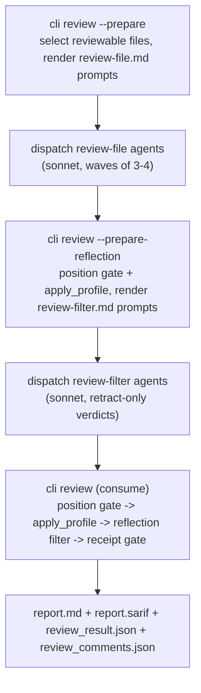

# sec-overlay diff-scoped review mode

`sec_overlay.cli review` is a second, lighter capability the sec-overlay plugin ships alongside
the full [audit pipeline](pipeline.md): it reviews one **diff** (`base..head`) instead of an
entire repository, has no `PHASE_TABLE` entry of its own, and is driven as a three-to-five-step
loop the main agent runs directly rather than a fixed phase sequence. It reuses the harness's
core safety machinery — the [tool-receipt gate](helpers.md#the-tool-receipt-gate), the untrusted
trust envelope, the `EXCLUSION_RULES` gate ladder — but with its own agent set and artifact
layout.

*The five-step review loop: prepare, dispatch, prepare-reflection, dispatch-reflection, consume.
Grounded in `SKILL.md`'s "Diff-scoped review" section.*

## Why a separate track

A full audit's investigate/critic/judge/validate ladder is built for whole-repository
discovery; a PR review needs a cheaper, file-scoped pass that still respects the same
anti-manipulation and evidence rules. Review mode keeps the harness's two non-negotiables —
untrusted repo text, and a mechanical check before anything ships — while dropping the
multi-agent adversarial ladder in favor of a single producer pass plus a retract-only
fact-check, which is why its own agent set lives apart from [agents](agents.md#the-pipeline-as-prompts).

## The five-step loop

1. **Prepare** — `uv run python -m sec_overlay.cli review --base <ref> --prepare` writes
   `runs/review_plan.json` (one entry per reviewable file: path, resolved rule text, diff, other
   changed files) and renders one prompt per entry from `agents/review-file.md` under
   `runs/review_prompts/<slug>.md`. Behind this: `diffscope.py` resolves and pins `base`/`head`
   refs to SHAs (rejecting a leading-dash or empty ref before it reaches git), `file_select.py`
   partitions changed files into `reviewable`/`excluded` (deleted, binary, generated,
   not-allowlisted, or over the 5000-line diff cap), and `bundle.py` groups impl/test pairs and
   locale/config siblings into one review unit so a change and its test are reviewed together.
2. **Dispatch** — spawn a `review-file` subagent (sonnet) per entry in a fresh context, then
   persist its final return with `workspace.record_agent_return(ws, <label>, <text>)` — the same
   disk-is-truth convention the full audit uses. Dispatch in waves of three to four, and never
   exceed `--concurrency` (default 8, ceiling 128) live subagents at once.
3. **Prepare reflection** — `cli review --base <ref> [--profile general] --prepare-reflection`
   reads the recorded returns, runs the position gate and `apply_profile`, and for each file with
   kept findings renders a `review-filter.md` prompt under `runs/reflection_prompts/<label>.md`.
4. **Dispatch reflection** — spawn a `review-filter` subagent (sonnet) per plan entry, then
   persist its return as `{"base": ..., "head": ..., "verdict": {...}}` — the base/head envelope
   rejects a verdict captured for a different ref pair. Same wave-of-three fan-out and
   `--concurrency` bound.
5. **Consume** — `cli review --base <ref> [--profile general] [--model <id>]` reads both the
   recorded review returns and reflection verdicts back from disk and runs the full gate chain:
   position gate → `apply_profile` → the reflection filter → the receipt gate. A file with no
   recorded verdict fails open as a `ReflectionSkip`, keeping its findings rather than dropping
   them silently.

The skill never parses a subagent's return itself: `sec_overlay.review_agent.parse_review_response`
is the sole parser, and it discards (never converts) a `code_comment` naming a path outside the
reviewing unit's membership — the elevation-of-privilege backstop. Every finding it builds
carries `REVIEW_AGENT_CLAIM` (`llm-claimed:review-agent`) and `FindingStatus.RAW`, both fixed in
code, never trusted from the model's response. The loop fails open end to end: a file with no
recorded return, or one whose return won't parse, contributes zero findings and is listed in a
skip ledger rather than aborting the run.

## `security` vs `general` profiles

`--profile security` (the default) reproduces the pre-review-mode gate ladder byte-for-byte:
every finding any of gates A-E (`EXCLUSION_RULES`) marks is dropped. `--profile general` relaxes
gates A and B for a finding whose rule-doc defect class is one of `null-dereference`,
`thread-safety`, `resource-leak`, `error-swallowing`, `injection`
(`GENERAL_PROFILE_EXCLUSION_RULES`) — a strict superset of the security profile's output, never a
change to it. `sec_overlay.review_findings.apply_profile` is the gate; `security` and `general`
never mix rule sets. Exit codes: 0 on a `complete` coverage seal, 2 on an invalid ref or an
unsafe rule file, 3 when one or more files could not be reviewed.

## The reflection pass — a retract-only fact-check

Every kept finding for a reviewable file runs through a reflection filter before the report is
written: `sec_overlay.reflection.render_reflection_prompt` renders `agents/review-filter.md` for
that file (path, diff, and the file's kept comments — no severity or category, so the filter has
nothing to rank or rewrite); the subagent returns exactly one of `approve_all_comments` or
`report_incorrect_comments`; `validate_verdict` parses that response before any finding sees it;
`apply_verdict` is the only code path that may act on it, and only to **retract** — never to add,
rank, or rewrite. `PROTECTED_SUBJECT_CLASSES` is a hardcoded veto no verdict can override: a
retraction naming a protected-subject finding is refused and the finding stays kept, but the
refusal is still recorded, never silently dropped. A file whose reflection pass raises fails
open — the run records a `ReflectionSkip` and continues rather than aborting. `review_ledger.json`
carries `reflection_retractions` and `reflection_skipped` unconditionally, even when empty.

This mechanism does not fit the [producer-vs-adversary pattern](agents.md#producer-vs-adversary)
elsewhere in this plugin: there is no separate adversary pass, because the real safety guarantee
is the mechanical `PROTECTED_SUBJECT_CLASSES` veto, not model tier or a second opinion.

## The review-mode agents

| Prompt | Model | Reads | Writes / does |
|---|---|---|---|
| `review-file.md` | sonnet | one changed file's path/diff, sibling-bundle diffs, the resolved review checklist, optional plan guidance and background context | the producer: one `code_comment` per confirmed issue plus a closing `task_done` |
| `review-plan.md` | sonnet | one over-threshold file's (≥100 changed lines, `PLAN_LINE_THRESHOLD`) path and diff | an advisory, severity-ordered plan (`issues[]`), never a finding or a mechanical receipt — hints only, injected into `review-file.md`'s `{{PLAN_GUIDANCE}}` |
| `review-filter.md` | sonnet | one file's path, diff, and kept comments | the retract-only verdict described above |

## The CLI surface

Beyond `scan`/`review`/`memory`, the CLI exposes a **read-only** `sessions` subcommand
(`sec_overlay.sessions`) over the per-repo sidecar: `sessions list` shows one row per session
slug (pass, SHA, finding counts from `artifacts/review_result.json`); `sessions show <id|latest>`
resolves `"latest"` by `state.json` mtime or an exact slug and renders stage + ledger summary +
a `--severity`-filtered finding list. It never writes.

`review_result.py`'s `write_review_result` writes one consolidated `artifacts/review_result.json`
per run (status, every finding, dropped/declined/retraction/skip lists, the coverage manifest,
base/head/model/profile) — the artifact both the `sessions` CLI and the CI Action below read.
`review_comments.py`'s `write_review_comments` writes `artifacts/review_comments.json`
(diff-anchored `{path, line, side, existing_code, content}` comments plus the embedded coverage
manifest) for a consumer that wants line-anchored comments rather than the consolidated result.

## CI integration: the composite GitHub Action

[`action.yml`](/plugins/sec-overlay/action.yml) at the plugin root is a reusable composite
GitHub Action — `sec-overlay review` for external consumers of this plugin. It is itself a
**shipping file**, so a change to it bumps the plugin's version (see
<!-- openwiki: broken internal link [../marketplace/validation-and-versioning.md] file "../marketplace/validation-and-versioning.md" does not exist. Fix the href or restore the target, then delete this comment. -->
[validation and versioning](../marketplace/validation-and-versioning.md)). Given `base`/`head`
(defaulting to the pull request's own), a `pull-number`, a `profile`, and a `github-token`, it:

1. Sets up `uv`, then runs `uv run python -m sec_overlay.cli review` with those inputs into a
   runner-temp workspace.
2. Uploads `report.sarif` to GitHub code scanning if the consume step produced one
   (`github/codeql-action/upload-sarif`).
3. Posts the result as a pull-request review via `uv run python -m sec_overlay.pr_poster
   "$SEC_OVERLAY_WS/artifacts/review_result.json" "<pull-number>"`.

`pr_poster.py` (`route_findings` / `build_review_payload` / `post_review`) is stdlib-only
(`urllib`): it splits critical/high findings into inline comments and everything else into the
review's summary body, then POSTs to `/repos/{owner}/{repo}/pulls/{n}/reviews` with bearer auth.
**The review event is always `COMMENT`**, so this Action never blocks a merge on its own — the
<!-- openwiki: broken internal link [../governance/code-review.md] file "../governance/code-review.md" does not exist. Fix the href or restore the target, then delete this comment. -->
same comment-only posture [CodeRabbit](../governance/code-review.md) has in this repository, by
design rather than coincidence.

## Related pages

- [Pipeline](pipeline.md) — the full-repository audit this track deliberately does not run.
- [Agents](agents.md) — the full-audit agent set; this page documents the separate review-only
  prompts instead of duplicating them there.
- [Helpers](helpers.md) — the tool-receipt gate and `Finding` contract this mode reuses.
- [Running an audit](running-an-audit.md) — the `/sec-overlay:audit` slash command this mode is
  deliberately separate from.
