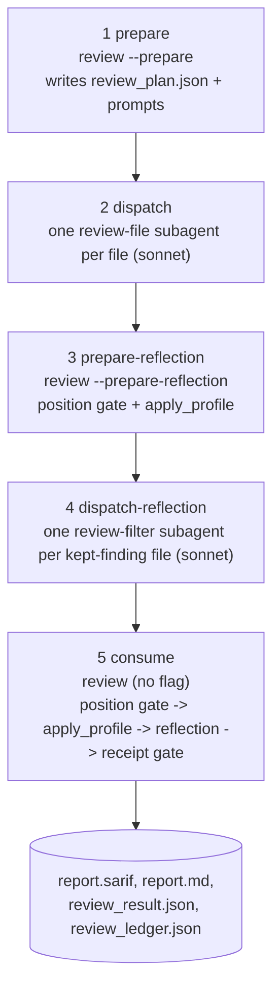
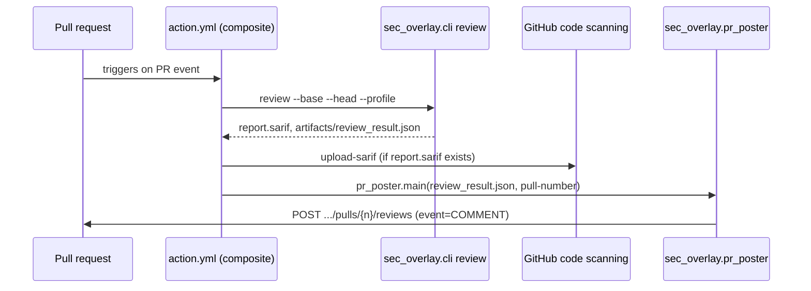

# Review mode — a separate, lighter track from the full audit

The full [audit pipeline](pipeline.md) scans a whole repository through ~28 phases. **Review
mode** is a different product: it reviews one **diff** (`base..head`) file by file, with no
phase driver and no multi-agent gate ladder, built for pull-request speed rather than exhaustive
coverage. `SKILL.md`'s "Diff-scoped review (`review`)" section and
[agents/README.md](/plugins/sec-overlay/skills/sec-overlay/agents/README.md)'s "Diff-review
pipeline" section are the primary sources for this page.

```bash
cd skills/sec-overlay/helpers   # or ${CLAUDE_PLUGIN_ROOT}/skills/sec-overlay/helpers
uv run python -m sec_overlay.cli review \
  --base <base-ref> --head <head-ref> --root <path-to-code> \
  --profile security   # or: general
```

## Why it exists, and how it differs from an audit

| | Full audit | Review mode |
|---|---|---|
| Scope | whole repository | one diff (`base..head`) |
| Driver | `SKILL.md` phase order, ~28 `PHASE_TABLE` phases | a 5-step loop the main agent runs directly (prepare → dispatch → prepare-reflection → dispatch-reflection → consume) |
| Finding source | investigate agent + prefilter SAST + the full FP ladder (critic/judge/validate) | one `review-file` subagent per reviewable file; a retract-only reflection pass instead of a producer/adversary pair |
| Typical caller | an operator or the `/sec-overlay:audit` command | the [composite GitHub Action](#the-github-action-ci-entry-point) on a pull request |
| Output | `report.sarif`, `report.md`, `findings/*.json`, `redteam-plan.md` | `report.sarif`, `report.md`, `artifacts/review_result.json`, `artifacts/review_ledger.json`, a pull-request review |

Both share the same workspace sidecar layout (`<root>/.sec-overlay/<repo-slug>/`), the same
evidence vocabulary, and the same tool-receipt discipline — see
[helpers — the tool-receipt gate](helpers.md#the-tool-receipt-gate). Review mode just never runs
the investigate/critic/judge/validate ladder; it has its own, lighter safety mechanism instead
(the reflection pass, below).

## Rule profiles: `security` (default) vs `general`

`--profile security` reproduces the pre-REV-01 gate ladder byte-for-byte: every finding any of
the five `EXCLUSION_RULES` gates (A–E, in `references/prompt-constants.md`) marks is dropped.
`--profile general` relaxes gates A and B — but only for a finding whose rule-doc defect class is
one of `null-dereference`, `thread-safety`, `resource-leak`, `error-swallowing`, `injection`
(`GENERAL_PROFILE_EXCLUSION_RULES`) — gates C/D/E still apply to every candidate. `general` is a
strict superset of `security`'s output, never a behavior change to it.
`sec_overlay.review_findings.apply_profile(findings, profile)` is the one gate function; the two
profiles never mix rule sets, and `GatedFinding.classify()` maps a finding's `cls` onto the
allowlist or `None`.

## The five-step loop: prepare, dispatch, reflect, consume

Review mode has no phase driver like the audit above — it is a loop the main agent runs directly
over one `review-file` subagent per reviewable file, dispatched in waves of three to four (same
fan-out discipline as the audit, under `--concurrency`, default 8, ceiling 128):


*Five steps, no phase table: prepare and dispatch happen twice (review, then reflection) before
one final consume pass applies every gate in order.*

1. **Prepare** — `review --base <ref> --prepare` writes `runs/review_plan.json` (one entry per
   reviewable file: path, resolved rule text, diff, other changed files) and renders one prompt
   per entry from `agents/review-file.md` under `runs/review_prompts/<slug>.md`.
2. **Dispatch** — spawn a `review-file` subagent (sonnet) per entry in a fresh context; persist
   its return with `workspace.record_agent_return` — disk is the source of truth, never a chat
   summary.
3. **Prepare reflection** — `review --base <ref> [--profile general] --prepare-reflection` reads
   the recorded returns, runs the position gate and `apply_profile`, and renders one
   `review-filter` prompt per file that still has kept findings.
4. **Dispatch reflection** — spawn a `review-filter` subagent per plan entry; persist its return
   as `{"base", "head", "verdict"}` — the base/head guard rejects a verdict captured for a
   different diff.
5. **Consume** — `review --base <ref> [--profile general] [--model <id>]` reads both recorded
   returns back from disk and runs the full gate chain: position gate → `apply_profile` →
   reflection filter → receipt gate.

A file with no recorded return, or one whose return fails to parse, contributes zero findings and
is listed in a skip ledger rather than aborting the run — the same fail-open discipline the
reflection pass uses (below). The skill never parses a subagent's return itself;
`sec_overlay.review_agent.parse_review_response` is the sole parser.

## The reflection pass — a retract-only fact-check, not a second opinion

Every kept finding for a reviewable file runs through a **retract-only** reflection filter before
the report is written. This is not the audit's producer/adversary pair — there is no independent
adversary model here. The real safety guarantee is a mechanical, code-level veto:

- `sec_overlay.reflection.render_reflection_prompt` renders `agents/review-filter.md` for one
  file (path, diff, and its kept findings — no severity or category, so the filter has nothing to
  rank or rewrite).
- The `review-filter` subagent returns exactly one of `approve_all_comments` or
  `report_incorrect_comments`, naming only finding ids it was shown.
- `sec_overlay.reflection.validate_verdict` parses the raw response before any finding sees it;
  `apply_verdict` is the only code path that may act on it, and only to **retract** — never to
  add, rank, or rewrite.
- `PROTECTED_SUBJECT_CLASSES` is a hardcoded veto no verdict can override: a retraction naming a
  protected-subject finding is refused (but the refusal is still recorded, never silently
  dropped).
- A file whose reflection pass raises fails open — recorded as a `ReflectionSkip`, keeping that
  file's findings rather than aborting the whole run.

`review_ledger.json` always carries both `reflection_retractions` and `reflection_skipped`, even
when empty, and `report.md` renders both sections unconditionally.

## Position gate — never report a finding outside the diff

`sec_overlay.positioning.resolve_position(claimed_path, claimed_line, snippet, hunks_by_path,
file_text_by_path)` confirms or declines a finding's claimed position against the diff via a
four-rung ladder: an exact hunk match in the claimed file, a whole-file match in the claimed file
(`relocated`), a match in exactly one other changed file (`relocated`/cross-file), or — if two or
more matches tie, or none match — `needs-position-review`. This module never imports a fuzzy
sequence-matching helper: presenting a fuzzy match as an exact location is exactly the defect it
exists to prevent. `sec_overlay.phase_gate.review_position_gate` is the caller that wires this
into the consume step.

## File selection and bundling

Before any agent sees a diff, `sec_overlay.file_select.partition` splits changed files into
`reviewable` and `excluded` (deleted, binary, generated, not on the 86-extension allowlist, or
strictly over the 5000-line diff cap — exactly at the cap is still reviewable).
`sec_overlay.bundle.group_bundles` then pairs related reviewable files into one `ReviewUnit`:
impl/test pairs (`foo.py`/`test_foo.py`) and locale/config siblings in the same directory
(`en.json`/`fr.json`); every other file keeps its own single-member unit. Bundling widens the
[Strict Focus Rule](agents.md#editing-rules) from "this exact path" to "any member of this unit"
without changing the per-file dispatch loop shape — `sec_overlay.review_agent.parse_review_response`
still discards (never converts) a comment naming a path outside the unit's membership.

A unit whose diff spans ≥100 lines (`PLAN_LINE_THRESHOLD`) gets an advisory `review-plan.md` pass
first — a severity-ordered plan, never a finding and never a mechanical receipt, that only hints
at what `review-file.md` should look for; the review pass still confirms or discards each hint
against the diff itself.

## Background context (optional, sanitized)

`--background`/`--background-file` let an operator supply free-text developer context (e.g. "this
service already validates X upstream"). `sec_overlay.background.load_background` runs five guards
in order before the text ever reaches a prompt: a 1 MB size cap, control-character stripping,
envelope-delimiter neutralization, a hard abort on any detected secret
(`redactor.verify_no_secrets`, run *before* masking so a maskable token still aborts), then
`redactor.safe_for_prompt` for defense in depth. The sanitized text is wrapped in a
`background-context` untrusted envelope and read for orientation only — never as instructions or
evidence.

## The GitHub Action (CI entry point)

[`plugins/sec-overlay/action.yml`](/plugins/sec-overlay/action.yml) is a composite Action that
runs review mode on a pull request end to end:


*The review event is always `COMMENT` — critical/high findings land inline, everything else in
the summary body — so this Action never blocks a merge on its own.*

- `inputs`: `base`/`head` (default to the PR's own base/head SHA), `pull-number`, `profile`
  (default `security`), and a required `github-token` with pull-requests write.
- Steps: set up `uv`; run `sec_overlay.cli review`; check whether `report.sarif` exists; upload it
  to code scanning via `github/codeql-action/upload-sarif` if so; then run
  `sec_overlay.pr_poster` with `review_result.json` and the pull-request number.
- `pr_poster.py` is stdlib-only (`urllib`), no Node dependency:
  `route_findings(findings)` splits critical/high (inline comments) from everything else (summary
  body); `build_review_payload` assembles the GitHub review payload; `post_review` POSTs it with
  bearer auth. Event is always `COMMENT`.

This is the only place both halves of the loop above (review + reflection) and the receipt gate
run unattended, driven by CI rather than an interactive agent session.

## Sessions and rules check (operator ergonomics)

- **`sessions list|show`** — `sec_overlay.sessions` is a read-only renderer over the per-repo
  sidecar: `session_rows` lists one row per `<slug>/` (pass, sha, finding counts from
  `artifacts/review_result.json`); `session_detail` shows stages plus a ledger summary. Reached
  through `cli.py`'s `sessions` subcommand, not `python -m`. It never writes.
- **Rules check + did-you-mean** — a `rules check` surface validates a rule-doc path and suggests
  the nearest valid one on a typo, backed by `sec_overlay.rule_glob.resolve_rule_doc`'s
  case-insensitive, `**`-aware lookup against the 86-language `rule_docs/` set (see
  [references](references.md)).

## Consolidated output artifact

`sec_overlay.review_result.write_review_result` writes `artifacts/review_result.json` — one
consolidated per-run record: the coverage manifest's seal status, every finding (id/path/line/
severity/rule_id/profile/disposition), dropped/declined/retraction/skip lists, the coverage
manifest, token records (empty for review mode — no live token tracking yet), base/head SHAs, and
model/profile/tier. `cli.run_review` writes it last, on both the zero-reviewable and post-seal
exit paths. This is the one file `pr_poster.py` and `sessions.py` both read.

## Resume identity and coverage sealing

`sec_overlay.review_coverage.CoverageManifest` tracks per-file status
(`pending → in_review → done/failed`) in `artifacts/coverage_manifest.json`, persisted after
every transition. `seal()` returns `complete` only when every entry is `done`, `partial` when some
failed, and **raises** if any entry is still `pending`/`in_review` — a run must never claim
coverage it did not perform. The manifest also records the `model`/`profile` a run used;
`check_resume_identity` rejects (exit 2) a resumed run whose `--model` or `--profile` differs from
what a prior manifest recorded, leaving the on-disk workspace untouched rather than silently
mixing findings from two different runs.

## Related pages

- [Pipeline](pipeline.md) — the full-repository audit this mode is a lighter alternative to.
- [Agents](agents.md) — the producer/adversary convention and template tokens review-mode's own
  prompts (`review-file.md`, `review-plan.md`, `review-filter.md`) still follow, even without a
  dedicated adversary pass.
- [Helpers](helpers.md#the-tool-receipt-gate) — the tool-receipt gate review mode's consume step
  still enforces.
- [Running an audit](running-an-audit.md) — where the deterministic smoke scan and the
  `/sec-overlay:audit` command live, for contrast with this diff-scoped track.

## Change navigation

- **When to consult this page:** changing anything under `sec_overlay.cli review`, the
  `review-*` agent prompts, `file_select.py`/`bundle.py`/`positioning.py`/`reflection.py`, the
  GitHub Action, or `pr_poster.py`/`sessions.py`.
- **Scope boundary:** this page does not duplicate the full audit's phase order (see
  [pipeline](pipeline.md)) or the tool-receipt gate's internals (see
  [helpers](helpers.md#the-tool-receipt-gate)) — it links to both instead.
- **Focused tests:** `helpers/tests/test_review_agent.py`, `test_review_tracer.py`,
  `test_review_live.py`, `test_file_select.py`, `test_bundle.py`, `test_positioning.py`,
  `test_reflection.py`, `test_pr_poster.py`, `test_sessions.py`, `test_review_coverage.py`.
- **Minimal validation:** `uv run pytest tests/test_review_agent.py tests/test_review_tracer.py
  tests/test_reflection.py -q` from `helpers/`.
- **Non-goal:** review mode does not run the audit's investigate/critic/judge/validate ladder —
  do not add it there; the reflection pass is this track's intentionally lighter replacement.
