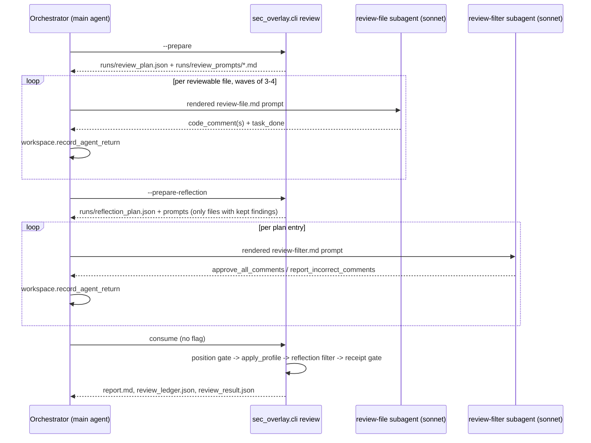

# The diff-scoped review pipeline

`sec_overlay.cli review` runs a distinct, lighter pipeline over **one diff** (`base..head`) —
not the full 28-phase [audit pipeline](pipeline.md). It exists to comment on a pull request
cheaply, without standing up a full campaign workspace per PR. Unlike the audit, review mode
has no `PHASE_TABLE`/driver: it is a three-step loop (**prepare → dispatch → consume**) the
orchestrator runs directly, spawning one `review-file` subagent per changed file. Grounded in
`SKILL.md`'s "Diff-scoped review (`review`)" section and `helpers/README.md`'s "Diff-scoped
review (`sec-overlay review` — tracer path)" section.

## Prepare, dispatch, consume

*A file whose subagent return is missing or unparseable contributes zero findings and is
recorded in the run's skip ledger — the loop fails open rather than aborting.*

1. **Prepare** — `sec_overlay.cli review --base <ref> --prepare` writes `runs/review_plan.json`
   (one entry per reviewable file: path, resolved rule-doc text, diff, other changed files) and
   renders one prompt per entry from `agents/review-file.md` under `runs/review_prompts/`.
   `rule_glob.py` resolves which per-language rule doc (custom > project > global > built-in)
   applies to each path; `bundle.py` groups related files so `{{SIBLING_DIFFS}}` can carry a
   bundle-mate's diff for context (largest-first, capped by `review_budget.estimate_tokens`).
   A changed file whose diff spans ≥100 lines first gets an advisory pass from
   `agents/review-plan.md`, parsed by `review_agent.plan_guidance_from_return` into
   `{{PLAN_GUIDANCE}}` hints (never a finding, never a receipt).
2. **Dispatch** — one `review-file` subagent (sonnet, fresh context) per file, in waves of 3-4,
   under `--concurrency` (default 8, ceiling 128). `review_agent.parse_review_response` is the
   *sole* reader of a subagent's return: every finding it builds is hardcoded to
   `evidence_sources=["llm-claimed:review-agent"]` and `status=FindingStatus.RAW`, regardless of
   what the model's response claims (`REVIEW_AGENT_CLAIM`, the REV-03 elevation-of-privilege
   backstop) — no review-mode finding can reach `confirmed` on an LLM's say-so alone. A
   `code_comment` naming a path other than the file under review is discarded, never converted.
3. **Position gate** — `positioning.resolve_position` confirms or declines a finding's claimed
   line against the real diff through four rungs (hunk match → whole-file match → cross-file
   match → decline), stopping at the first rung with exactly one match; two-or-more matches at
   any rung decline rather than guess (never approximates a location).
4. **`apply_profile`** — `review_findings.apply_profile` runs the same five exclusion gates
   (A-E) as the full audit's `EXCLUSION_RULES`, selected by `--profile`: `security` (default)
   reproduces the original gate ladder byte-for-byte; `general` relaxes gates A/B for
   `null-dereference`/`thread-safety`/`resource-leak`/`error-swallowing`/`injection` defect
   classes (`GENERAL_PROFILE_EXCLUSION_RULES`) — a strict superset of `security`'s output, never
   a divergent ruleset.
5. **Prepare/dispatch reflection** — every kept finding for a file gets one more pass: a
   `review-filter` subagent sees the file's kept comments (no severity or category — nothing to
   rank or rewrite) and returns `approve_all_comments` or `report_incorrect_comments` naming only
   ids it was shown. This is deliberately **not** a producer/adversary pair like the rest of the
   harness: `reflection.validate_verdict` parses the raw response, and `apply_verdict` is the
   sole code path that may act on it — and only to *retract*, never to add, rank, or rewrite. A
   hardcoded `PROTECTED_SUBJECT_CLASSES` veto in both the prompt and this module refuses a
   retraction naming a protected-subject finding regardless of what the verdict says; the refusal
   is still recorded, never silently dropped. A file whose reflection pass raises fails open (a
   recorded `ReflectionSkip`, findings stay kept) rather than aborting the run.
6. **Consume** — re-reads every recorded return and verdict from disk and runs the full chain:
   position gate → `apply_profile` → reflection filter → the receipt gate, then writes
   `report.md`, `review_ledger.json` (carries `reflection_retractions`/`reflection_skipped`
   unconditionally, even empty), and `review_result.py`'s consolidated `review_result.json` (run
   status, per-finding records, dropped/declined findings, retractions/skips, the coverage
   manifest, per-phase token records, base/head SHAs, model/profile/tier).

`--model` and `--workspace` must be passed identically across every `prepare`/dispatch/`consume`
invocation of one review — a differently-spelled workspace path silently orphans the prepared
run, and a resumed consume with a different `--model` is rejected (exit 2) rather than mixing
findings from two models on one manifest.

## Supporting modules

| Module | Job |
|---|---|
| `review_agent.py` | renders `review-file.md`/`review-plan.md`, parses their responses; never dispatches |
| `reflection.py` | renders `review-filter.md`, validates and applies its retract-only verdict |
| `positioning.py` | the four-rung claimed-position gate above |
| `rule_glob.py` | resolves a changed file's path to its per-language review-rule doc (custom > project > global > built-in) |
| `bundle.py` | groups related changed files so sibling diffs can ride along as context |
| `background.py` | sanitizes operator-supplied background context into `{{BACKGROUND}}`, read for orientation only, never as instructions or evidence |
| `review_budget.py` | token estimation and the sibling-diff token cap |
| `review_coverage.py` | the coverage manifest — which files were reviewable, skipped, or errored |
| `review_findings.py` | `apply_profile`'s security/general exclusion-gate implementation |
| `review_result.py` | the consolidated `review_result.json` writer |
| `sessions.py` | read-only listing/detail over sidecar session state for the `sessions list`/`sessions show` CLI subcommands |
| `pr_poster.py` | posts `review_result.json` to a GitHub pull request as a `COMMENT`-event review (never blocking) — critical/high inline, the rest in the summary |

## Distribution surfaces

The review pipeline ships through two paths distinct from installing the Claude Code skill
directly:

- **`plugins/sec-overlay/action.yml`** — a composite GitHub Action, "sec-overlay review", that
  runs `sec_overlay.cli review` on a pull request's `base`/`head`, uploads any `report.sarif` to
  GitHub code scanning, and posts the review via `pr_poster.py`. The review event is always
  `COMMENT`, so it never blocks a merge on its own, matching the harness-wide rule that
  reasoning alone never gates a merge. This is the harness's only surface that runs outside a
  Claude Code session — the action installs `uv`, then shells out to the same
  `sec_overlay.cli review` CLI documented above.
- **`plugins/sec-overlay/commands/audit.md`** — the `/sec-overlay:audit <repo> [<repo> ...]`
  slash command. A single repo argument drives `sec_overlay.run.drive()` (the full audit
  pipeline, not review mode); two or more repo arguments drive each repo's audit in turn, infer
  each repo's role from its `kb/scan-profile.json`, confirm with the operator, then run
  [cross-repo correlation](cross-repo-correlation.md) over all of them. `commands/` is itself a
<!-- openwiki: broken internal link [../marketplace/overview.md] file "../marketplace/overview.md" does not exist. Fix the href or restore the target, then delete this comment. -->
  shipping surface — see [marketplace overview](../marketplace/overview.md) — so a change to
  `commands/audit.md` bumps the plugin version like any other shipping file.

Both are new install-time contract surfaces alongside the skill itself: `action.yml` is copied
into the plugin cache like everything else under `plugins/sec-overlay/`, so its steps must also
resolve every path relative to `${{ github.action_path }}`, the Action-runtime equivalent of
`${CLAUDE_PLUGIN_ROOT}`.

## Related pages

- [Agents](agents.md#the-diff-scoped-review-track-has-its-own-three-prompts) — `review-file.md`,
  `review-plan.md`, `review-filter.md` as prompts.
- [Pipeline](pipeline.md#the-diff-scoped-review-pipeline-is-a-separate-lighter-track) — how this
  relates to the full audit.
- [Helpers](helpers.md#module-map-grouped-by-job) — where these modules sit in the module map.
<!-- openwiki: broken internal link [../marketplace/overview.md] file "../marketplace/overview.md" does not exist. Fix the href or restore the target, then delete this comment. -->
- [Marketplace overview](../marketplace/overview.md) — `commands/` and `action.yml` as
  additional shipping/install surfaces.
