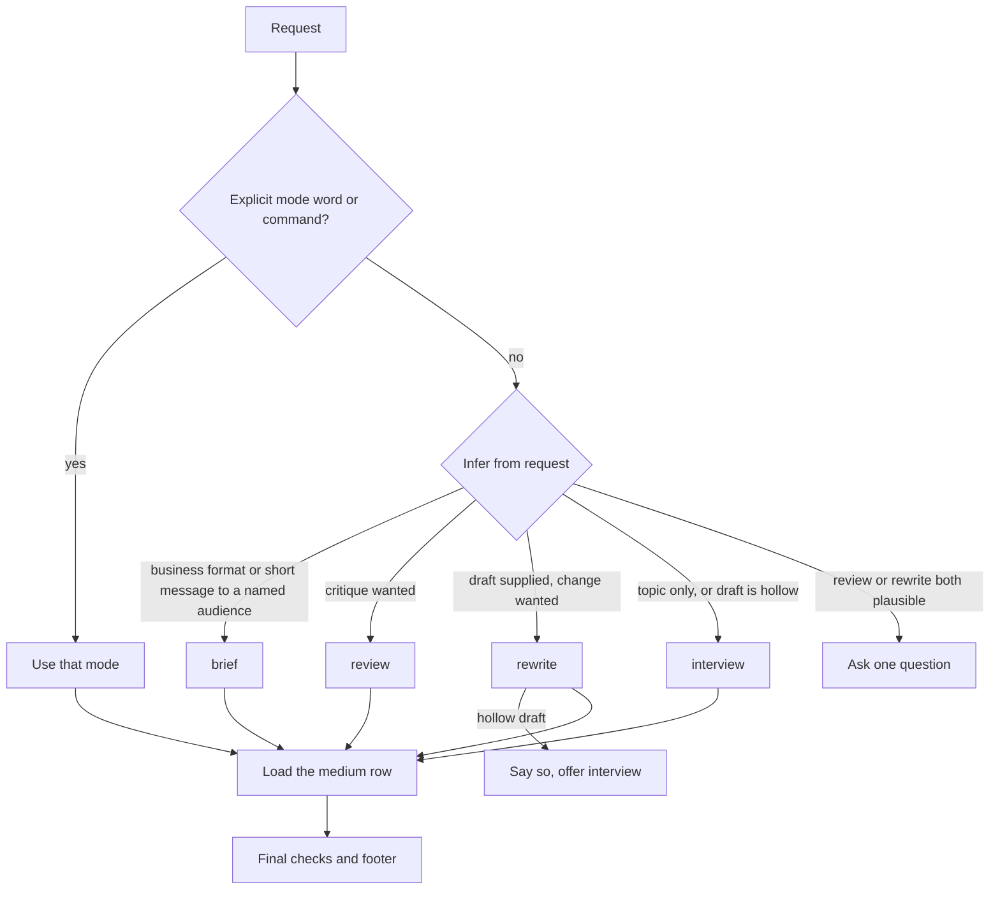

# plainspoken

Draft, rewrite, review, deep-review, brief, and lint prose so it is specific, useful, and the writer's own,
without inventing facts.

## Install

```text
/plugin marketplace add cjbischoff/cjbischoff-claude-code-tools
/plugin install plainspoken@cjbischoff-claude-code-tools
```

## Prerequisites

None for the skill. The `lint` mode runs a stdlib-only script and needs Python 3.10 or later on
`PATH`.

## Quick start

```text
/plainspoken:rewrite draft.md
/plainspoken:brief <paste meeting notes>
```

Or ask in plain words ("rewrite this", "make this a BLUF email to my VP"). The skill picks the
mode.

## Modes

| Mode | Command | What it does |
|---|---|---|
| `interview` | `/plainspoken:interview <topic>` | Asks for your unorganized take, then at most 5 follow-up questions, then writes from your words |
| `rewrite` | `/plainspoken:rewrite <file or text>` | Fixes substance first, then AI tells and rhythm. Keeps every fact at the same certainty |
| `review` | `/plainspoken:review <file or text>` | Critiques the piece with P0/P1/P2 severity on each finding. Never rewrites it or changes a file |
| `deep` | `/plainspoken:deep <file or text>` | Four read-only lens agents check structure, fluff, patterns, and flow in parallel. Shows ranked findings, then asks before one rewrite |
| `brief` | `/plainspoken:brief <file or text>` | Reformats into a BLUF email, 3-sentence executive summary, action items, or a 75-word message |
| `lint` | `/plainspoken:lint <file>` | Runs the stdlib diagnostic script. Reports, never edits |



A file path means the skill edits the file in place and puts its notes in chat. Use git or your
editor to undo.

## Deep-review agents

`agents/` holds four read-only lens agents (tools: `Read` only, model: `sonnet`) that
`/plainspoken:deep` starts in parallel. Address one as `plainspoken:<name>`. The folder has no
`README.md`, because Claude Code loads every `.md` file in `agents/` as an agent.

| Agent | Finds | Reads |
|---|---|---|
| `structure-lens` | Orphaned list signals, duplicate sentence functions, summary paragraphs, section mismatch | `rewrite.md`, `severity.md` |
| `fluff-lens` | Defense phrases, redundant pairs, wordy constructions, empty qualifiers, hedges | `rewrite.md`, `severity.md` |
| `pattern-lens` | Staging, inflation, rhythm by rule, punctuation, chat residue, stock word lists | `rewrite.md`, `severity.md`, `tells.md` |
| `flow-lens` | Conclusion before setup, assumed context, unjoined paragraphs, open questions for the author | `rewrite.md`, `severity.md` |

## What it will not do

- Invent a fact, number, quote, example, or personal experience. A gap becomes `[TK: question]`.
- Promise that text will pass an AI detector.
- Add fake typos, slang, or stories to sound human.

## Development

Maintainer commands are in [`CLAUDE.md`](CLAUDE.md). `ruff.toml` sets the Python line length to 100.

## Attribution

The severity tiers and deep-review lenses adapt ideas from anti-slop-editor, which draws on [humanizer](https://github.com/blader/humanizer) by Siqi Chen (MIT). No text was copied.

plainspoken adapts two MIT-licensed skills: [clarity](https://github.com/addyosmani/clarity) by
Addy Osmani and [work-humanizer](https://github.com/phuryn/work-humanizer) by Pawel Huryn. See
[`NOTICE.md`](NOTICE.md) for both licenses and the list of adapted files.

## More

| To understand… | Read |
|-----------------|------|
| What changed between releases | [`CHANGELOG.md`](CHANGELOG.md) |
| The skill in depth | [`skills/plainspoken/SKILL.md`](skills/plainspoken/SKILL.md) |
| How to develop and test it | [`CLAUDE.md`](CLAUDE.md) |
