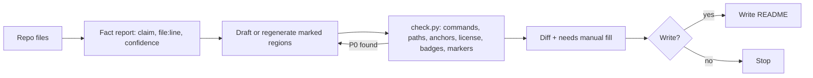

# readme-keeper

Write a README from the code, keep it true with marker-based updates, check it offline for
drift, and review it, without inventing facts.

## Install

```text
/plugin marketplace add cjbischoff/cjbischoff-claude-code-tools
/plugin install readme-keeper@cjbischoff-claude-code-tools
```

## Prerequisites

Python 3.11 or later on `PATH` for the checker (`check.py` uses only the standard library).

## Quick start

```text
/readme-keeper:check --all      # read-only drift report for every README
/readme-keeper:create           # new README from the code; shows a diff, writes on yes
/readme-keeper:update           # refresh generated regions only; shows a diff, writes on yes
/readme-keeper:review --score   # reader-rubric critique with severity and a 0-100 score
```

## Modes

| Mode | Writes | What it does |
|---|---|---|
| `create` | after approval | Inspects the repo, reports each fact with its source, asks what the code cannot answer, drafts only the sections the project earns, checks the draft, shows the diff |
| `update` | after approval | Regenerates only the content between `readme-keeper` markers. Text outside markers is never edited |
| `check` | never | Offline drift report: commands, paths, anchors, license, badges, markers. `--links` and `--prose` are opt-in |
| `review` | never | Reader rubric with P0/P1/P2 findings. `--score` adds a report-only score |



## Markers

```markdown
<!-- readme-keeper:start install -->
generated content
<!-- readme-keeper:end install -->
```

Region ids: `badges`, `install`, `quickstart`, `commands`, `env`, `structure`, `license`, `toc`.
Delete a region and `update` never adds it back.

## CI

`/readme-keeper:check --install-ci` copies the checker to `.github/scripts/readme_check.py` and a
workflow to `.github/workflows/readme-check.yml`, as a diff you approve. The workflow runs offline
and does not need the plugin.

## What it will not do

- Invent a license, badge, metric, command, or URL.
- Run your project's code or install commands.
- Commit or push.
- Edit text outside markers during `update`.

## Attribution

readme-keeper builds on the author's own `readme` skill and adapts MIT-licensed work from
readme-forge, claudikins, cajias/claude-skills, and plainspoken. See [`NOTICE.md`](NOTICE.md).

## More

| To understand… | Read |
|---|---|
| What changed between releases | [`CHANGELOG.md`](CHANGELOG.md) |
| The skill in depth | [`skills/readme-keeper/SKILL.md`](skills/readme-keeper/SKILL.md) |
| How to develop and test it | [`CLAUDE.md`](CLAUDE.md) |
